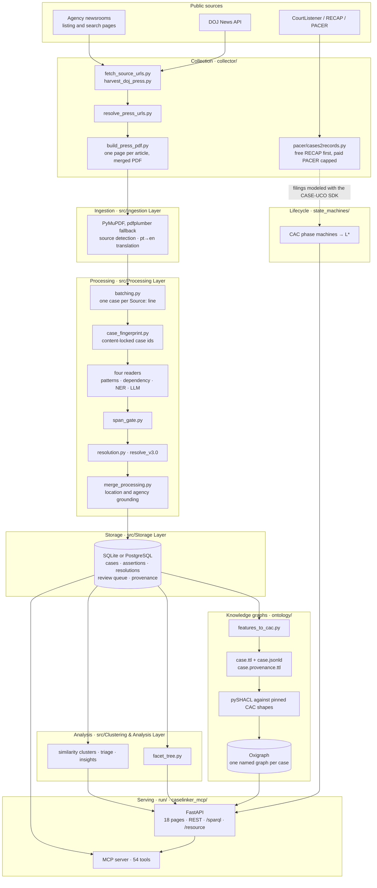
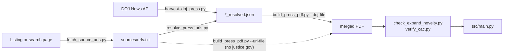
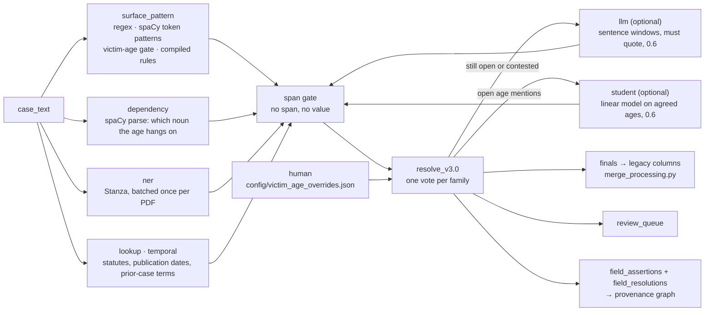
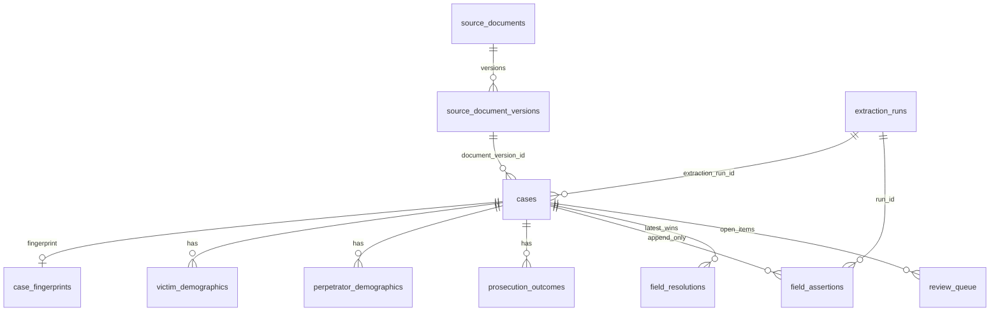
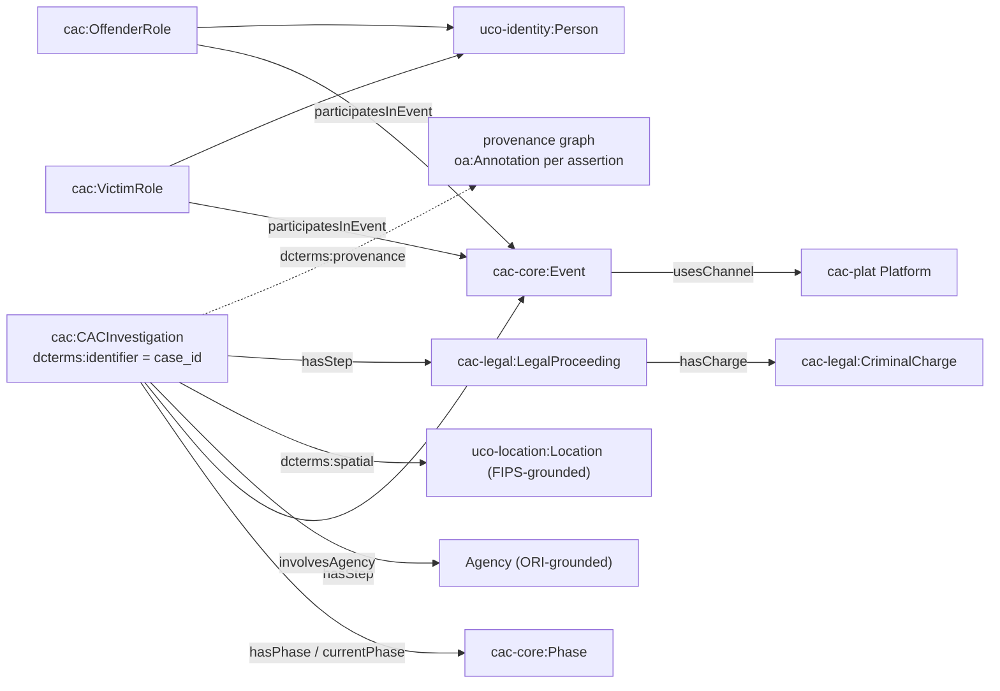
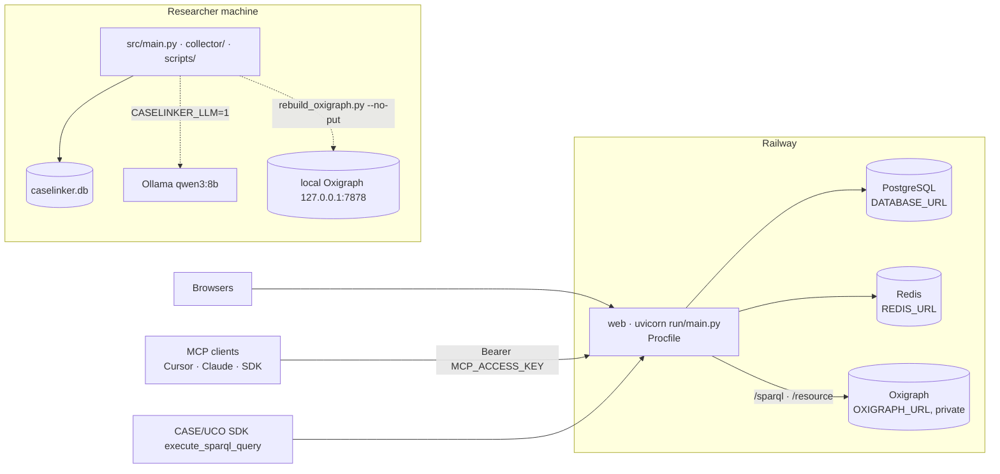

# CaseLinker Architecture

> **CaseLinker** reads public ICAC case reports, turns them into a structured, provenance-tracked, graph-queryable corpus, and serves it through a web app, a REST API, a public SPARQL endpoint and an MCP server for deeper analysis. The same corpus feeds the analysis tools: platform-harm evidence, similarity clusters and triage, facet cohorts, CAC knowledge graphs and lifecycle state machines, each reachable from a browser, a script or an agent. Live at [caselinker.up.railway.app](https://caselinker.up.railway.app/).

| At a glance | |
|---|---|
| Corpus | **10,711** case reports from **70** public sources, 2002–2026: ICAC task forces, state attorneys general, state police, NCMEC, DOJ, federal and international agencies |
| Extracted | **131,332** structured features; **4,000+** distinct law-enforcement agencies (live count on [`/sources`](https://caselinker.up.railway.app/sources)) |
| Graphs | 10,711 CAC/UCO case graphs + 10,711 provenance graphs in a public SPARQL store, plus 297 PACER court-record graphs |
| Lifecycles | 30 federal cases modeled as CAC phase state machines with L\* trajectories |
| Analysis | Platform harm (Q1 affordance → misuse → harm evidence), similarity clusters and automated insights, rule and model triage, 11-dimension facet cohorts |
| Agents | 54 MCP tools locally, 44 hosted, over stdio, SSE and Streamable HTTP |
| Code | ~47k lines of Python, ~31k lines of HTML/JS, 61 test files (421 tests) |

## Contents

1. [The system in one picture](#1-the-system-in-one-picture)
2. [Design principles](#2-design-principles)
3. [Collection](#3-collection)
4. [Ingestion and batching](#4-ingestion-and-batching)
5. [Extraction: four readers, one decision](#5-extraction-four-readers-one-decision)
6. [Storage](#6-storage)
7. [Analysis: clusters, triage, facets](#7-analysis-clusters-triage-facets)
8. [Knowledge graphs](#8-knowledge-graphs)
9. [Lifecycle state machines](#9-lifecycle-state-machines)
10. [Web app and API](#10-web-app-and-api)
11. [MCP server](#11-mcp-server)
12. [Deployment](#12-deployment)
13. [Data policy](#13-data-policy)
14. [Verification](#14-verification)
15. [Repository map](#15-repository-map)
16. [Hand-off docs](#16-hand-off-docs)
17. [How it got here](#17-how-it-got-here)

---

## 1. The system in one picture



Three stores, one corpus:

| Store | Holds | Served by |
|---|---|---|
| Relational (SQLite locally, PostgreSQL on Railway) | Case rows, satellites, every reader's assertion, resolutions, review queue, provenance tables, precomputed analysis | REST API, facet search, triage, MCP |
| RDF (Oxigraph) | One named graph per case plus one provenance graph per case; PACER court-record graphs | `GET\|POST /sparql`, `/resource/…` dereferencing, graph explorer |
| Files in the repo | Per-case Turtle and JSON-LD, PACER JSON-LD, 30 state machines, L\* export, research evidence JSON, case studies | Graph explorer pools, `/lifecycle`, Q1–Q3 pages, fresh clones with an empty DB |

---

## 2. Design principles

- **Public records only, no direct identifiers in derived data.** Source text may contain names. Structured fields, API output, graphs, exports, logs, issues and commits never do. See [13. Data policy](#13-data-policy).
- **Deterministic first.** Regex, grammar and NER are the witnesses. The LLM is optional, reads sentence windows, must quote its source, and cannot finalize a value alone.
- **No span, no value.** Every stored assertion points at a character span of the original text. Assertions are append-only; resolution is versioned and re-runnable without re-extraction.
- **A wrong final is worse than review.** Disagreement between evidence families vetoes a value. Open items go to a review queue, not to a column.
- **Standard vocabularies.** CAC, UCO and CASE for cases; PROV-O and Web Annotation for provenance; Census FIPS and FBI CDE for grounding; persistent `w3id.org/caselinker` IRIs. CaseLinker binds, it does not invent.
- **Agents read; humans investigate.** MCP tools let an agent ask complex relational questions over the corpus: cohorts, facet trees, session graphs, SPARQL and comparisons across the whole corpus in a single call. Answers come from stored assertions and graphs, never from the agent's own inference, and no tool writes a claim back into the database.

---

## 3. Collection

`collector/` turns any public press release into a merged PDF with a predictable layout (`Title / Publication date / Source: https://… / body`). Topic filters are optional gates for the CSEA corpus, not the engine.



| Script | Role |
|---|---|
| [`build_press_pdf.py`](collector/build_press_pdf.py) | The engine. URL or resolved DOJ record → one ReportLab page → merged PDF. Host extractors, Jina fallback, native PDF via pdfplumber. Writes a provenance sidecar (document identity, scraper, URL canonicalization). |
| [`harvest_doj_press.py`](collector/harvest_doj_press.py) | DOJ discovery by title term (newest first), optional body regex and CAC gate, novelty against existing DOJ PDFs. |
| [`resolve_press_urls.py`](collector/resolve_press_urls.py) | Router for URLs you already have: `justice.gov` through the API (Akamai bot-wall is never fetched), everything else `mode: scrape`. |
| [`fetch_source_urls.py`](collector/fetch_source_urls.py) | Listing harvester: HTML, Squarespace, Google CSE, search.usa.gov, WordPress REST, optional Jina. |
| [`http_policy.py`](collector/http_policy.py) | Honest user agent, robots.txt enforcement, crawl delay. A 403 stops the host. |
| [`check_expand_novelty.py`](collector/check_expand_novelty.py), [`remove_pdf_pages_by_text.py`](collector/remove_pdf_pages_by_text.py), [`filter_merged_pdf.py`](collector/filter_merged_pdf.py) | Dedupe and page surgery before ingest. |
| [`pacer/cases2records.py`](collector/pacer/cases2records.py), [`pacer/corpus2pacer.py`](collector/pacer/corpus2pacer.py) | One federal docket → filings. Free RECAP by default; purchases require `--charge-pacer --max-spend N` and log to `pacer_cost.csv`. |

Hard hosts (login, CAPTCHA, JS bot-walls without an API) are stop-and-ask, never try-harder. Output PDFs and JSON are gitignored.

Hand-off: [`collector/README.md`](collector/README.md) (onboarding) · [`collector/PRESS_RELEASE_COLLECTION.md`](collector/PRESS_RELEASE_COLLECTION.md) (extractors, DOJ API quirks, troubleshooting).

---

## 4. Ingestion and batching

**Ingestion** ([`src/Ingestion Layer/ingestion.py`](src/Ingestion%20Layer/ingestion.py)) takes a PDF path and returns a DataFrame row of `extracted_text`, `source`, `source_file`, `source_url`.

- Text: PyMuPDF first; pdfplumber when PyMuPDF returns under 50 characters.
- Source: `detect_source_from_content` from filename and content cues (AZICAC, NCMEC, state AG, DOJ, international feeds).
- International feeds: [`international_text.py`](src/Ingestion%20Layer/international_text.py) translates Portuguese locally with a CTranslate2 model under `models/`; English feeds pass through. No translation API is ever called.

**Batching** ([`src/Processing Layer/batching.py`](src/Processing%20Layer/batching.py)) splits one merged PDF into cases. `case_batching` dispatches on source: AZICAC annual reports split on `In [Month]`; NCMEC media layouts by year; GBI, Idaho, Texas AG and SV ICAC have their own splitters; every collector-built PDF splits on its `Source: https://` line, with wrapped URLs stitched back by [`source_url_continuations.py`](src/Processing%20Layer/source_url_continuations.py).

**Identity.** The readable id stays `{org}_{year}_{NNN}`. [`case_fingerprint.py`](src/Processing%20Layer/case_fingerprint.py) hashes the normalized article text (normalization `fp-1`, stored with every fingerprint) and that hash decides the ordinal, so a re-ingest of the same article keeps its id and a different normalization version refuses to mint. Three gates keep an article from being stored twice:

| Gate | Where | Rule |
|---|---|---|
| Fingerprint | `case_batching` → `case_fingerprints` | Same normalized text already has an id → skip, report `duplicate_of` |
| Canonical URL | [`source_url_gate.py`](src/Processing%20Layer/source_url_gate.py) | Same canonical URL already stored under another source → skip |
| Novelty | [`src/main.py`](src/main.py) | DOJ compilations and NCMEC 2022–2024 near-duplicates by normalized text and similarity |

**Provenance capture** ([`src/Storage Layer/provenance.py`](src/Storage%20Layer/provenance.py)) records `source_documents`, `source_document_versions` (sha256 of content, parser name and version) and one `extraction_runs` row per ingest, carrying the code revision, NER backend, LLM digest and rule set. Each case row links to both.

Entry point: `python3 src/main.py <pdf…>` runs ingest → process → store → optional cluster precompute. [`scripts/run/ingest_all_pdfs.sh`](scripts/run/ingest_all_pdfs.sh) keeps models warm across every PDF in the repo root.

---

## 5. Extraction: four readers, one decision

An age or a sentence is never stored because one function returned it. Each reader writes its own assertion with method, version, family, role, confidence and a character span. The span gate checks the span against the original text. The resolver counts votes by family and stores only what the evidence supports.



### Readers and families

| Reader | Method ids | Family | Notes |
|---|---|---|---|
| Regex and spaCy token patterns, victim-age gate, approved compiled rules | `regex`, `spacy_token`, `victim_age_gate`, `compiled_rule` | `surface_pattern` | Press-release grammar: "Name, 32,", "N-year-old", "charged … (age 20)", "posing as", "faces up to" |
| spaCy dependency parse | `spacy_dep` | `dependency` | Links a number to the noun it modifies; "posed as", "images of" |
| Stanza NER | `ner_stanza` | `ner` | Runs once per PDF in batches of 64. Keeps an age only when a person entity sits on it. Perpetrator cue capped at 0.65, so it corroborates and never finalizes |
| Statute lookup, temporal tags | `statute_lookup`, `temporal` | `lookup`, `temporal` | "under the age of 18", publication dates, terms from an earlier case |
| Local LLM | `llm` | `llm` | Off unless `CASELINKER_LLM=1`. Ollama `qwen3:8b` by default. Only mentions the others left open |
| Age student | `student` | `student` | Off unless trained. Admits only roles whose held-out precision clears a 0.99 Wilson lower bound (today: `perpetrator`, `statutory_threshold`) |
| Human | `human` | `human` | Verdicts in `config/victim_age_overrides.json`; win outright |

Fields with assertions today: `age`, `sentence`, `date`, `investigation_type` (CyberTip scope). Local snapshot: 78,761 age, 51,721 date, 31,192 sentence and 4,110 investigation-type assertions.

### Resolution rules ([`resolution.py`](src/Processing%20Layer/field_assertions/resolution.py), rule set `resolve_v3.0`)

1. Human wins.
2. `unknown` is an abstention, never a competing role.
3. Votes count by family. Two methods in one family are one vote. A family that asserts two roles for one mention abstains.
4. Two families that disagree veto the mention. It never finalizes.
5. One role from two families → `agreed`. One family at confidence ≥ 0.7 → `resolved`. Otherwise → `needs_review`.
6. Settled mentions finalize while other mentions in the same case stay contested (`partial`).
7. No numeric thresholds. 18 is not a defendant because it is 18; 14 is not a victim because it is 14.
8. A value settled as victim at one mention and read as decoy, claimed or depicted at another stays contested.

Statuses: `empty`, `resolved`, `agreed`, `partial`, `needs_review`, `disagreement`. Resolution never edits assertions, so [`scripts/run/reresolve_assertions.py`](scripts/run/reresolve_assertions.py) re-votes the corpus under a new rule set without re-extracting.

### Span gate ([`span_gate.py`](src/Processing%20Layer/field_assertions/span_gate.py))

Matching uses NFKC, casefold and straightened apostrophes; offsets always map back to the original string. An age span must be the age token in an age-shaped context. A sentence span must be a duration or dollar amount whose clause decides the kind (exposure overrides). Durations, counts and bare numbers are never ages.

### What lands in the columns ([`merge_processing.py`](src/Processing%20Layer/merge_processing.py))

The columns the API and graphs read hold the settled vote only. Decoy, claimed, statutory and depicted ages stay out of `perpetrator_age` and victim ages. "Faces up to" and prior-case terms stay out of `prosecution_outcome.sentences`. CyberTip origin counts only when the tip is about this case, not a "report a tip" footer. `date_range` takes the publication day when the batch date was only a year.

Pattern extraction ([`Pattern Processing Layer/processing.py`](src/Processing%20Layer/Pattern%20Processing%20Layer/processing.py)) still produces the wide feature set in one pass: platforms (named apps plus generic `online` / `chat` / `social media`), technology signals (investigation tooling, anonymization, P2P), topics (`production`, `possession`, `distribution`, `trafficking`, `csam`, `ai_csam`, `sextortion`, `hands_on` vs `online_only`, `family` vs `stranger`, `international`, `multi_state`, `project_safe_childhood`), severity indicators and phrases, victim count, relationship, prior record, charges and booking stage, evidence volume, investigation types, agencies, perpetrator admissions. Semantic concept scores from `all-MiniLM-L6-v2` ([`semantic_concepts.py`](src/Processing%20Layer/ML%20Processing%20Layer/semantic_concepts.py)) add `grooming` as a severity tag above 0.35 and otherwise stay as analysis features.

### The LLM, used narrowly ([`llm_extraction.py`](src/Processing%20Layer/ML%20Processing%20Layer/llm_extraction.py))

Reads up to eight sentence windows, not the document. Returns a role from a fixed enum and an exact quote that must occur once in its window and cover the mention; quotes that fail the gate are dropped. Confidence 0.6 sits under the 0.7 line, so it can confirm or veto a deterministic family but never store a value by itself. Replies are cached by provider, model digest, prompt hash and parameters; transport errors and truncated output are never cached. [`scripts/run/llm_residue_pass.py`](scripts/run/llm_residue_pass.py) runs it as a resumable pass over stored open mentions and counts its finals and vetoes separately. [`scripts/run/propose_compiled_rule.py`](scripts/run/propose_compiled_rule.py) drafts a regex from reviewer-confirmed quotes; the draft runs only after a person commits it to `APPROVED` in [`compiled_rules.py`](src/Processing%20Layer/field_assertions/compiled_rules.py). None are approved.

### Grounding (after the vote)

Witnesses settle what the text said. Grounding settles which real-world thing it names, and is not a family vote.

| Linker | Authority | Output |
|---|---|---|
| [`location_grounding.py`](src/Processing%20Layer/location_grounding.py) | Pinned 2024 Census gazetteer (`data/gazetteer/`, `MANIFEST.json` checksums) | `location_grounds`: GEOID, state hint and its source. Hint priority: same sentence → trailing ", ST" → USAO district → case source |
| [`agency_grounding.py`](src/Processing%20Layer/agency_grounding.py) | Pinned FBI CDE ORI registry plus a federal table (`data/agency_registry/`) | `agency_grounds`: ORI or federal id; `grounded`, `ambiguous`, `ungrounded`, `out_of_scope`, `out_of_registry` |

Grounded rows mint readable IRIs (`location/fips/{geoid}`, agency by ORI) in the CAC mapper, so the same county name in two states never shares a slug. Agency strings are normalized before grounding by [`agency_label_normalize.py`](src/Processing%20Layer/agency_label_normalize.py), [`agency_context_gate.py`](src/Processing%20Layer/agency_context_gate.py) and [`agency_possessive_repair.py`](src/Processing%20Layer/agency_possessive_repair.py).

### Document kinds

[`detectors.py`](src/Processing%20Layer/field_assertions/detectors.py) registers detectors by kind. `press_release` is the live set. `pacer`, `investigative_note` and `cybertip` are accepted kinds with no detectors yet: register one function returning the same assertion dicts and the gate and resolver apply unchanged.

Orchestration lives in [`processing.py`](src/Processing%20Layer/processing.py) `process_cases`: batch → pattern extract → MiniLM batch encode → Stanza bulk NER → spaCy pipe → `collect_assertions` → `resolve` → optional LLM round → merge → comparison values. Set `CASELINKER_PROFILE=1` for per-stage timings.

Hand-off: [`src/Processing Layer/README.md`](src/Processing%20Layer/README.md).

---

## 6. Storage



| Table | Written by | Holds |
|---|---|---|
| `cases` | `store_case` | One row per case: `id`, `source`, `source_url`, `date_start/end`, counts, relationship, JSON arrays for `platforms_used`, `severity_indicators`, `case_topics` (indexed), `raw_data` (ingest blob with `case_text`), `extracted_features` (slim structured JSON), provenance links |
| `victim_demographics`, `perpetrator_demographics`, `prosecution_outcomes` | `store_case` | Satellite rows for age ranges, regions, prior conviction, status, charges, sentences |
| `field_assertions` | [`assertion_store.py`](src/Storage%20Layer/assertion_store.py) | One row per reader claim. Triggers reject UPDATE and DELETE on both databases |
| `field_resolutions` | same | One row per (run, case, field, rule set); re-resolution appends and the latest wins |
| `review_queue` | same | Open items for `needs_review`, `disagreement`, `partial` |
| `case_fingerprints` | [`fingerprint_store.py`](src/Storage%20Layer/fingerprint_store.py) | Fingerprint, normalization version, id |
| `source_documents`, `source_document_versions`, `extraction_runs` | [`provenance.py`](src/Storage%20Layer/provenance.py) | Document identity, content hash, parser, run metadata |
| `cluster_groups_slim`, `automated_analysis_slim`, `technology_revolver_slim` | precompute | Durable caches keyed by `case_count`, so a corpus change invalidates them |

The case record as code sees it (`get_all_cases` merges `extracted_features` onto the row):

```yaml
id: nj_ag_2017_001                      # {org}_{year}_{NNN}, ordinal locked to a text fingerprint
source, source_url, date_start, date_end
victim_count, perpetrator_count, relationship_to_victim
platforms_used[], severity_indicators[], case_topics[]
raw_data: {case_text, source_file, month_year, …}          # the only place a name may live
extracted_features:
  date_range, case_demographics, perpetrator_age, perpetrator_gender
  perpetrator_registered_sex_offender, previous_conviction, multi_defendant_operation
  investigation_type, investigation_types[], agencies_involved[], organizations[], locations[]
  location_grounds[], agency_grounds[]
  prosecution_outcome: {charges[], booking_status, jail, sentences[]}
  evidence_volume, severity_phrases[], perpetrator_admissions[], perpetrator_admission_themes[]
  investigation_technology[], anonymization_network[], p2p_clients[], offense_technology[]
  ml_features: {semantic_severity, ner_entities}
  comparison_values                                          # vectors for similarity
document_version_id, extraction_run_id
```

**Two databases, one schema.** [`storage.py`](src/Storage%20Layer/storage.py) (SQLite) and [`storage_postgres.py`](src/Storage%20Layer/storage_postgres.py) (psycopg2 pool) both call `apply_*_schema` from the provenance, assertion and fingerprint modules. `DATABASE_URL` selects Postgres; `CASELINKER_DB` points SQLite elsewhere. [`test_storage_parity.py`](tests/test_storage_parity.py) keeps them aligned.

**Reproduce the corpus.** `GET /api/corpus` streams every table as one JSON object (trusted key); [`scripts/run/import_corpus_from_api.py`](scripts/run/import_corpus_from_api.py) rebuilds a local SQLite from it. Or ingest PDFs yourself.

---

## 7. Analysis: clusters, triage, facets

All of it lives in [`src/Clustering & Analysis Layer/`](src/Clustering%20%26%20Analysis%20Layer/) and [`src/Storage Layer/facet_tree.py`](src/Storage%20Layer/facet_tree.py).

**Similarity** (`calculate_case_similarity`): a weighted blend of per-dimension Jaccard and overlap scores, normalized by the weights present.

| Dimension | Weight | Compared as |
|---|---|---|
| Case topics | 0.25 | Jaccard |
| Demographics | 0.20 | Victim age-range overlap, victim count ratio, perpetrator age sets, registered-offender agreement |
| Platforms | 0.15 | Jaccard |
| Investigation | 0.15 | Type equality plus agency Jaccard |
| Severity indicators | 0.15 | Jaccard |
| Relationship | 0.10 | Exact or partial match |

`group_similar_cases` unions pairs above 0.45 and curates groups with shared characteristics; `generate_automated_insights` adds platform, severity and topic distributions, repeat-offender and relationship patterns, and keyword extraction.

**Triage.** `triage_cases` scores priority from weighted factors (severity indicators 0.35, victim count 0.30, case type, severity phrases, evidence volume 0.10, registered status) and normalizes to 5–10. [`train_triage_model.py`](scripts/run/train_triage_model.py) bins those scores into tiers and trains a random forest or decision tree on the tabular features; the bundle ships as `models/triage_bundle.joblib`. [`triage.py`](src/Clustering%20%26%20Analysis%20Layer/triage.py) runs the saved bundle over the live corpus and over pasted text in memory, never writing to the database. The model is accountable to the rules, not a parallel policy.

**Facet tree.** A deterministic partition of the corpus over eleven dimensions in order: Topic → Severity → Platform → Investigation type → Source → Agency → Prosecution outcome → Location → Severity phrase → Perpetrator admission → Era. Each node carries a hashed `cohort_group_id`, a count with any-tag semantics and a facet signature. Cohorts under three cases hide their ids behind a demo key. Eras: 2010–2014, 2015–2018, 2019–2022, 2023–2026.

**Precompute.** Clusters, automated analysis and the technology revolver are computed offline by [`scripts/run/precompute_clusters.py`](scripts/run/precompute_clusters.py) into the slim tables and Redis; runtime compute is disabled on Railway.

**Research evidence.** [`ontology/platform_affordance_evidence/`](ontology/platform_affordance_evidence/) (Q1, platform affordance → misuse → harm), [`ontology/q2/`](ontology/q2/) (lifecycles) and [`ontology/q3/`](ontology/q3/) (interventions) are precomputed indexes with build scripts beside them. Their API responses carry a `freshness` block that says the snapshot is unverified against the live corpus rather than implying it is current.

Hand-off: [`search.md`](search.md) (which surface answers which question) · [`triage.md`](triage.md).

---

## 8. Knowledge graphs

Every case is mapped onto the [CAC Ontology](https://github.com/Project-VIC-International/CAC-Ontology) (Crimes Against Children, Project VIC) on the [UCO](https://unifiedcyberontology.org/) / [CASE](https://caseontology.org/) stack. The pinned modules and SHACL shapes live in `ontology/cacontology-*.ttl`; the pin is recorded in [`CAC_ONTOLOGY_VERSION`](ontology/CAC_ONTOLOGY_VERSION) (`v3.0.0-3-gb73b51b`). Missing or empty shapes raise; validation never reports conformance against zero shapes.



**Pipeline.** [`features_to_cac.py`](ontology/features_to_cac.py) `CaseToCAC.map_case` turns a case dict into an rdflib dataset (platforms, topics, roles, severity, investigation type, prosecution, agencies, locations, technology, NLP features, admissions). [`graph_generate.py`](ontology/graph_generate.py) batch-writes `{case_id}.ttl` and `.jsonld` under `ontology/graph_output/` and, beside each, `{case_id}.provenance.ttl` from [`provenance_export.py`](ontology/provenance_export.py). pySHACL validates against the core shapes; a `done.txt` lets a stopped run continue.

**Provenance graphs.** Every assertion is a W3C Web Annotation and a CAC `AssessmentResult` with `TextPositionSelector` and `TextQuoteSelector`, confidence, method and issue time. Runs and methods are PROV-O activities and software agents; each resolution records the assertions it derived from. The vocabulary ([`caselinker-provenance.ttl`](ontology/caselinker-provenance.ttl), version 3.1) adds `evidenceFamily`, `resolutionStatus`, `ruleSetVersion`, grounding terms (`fipsCode`, `oriCode`, `groundStatus`, registry versions). [`caselinker-provenance-shapes.ttl`](ontology/caselinker-provenance-shapes.ttl) rejects a graph missing any of them.

**Pools.** Rebuild is remap-and-overwrite, not incremental.

| Pool | Ids | Folder | Used by |
|---|---|---|---|
| Full corpus (staging) | all DB ids | `graph_output/*.ttl` | Oxigraph, `/patterns` find and load |
| Universe | [`universe_ids.txt`](ontology/universe_ids.txt) (1,969) | `graph_output/universe/` | `/patterns` Universe |
| Big Bang | [`big_bang_ids.txt`](ontology/big_bang_ids.txt) (968) | `graph_output/big_bang/` | bridge-dense subset |
| Analysis | [`analysis_ids.txt`](ontology/analysis_ids.txt) (124) | `graph_output/analysis/` | MCP exports, research cohorts |
| Compare | [`selected_200_ids.txt`](ontology/selected_200_ids.txt) (200) | subset of universe | `/patterns` compare chips |

**Oxigraph.** [`oxigraph_rebuild.py`](ontology/oxigraph_rebuild.py) picks one canonical Turtle per case (universe > staging > big_bang > analysis > pacer), loads it as named graph `https://w3id.org/caselinker/resource/case/{case_id}` and its sidecar as `…/{case_id}/provenance`, writes one N-Quads file and `PUT`s it to `/store` ([`scripts/rebuild_oxigraph.py`](scripts/rebuild_oxigraph.py)). The store runs with `--union-default-graph`. PACER court-record graphs modeled with the CASE-UCO SDK load separately and incrementally as `urn:pacer:kg:…` ([`scripts/load_pacer_jsonld.py`](scripts/load_pacer_jsonld.py) `--post`); a full rebuild does not restore them, so run both.

**Public SPARQL** ([`run/sparql_proxy.py`](run/sparql_proxy.py)). SPARQL 1.1 Query only, classified with rdflib's parser rather than regex. Update and `SERVICE` are rejected; a missing outer `LIMIT` becomes 1000 and anything above 10,000 is a 400. 30 requests per minute per IP, 32 s store timeout. While a rebuild holds the lock ([`sparql_rebuild_lock.py`](run/sparql_rebuild_lock.py)) the endpoint returns 503. When the Railway store is asleep, [`oxigraph_wake.py`](run/oxigraph_wake.py) retries once and then answers HTTP 200 with `status: "waking"`, `retry: true` and `Retry-After`, so agents never see a raw 502.

**Persistent IRIs.** Cases, platforms, agencies, locations and the provenance vocabulary live under `https://w3id.org/caselinker/`. The registration ([`w3id-caselinker.htaccess`](ontology/w3id-caselinker.htaccess)) answers 303 and keeps the path, landing on `GET /resource/{path}` or `GET /ns/provenance`. [`run/deref.py`](run/deref.py) builds a `CONSTRUCT` for the named graph or node, reads it from Oxigraph and renders HTML, Turtle or JSON-LD by `Accept`. If the host ever moves, only the redirect changes.

**Session graphs for agents.** CaseLinker's own MCP builds cohort graphs on demand rather than running SPARQL: `case2cac(case_ids)` → `graph_summarize` / `graph_get_neighbors` / `graph_find_cases_by_concept` / `graph_compare_cohorts` → `export_case_graph_ttl`. Session graphs sit in Redis for two hours with an in-memory fallback.

Hand-off: [`ontology/README.md`](ontology/README.md) · [`ontology/docs/SPARQL.md`](ontology/docs/SPARQL.md) · [`ontology/MAPPING_PLAN.md`](ontology/MAPPING_PLAN.md).

---

## 9. Lifecycle state machines

The press-release corpus answers *what happened at scale*. [`state_machines/`](state_machines/) answers *how an offense moved* using federal court records: an Exploitation State Machine over CAC phase classes,

```
M = (S, A, T, R_g, s0, F)
```

with phases as states, platform affordances on transitions, empirical transition counts across case graphs, goal-conditioned rewards, `InitialContactPhase` as the start and terminal exploitation or maintenance phases.

- **Corpus:** 5 anchor cases (enticement, production, sextortion, enterprise, trafficking) plus 25 expansion cases, each a JSON-LD phase graph under [`graphs/`](state_machines/graphs/) authored from the narratives and facts under [`ontology/PACER/`](ontology/PACER/).
- **Backbone:** every complete trajectory passes `InitialContact → Conditioning → Exploitation → Maintenance`; variant stages (Sexualization, ChannelMigration, CoercionCycle, …) appear only for some goals. Blocking a backbone state degrades every goal; blocking a variant degrades only the modalities that use it. [`bellman.py`](state_machines/bellman.py) computes that delta.
- **Two L\*:** the empirical max-weight path ([`trajectory.py`](state_machines/trajectory.py)) and the goal-conditioned Bellman optimum ([`bellman.py`](state_machines/bellman.py)). Both ship in [`data/lstar_all_cases.json`](state_machines/data/lstar_all_cases.json), rebuilt by `python3 -m state_machines.compute_lstar`.
- **Serving:** [`lifecycle_api.py`](state_machines/lifecycle_api.py) feeds `/lifecycle` (public, payload embedded), `/api/lifecycle/anchors` (public, five cases) and the trusted `/api/lifecycle/cases` and `/api/lifecycle/lstar`.

These machines describe the observable enforcement record only. They map capability to phase progression, nothing about why people offend.

Hand-off: [`state_machines/README.md`](state_machines/README.md).

---

## 10. Web app and API

[`run/main.py`](run/main.py) is one FastAPI app: static pages from [`visualization/`](visualization/), the REST API, the SPARQL proxy, w3id dereferencing and the mounted MCP transports. D3.js renders the pages; [`assets/caselinker-api.js`](visualization/assets/caselinker-api.js) adds a partner key from `sessionStorage` when present.

| Page | File | What it does |
|---|---|---|
| `/` | `home.html` | Entry and content warning |
| `/visualization` | `visualization.html` | Platform Harm Dashboard: platforms on six exploitation lanes; affordances, misuse surface, harm vectors, case evidence |
| `/search` | `search.html` | Facet decision tree; copy a cohort as SPARQL or open it in the graph explorer |
| `/analysis` | `analysis.html` | Tag intersection with highlighted text; automated groups, priority ranking, insights |
| `/clusters`, `/stats`, `/tech-landscape` | | Precomputed clusters, corpus statistics, technology by era |
| `/triage` | `triage.html` | Rule tiers, model evaluation, corpus model tiers, paste-in live triage |
| `/patterns` (+ `/patterns/graph`, `/patterns/questions/q01–q03`) | `patterns-graph.html`, `questions/` | Ontology & Graphs explorer: force graph, class / platform / agency / case lookup, in-page SPARQL, PACER tab, Q1–Q3 findings |
| `/lifecycle` | `lifecycle.html` | PACER state machines, swimlanes, L\* |
| `/llm`, `/query` | `LLM.html`, `query.html` | Natural-language questions over corpus statistics (Groq or Gemini, function-calling over the DB); browser-only analysis lab over public APIs |
| `/case-studies` | `case-studies.html` | 21 narrative studies across four eras from `data/case_studies.json`, with community notes |
| `/audit`, `/sources`, `/under-the-hood`, `/crash-course` | | Feature-by-feature review with highlighting; source catalog and disclaimer; internals; guided tour |

API families (full list with parameters in the README and at [`/docs`](https://caselinker.up.railway.app/docs)):

| Family | Routes | Access |
|---|---|---|
| Corpus reads | `/api/cases-summaries-chunk`, `/api/cases-summaries-by-ids`, `/api/cases/{id}`, `/api/case-count`, `/api/case-ids-by-filter`, `/api/tags` | Public, rate limited. Single cases are sanitized (no `raw_data`) and capped at 20 narratives per IP per day |
| Assertions | `/api/cases/{id}/assertions`, `/api/assertions/disagreements` | Public offsets; span excerpts and LLM quotes need a trusted key |
| Search and cohorts | `/api/facet-tree`, `/api/facet-distinct`, `/api/facet-cohort-members`, `/api/cohort-sparql`, `/api/return-tagged-cases`, `/api/tag-threader` | Public; small cohorts behind `COHORT_DEMO_ACCESS_KEY` |
| Analysis | `/api/automated-analysis`, `/api/cluster-groups`, `/api/stats`, `/api/stats-detailed`, `/api/location-stats`, `/api/technology-revolver`, `/api/triage-eval`, `/api/triage-model-corpus`, `/api/triage-live` | Public, served from precomputed caches |
| Graphs | `/api/ontology/cases`, `/api/ontology/merged`, `/api/ontology/lookup`, `/api/ontology/pacer`, static `/ontology/graph_output/…`, `GET\|POST /sparql`, `/resource/{path}`, `/ns/provenance` | Public; SPARQL 30/min |
| Research | `/api/platform-affordance-evidence`, `/api/lifecycle/anchors`, `/api/case-studies` | Public |
| Bulk and sensitive | `/api/corpus`, `/api/cases`, `/api/lifecycle/cases`, `/api/lifecycle/lstar` | Localhost or `CaseLinker-Key` in `CASELINKER_TRUSTED_KEYS` |
| LLM | `/api/llm/chat`, `/api/sparql/from-nl` | 15/min and 50/day per IP; trusted key lifts the daily cap |
| Admin | `/api/cache/clear`, `/api/ontology/cache/warm`, `/api/oxigraph/warm`, `/healthz` | Rate limited |

Runtime details worth knowing: slowapi rate limits per route; GZip and proxy-header middleware; CORS on `/sparql` is same-origin unless `SPARQL_CORS_ORIGINS` lists more; a background thread loads the slim caches at startup and never computes them on Railway; Redis ([`redis_cache.py`](run/redis_cache.py)) fronts the precomputed payloads when `REDIS_URL` is set; `HEAD` mirrors `GET`.

---

## 11. MCP server

[`caselinker_mcp/server.py`](caselinker_mcp/server.py) exposes the corpus to agents with `mcp` 2.x `MCPServer`. Tools are thin wrappers over the REST API plus MCP-only graph, SPARQL, public-records and collector helpers.

| Tier | Local | Hosted | Examples |
|---|---:|---:|---|
| REST wrappers | 31 | 31 | `get_cases_page`, `filter_cases_by_tags`, `get_facet_tree`, `get_field_disagreements`, `triage_text`, `get_stats_detailed` |
| Corpus graphs | 8 | 8 | `tree_traversal`, `list_sources`, `case2cac`, `graph_*`, `export_case_graph_ttl` |
| SPARQL | 1 | 1 | `sparql_query` with `live`, `oxigraph` or `nq` backends under the same Query-only policy |
| Free public records (READ) | 5 | 5 | `search_doj_press_releases`, `search_courtlistener`, `list_free_recap_documents`, `resolve_free_recap_download`, `probe_press_url` |
| Collector (WRITE, local disk) | 8 | 0 | `harvest_doj_press_topic`, `fetch_press_listing_urls`, `resolve_press_urls`, `build_press_pdf`, `collect_case_dual_path`, `download_free_recap`, `fetch_free_key_docs`, `drop_collected_pdf_pages` |
| Local duplicate audit (READ) | 2 | 0 | `find_ingested_duplicates`, `verify_duplicate_pdf_pages` |
| **Total** | **54** | **44** | |

Six tools are trusted-key sensitive: `get_all_cases`, `get_lifecycle_cases` and `get_lifecycle_lstar` return 403 without one; `get_case` and `get_case_assertions` return sanitized payloads; `llm_chat` keeps the daily cap.

| Transport | Where | Auth |
|---|---|---|
| stdio | `python -m caselinker_mcp.server` (this repo's [`.mcp.json`](.mcp.json)) | `CASELINKER_KEY` env forwarded as `CaseLinker-Key` |
| SSE | `https://caselinker.up.railway.app/mcp/sse` (+ `POST /mcp/messages`) | `Authorization: Bearer <MCP_ACCESS_KEY>`; optional per-request `CaseLinker-Key` header |
| Streamable HTTP | `https://caselinker.up.railway.app/mcp-http/` | same |

When MCP points at a local SQLite, [`facet_local.py`](caselinker_mcp/facet_local.py) builds facet trees straight from the file. Session graphs live in Redis (`caselinker:mcp:graph:{id}`, 2 h) or process memory. No resources or prompts are registered.

Hand-off: [`caselinker_mcp/README.md`](caselinker_mcp/README.md) · [`caselinker_mcp/tool_registry.md`](caselinker_mcp/tool_registry.md).

---

## 12. Deployment



| Variable | Service | Purpose |
|---|---|---|
| `DATABASE_URL` | web, scripts | Postgres; unset → SQLite `caselinker.db` (`CASELINKER_DB` overrides the path) |
| `REDIS_URL` | web, MCP | Cache for precomputed payloads and session graphs; optional |
| `OXIGRAPH_URL` | web, MCP | Private store base URL; `/sparql` returns 503 when unset |
| `CASELINKER_TRUSTED_KEYS` | web | Comma list of partner keys for bulk and sensitive routes |
| `MCP_ACCESS_KEY` | web | Bearer gate on the hosted MCP transports |
| `GROQ_API_KEY`, `GEMINI_API_KEY` | web | LLM chat and NL→SPARQL |
| `COHORT_DEMO_ACCESS_KEY` | web | Reveals ids of cohorts under three cases |
| `CASELINKER_API_URL`, `CASELINKER_KEY`, `MCP_COLLECTOR_WRITE` | MCP | Target API, forwarded key, force collector writes on or off |
| `CASELINKER_LLM`, `CASELINKER_LLM_PROVIDER`, `CASELINKER_LLM_BASE_URL` | ingest | Optional LLM witness |
| `CAC_ONTOLOGY_DIR`, `CASELINKER_GAZETTEER_DIR`, `CASELINKER_AGENCY_REGISTRY_DIR` | ontology, ingest | Override pinned authorities |
| `CASELINKER_MODELS_DIR`, `CASELINKER_TRIAGE_BUNDLE` | web | Where the triage bundle lives |

Runbook for a corpus change, from the repo root with `.venv` active:

```bash
SKIP_PRECOMPUTE_CLUSTERS=1 ./scripts/run/ingest_all_pdfs.sh     # or python3 src/main.py <pdf>
python3 scripts/run/precompute_clusters.py                       # slim caches + Redis
python3 -c "from ontology.graph_generate import generate_graphs; generate_graphs()"   # TTL, JSON-LD, provenance
python3 scripts/rebuild_oxigraph.py                              # wholesale PUT /store
python3 scripts/load_pacer_jsonld.py --post                      # restore urn:pacer:kg graphs
```

Locally, `python3 run/main.py` serves on port 8000, `scripts/run/local_oxigraph.sh` runs a read-only store from an N-Quads backup, and `scripts/run/reresolve_assertions.py` re-votes stored assertions under a new rule set without touching the PDFs.

---

## 13. Data policy

- **Sources.** Public, redacted press materials and public federal court records. UMass Amherst HRPO Determination #7668: not private or identifiable information under 45 CFR 46.102(f)(1), (2).
- **Names stay in source text.** `raw_data.case_text`, the PDFs, process memory during extraction and verbatim review excerpts (`span_text`, LLM quotes, admission context) may hold a name. Structured derived fields, the public API, MCP responses, graph files, provenance graphs, exports, logs, issues, pull requests and commit messages never do. Excerpts are withheld from public assertion responses and returned only to a trusted key.
- **Quasi-identifiers are research data.** Age, county or city, date, charge, occupation and relationship type are kept and published.
- **Tiers.** Public (rate limited, sanitized), demo key (small cohort ids), trusted `CaseLinker-Key` (bulk export, narratives, excerpts, lifecycle data), `MCP_ACCESS_KEY` (who may connect to hosted MCP).
- **When a name leaks.** Strip it from public output first, fix the writer, migrate stored rows, report counts and case ids only.
- **Content warning** on every page and in the README: the material describes child exploitation and abuse.

---

## 14. Verification

Every claim in a PR is either verified (ran it) or asserted (read it), and labeled.

| What | Where |
|---|---|
| Unit and integration tests, 61 files | [`tests/`](tests/): extraction end to end from real excerpts ([`test_field_assertions.py`](tests/test_field_assertions.py)), SQLite/Postgres parity, provenance, fingerprints, SPARQL proxy policy, Oxigraph rebuild, dereferencing, grounding, collector fetchers, SHACL canary that must fail |
| Live checks | `CASELINKER_SPARQL_LIVE=1 pytest tests/test_sparql_live.py -q` |
| Phase 3 paired samples | Two 200-case samples (development seed 20261017, holdout seed 20261018), one seat per source, frozen ids and per-case judgments under [`scripts/verify/`](scripts/verify/); [`phase3_paired_results.py`](scripts/verify/phase3_paired_results.py) adds Wilson intervals |
| Grounding precision | Frozen location and agency samples and holdouts with reports in [`scripts/verify/extraction/`](scripts/verify/extraction/); hint sources under 95% precision are demoted by policy file |
| Paper claims | [`scripts/verify/paper/`](scripts/verify/paper/): a registry of 64 claims from the Affordances for Harm paper, snapshot manifests and drift modes (`verify_paper.py`) |
| Corpus hygiene | [`verify_cac.py`](scripts/verify/verify_cac.py) before ingest, [`validate_case_uniqueness.py`](scripts/verify/validate_case_uniqueness.py), MCP duplicate audit tools |

Phase 3 result on the holdout: sentence finals went from 19.6% wrong to 0.8%, and 17% more ages were stored at comparable accuracy (1.0% against 0.6%). Full table in [`.github/RELEASE_v3.md`](.github/RELEASE_v3.md).

---

## 15. Repository map

```
CaseLinker/
├── src/
│   ├── main.py                        CLI: ingest → process → store → clusters
│   ├── Ingestion Layer/               ingestion.py, international_text.py
│   ├── Processing Layer/              processing.py (orchestration), batching.py, merge_processing.py,
│   │   │                              case_fingerprint.py, source_url_gate.py, *_grounding.py, agency_* gates
│   │   ├── field_assertions/          assertions.py, span_gate.py, resolution.py, detectors.py, compiled_rules.py
│   │   ├── Pattern Processing Layer/  regex extractors, assertion_patterns.py, statute_lookup.py, temporal_tags.py
│   │   └── ML Processing Layer/       ner_extraction.py (Stanza), spacy_patterns.py, semantic_concepts.py,
│   │                                  llm_extraction.py, age_student.py, content_sanitization.py
│   ├── Storage Layer/                 storage.py, storage_postgres.py, assertion_store.py, provenance.py,
│   │                                  fingerprint_store.py, facet_tree.py, case_storage_utils.py
│   ├── Clustering & Analysis Layer/   analysis.py, triage.py
│   └── Visualization Layer/           server-side timeline and filter helpers
├── run/                               main.py (FastAPI), sparql_proxy.py, deref.py, oxigraph_wake.py,
│                                      sparql_rebuild_lock.py, redis_cache.py, corpus_export.py
├── caselinker_mcp/                    server.py, client.py, sparql_tool.py, facet_local.py,
│                                      public_records.py, collector_tools.py, clean_and_validate.py
├── ontology/                          features_to_cac.py, graph_generate.py, provenance_export.py,
│   │                                  oxigraph_rebuild.py, cohort_sparql.py, select_cases.py, big_bang.py
│   ├── cacontology-*.ttl              pinned CAC modules and SHACL shapes (CAC_ONTOLOGY_VERSION)
│   ├── caselinker-provenance.ttl      provenance vocabulary and shapes
│   ├── graph_output/                  staging + universe/ big_bang/ analysis/ (TTL, JSON-LD, provenance)
│   ├── PACER/                         court-record narratives, facts, CASE-UCO JSON-LD by offense family
│   ├── platform_affordance_evidence/  q2/  q3/   research evidence indexes
│   └── docs/SPARQL.md
├── state_machines/                    iris.py, sparql_queries.py, trajectory.py, bellman.py,
│                                      compute_lstar.py, lifecycle_api.py, graphs/, data/
├── collector/                         press and court collection suite, pacer/
├── scripts/
│   ├── run/                           ingest_all_pdfs.sh, import_corpus_from_api.py, precompute_clusters.py,
│   │                                  reresolve_assertions.py, llm_residue_pass.py, train_*.py, backfill_*.py
│   ├── verify/                        extraction precision, phase-3 paired results, paper claims, verify_cac.py
│   ├── stats/  explore/  validation/
│   ├── rebuild_oxigraph.py  load_pacer_jsonld.py  warm_oxigraph.py
├── visualization/                     18 HTML pages, assets/ (D3 viewers), questions/
├── data/                              case_studies.json, gazetteer/, agency_registry/
├── config/                            victim_age_overrides.json (human verdicts)
├── models/                            triage_bundle.joblib (tracked), translation and student bundles (local)
├── tests/
├── Procfile  setup.sh  requirements.txt  requirements-ml.txt  config.py  .mcp.json
└── README.md  ARCHITECTURE.md  search.md  triage.md
```

---

## 16. Hand-off docs

| Doc | Owns |
|---|---|
| [`README.md`](README.md) | Product overview, install, reports, page tour, full route list |
| [`src/Processing Layer/README.md`](src/Processing%20Layer/README.md) | Readers, span gate, resolver rules, LLM and student passes, how to run extraction |
| [`ontology/README.md`](ontology/README.md) | Vocabulary, pins, pools, graph pipeline, w3id, regeneration |
| [`ontology/docs/SPARQL.md`](ontology/docs/SPARQL.md) | Public SPARQL protocol, named graphs, limits, errors, examples |
| [`ontology/MAPPING_PLAN.md`](ontology/MAPPING_PLAN.md) | Feature-by-feature mapping to CAC classes, unmappable gaps |
| [`state_machines/README.md`](state_machines/README.md) | Lifecycle machines, backbone, two L\*, recompute |
| [`caselinker_mcp/README.md`](caselinker_mcp/README.md) | MCP setup, transports, keys, graph workflow |
| [`caselinker_mcp/tool_registry.md`](caselinker_mcp/tool_registry.md) | Every tool, backend, READ vs WRITE, host split |
| [`collector/README.md`](collector/README.md) | Collecting a new source, quality gates, court records |
| [`collector/PRESS_RELEASE_COLLECTION.md`](collector/PRESS_RELEASE_COLLECTION.md) | Extractors, DOJ API behavior, troubleshooting |
| [`search.md`](search.md) | Which discovery surface answers which question |
| [`triage.md`](triage.md) | Rule layer, model, evaluation, live paste contract |
| [`config/victim_age_overrides.README.md`](config/victim_age_overrides.README.md) | Human verdicts and how to apply them |
| [`.github/RELEASE_v1.md`](.github/RELEASE_v1.md) … [`RELEASE_v3.md`](.github/RELEASE_v3.md) | What each phase shipped and measured |
| [`scripts/verify/paper/claims.md`](scripts/verify/paper/claims.md) | Registered paper claims |

---

## 17. How it got here

| When | Milestone |
|---|---|
| Jan 2026 | Design document and layer templates |
| Feb 2026 | Prototype: 47 Arizona ICAC cases, regex extraction, tag linking, D3 views, Railway. **Phase 1** and [Report #1](https://arxiv.org/pdf/2603.18020) |
| Mar 2026 | NCMEC CyberTipline data, Stanza NER merged with patterns, PostgreSQL, locations and map, facet-tree search |
| Apr 2026 | Texas AG and GBI feeds, 2,000 cases, random-forest triage, technology landscape, first case studies |
| May 2026 | 50 sources and 5,000 cases, verification scripts, first CAC knowledge graphs, platform-harm framework |
| Jun 2026 | MCP server over stdio, SSE and Streamable HTTP; PACER framework; state machines and L\*; CourtListener fetch; paper verification suite |
| Jul 2026 | **Phase 2**: 7,426 cases, Platform Harm Dashboard (Q1), lifecycles (Q2), interventions (Q3), 37 read-only MCP tools |
| Aug 2026 | Contributor provenance capture and claim-snapshot drift (PRs #6, #7); public SPARQL on Oxigraph; 41 PACER investigations as 297 CASE-UCO graphs |
| Sep 2026 | Ontology & Graphs explorer, LLM-assisted SPARQL, 10,000 cases. **Phase 2.5**: 10,282 cases, PyMuPDF ingest, crash course. Collector MCP tools, international sources with local translation, duplicate-URL gate |
| Oct 2026 | **Phase 3**: four-layer extractor with span gate and `resolve_v3.0`, provenance graphs, w3id IRIs with dereferencing, content-locked case ids, Census and CDE grounding, snapshot freshness disclosure. 10,711 cases, 131,332 features |

Research outputs: five technical reports (listed in the [README](README.md#technical-reports)) and the companion paper *Affordances for Harm* ([DOI](https://doi.org/10.5281/zenodo.21347781)), whose questions CaseLinker was built to answer.
