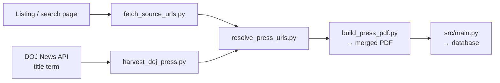
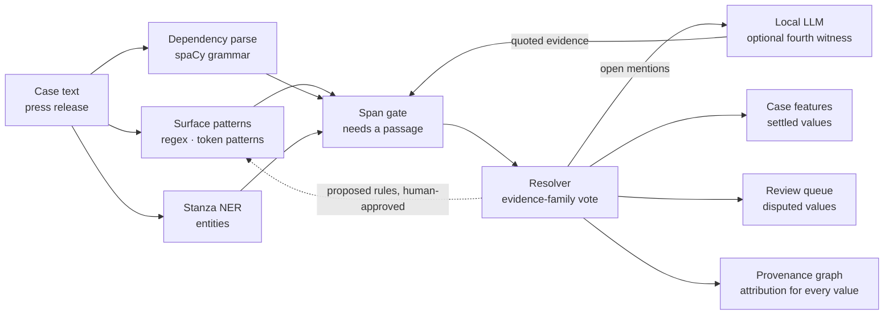

# CaseLinker

**CaseLinker** is a project designed to group and visualize **statistical** and **contextual** information from cases involving crimes against children and child sexual exploitation & abuse (CSEA).

## Live Demo

**Try the latest version online:** [https://caselinker.up.railway.app/](https://caselinker.up.railway.app/)

The live release includes all features and a processed case corpus from publicly available ICAC / NCMEC / DOJ / State Attorneys General press materials. The processed corpus holds **10,711 case reports**, **131,332 extracted features**, and **4,000+ distinct law-enforcement agencies** across **70** sources. Per-source coverage is on the in-app **Sources** page. These reports summarize investigations, arrests, and prosecutions, redacted for public release. No PII was processed; all data was already in the public domain. No installation required — just open the link in your browser.

## Technical Reports

- **Report #1: [CaseLinker: An Open-Source System for Cross-Case Analysis of Internet Crimes Against Children Reports](https://arxiv.org/pdf/2603.18020)** - Initial technical report documenting the prototype architecture, deterministic extraction pipeline, and evaluation baseline on 47 cases.

- **Report #2: [Interpretable ML Approaches for Analyzing Internet Crimes Against Children Reports](https://mrinaalr.github.io/website/CaseLinker-%20Interpretable%20ML%20Approaches%20for%20Analyzing%20Internet%20Crimes%20Against%20Children%20Reports.pdf)** - Second report covering NER integration, dataset expansion to 207 cases, and emerging patterns from the expanded dataset including the distributed network of 215 law enforcement organizations.

- **Report #3: [5 Sources, 500 Cases, and Scaling Considerations](https://mrinaalr.github.io/website/Scaling.pdf)** - Third report covering the addition of 3 new sources, facet-tree search, and data utility.

- **Report #4: [Framework for Retrospective Analysis and Case Studies of Internet Crimes Against Children Across U.S. Task Forces](https://mrinaalr.github.io/website/Framework.pdf)** - Fourth report establishing a replicable and extensible case study methodology: four-era framework (2010-2026), stratified sampling across eras, a five-dimension case study structure, and the legal and ethical grounding for the analysis.

- **Report #5: [Painting the Landscape of Internet Crimes Against Children with Interpretive Tooling](https://mrinaalr.github.io/website/PaintingTheLandscapeOfInternetCrimesAgainstChildrenWithInterpretiveTooling.html)** - Fifth and final report: a ten-page visual briefing on sixteen years of U.S. ICAC enforcement, presenting the extraction and analysis framework, 20 case studies across four eras, and aggregate findings across 5,000+ cases.

## Motivation

This project was motivated by challenges I encountered with understanding ICAC cases, including:

- **Fragmented data sources**: Cases are scattered across numerous organizations, states, and agencies
- **Cross-case analysis**: Identifying patterns, similarities, and connections between cases becomes challenging without a unified system, even when cases share common characteristics such as abuse patterns, platforms, or perpetrator demographics
- **Limitations in trend analysis**: Analyzing the evolution of child exploitation, the mediums in which it occurs, and recurring case topics
- **Emotional impact**: The challenge of repeatedly reading and processing highly disturbing case material

CaseLinker aims to address these challenges by serving as a tool for case analysis, enabling researchers, law enforcement, and advocacy organizations to better understand the landscape of child exploitation.

## Emphasis

- **Feature extraction**: Robust extraction of information from cases and explainability for clusters and analysis
- **Clustering and linking**: Cases based on shared characteristics such as victim context, platforms used, and law enforcement actions
- **Visualization**: With particular attention to tasteful presentation of case content, and pattern analysis across investigations

## System Architecture

CaseLinker follows a modular, layered architecture:

1. **Ingestion Layer**: Handles PDF data sources with text extraction and validation
2. **Processing Layer**: Extracts features, assigns comparison values, and fills case schema
3. **Storage Layer**: PostgreSQL (production) / SQLite (local development) - Database-agnostic implementation
4. **Clustering & Analysis Layer**: Case comparison, similarity detection, automated grouping, triage, and insights generation
5. **Visualization Layer**: Interactive web dashboards (platform harm dashboard, lifecycle state machines, facet tree search, analysis views)

## Installation

### Option 1: Use Live Demo (Recommended for Quick Testing)

**No installation required.** Visit the live deployment:
- **Live Application**: [https://caselinker.up.railway.app](https://caselinker.up.railway.app)

The live version includes all features and a processed case corpus. Created for quick testing and demonstrations.

### Option 2: Local Setup (Works Out of the Box)

```bash
# Clone the repository
git clone https://github.com/mrinaalr/CaseLinker.git
cd CaseLinker

# Run setup script (creates venv and installs dependencies)
./setup.sh

# Activate virtual environment
source .venv/bin/activate

# Start the main application
python3 run/main.py
```

Then open your browser to:
- **Home**: http://localhost:8000/
- **Visualizations**: http://localhost:8000/visualization
- **Advanced Analysis**: http://localhost:8000/analysis
- **Clusters**: http://localhost:8000/clusters
- **Stats**: http://localhost:8000/stats
- **Search**: http://localhost:8000/search
- **Query**: http://localhost:8000/query 
- **Lifecycle**: http://localhost:8000/lifecycle
- **Triage**: http://localhost:8000/triage
- **Ontology & Graphs**: http://localhost:8000/patterns
- **Tech Landscape**: http://localhost:8000/tech-landscape
- **LLM**: http://localhost:8000/llm
- **Data Sources**: http://localhost:8000/sources
- **Data Audit**: http://localhost:8000/audit
- **Look Under the Hood**: http://localhost:8000/under-the-hood
- **Crash Course**: http://localhost:8000/crash-course
- **Case Studies**: http://localhost:8000/case-studies
- **API Documentation**: http://localhost:8000/docs


**Database:**
- **Production (Railway)**: PostgreSQL with encrypted connections and managed backups
- **Local Development**: SQLite (`caselinker.db`) - created automatically when 
running locally, initially empty

**What a fresh clone includes** (works with an empty DB):

| Included | Path | Local use |
|-------|------|-----------|
| Ontology case graphs (~10k+ expressed via CASE/UCO/CAC) | `ontology/graph_output/` | `/patterns`, `/api/ontology/*` |
| PACER knowledge graphs (41 investigations, 128 docs, 297 graphs, modeled by the CASE-UCO SDK) | `ontology/PACER/` | `/patterns` |
| PACER lifecycle state machines (30 cases) | `state_machines/graphs/` | `/lifecycle` |
| L* trajectories / transition matrix | `state_machines/data/lstar_all_cases.json` | `/api/lifecycle/lstar` |
| Case studies (21 across 4 eras) | `data/case_studies.json` | `/case-studies` |
| Triage model bundle | `models/triage_bundle.joblib` | `/triage`, `/api/triage-live` |


**Reproduce the local corpus DB** (two options):

1. **Trusted API export** (full production corpus in one shot) — request a `CaseLinker-Key` at **mramachandra@umass.edu**, then:

```bash
source .venv/bin/activate
export CASELINKER_KEY='your-trusted-key'
python3 scripts/run/import_corpus_from_api.py
python3 run/main.py
```

2. **PDF ingest** (build from public data you collect; see **Process Your Own PDF Files** below):

```bash
source .venv/bin/activate
python3 src/main.py "path/to/your/file.pdf"

# or, after placing multiple PDFs in the repo root:

./scripts/run/ingest_all_pdfs.sh
python3 run/main.py
```

You can process additional PDFs to add more cases to the database.

## Usage

### ⚠️ Important: Data Content and Warning

**CaseLinker processes publicly available case reports and related records for research, analytical, and investigative workflow purposes.**

**While all source materials are drawn from public reports, content involves descriptions of child exploitation, abuse, or other disturbing criminal case details that may be difficult to read.**

**Please proceed with awareness of the sensitive nature of the material and use the project responsibly for research, academic, or authorized analytical purposes.**


## Entry Points

1. **`src/main.py`** - **CLI Tool for Processing PDFs**
   - Processes PDF files to extract and store cases in the database
   - Run this when you want to add new cases from PDF files
   - Extracts text, identifies sources, splits cases, extracts features, and stores them
   - Pre-computes clusters after storing new cases

2. **`run/main.py`** - **Main application**
   - Starts the web server that serves the visualization interface and API
   - Run this to access the web interface and visualizations
   - Uses pre-computes clusters on startup for fast performance
   - Provides REST API endpoints for case data, analysis, and statistics

3. **`caselinker_mcp/server.py`** - **MCP server for agents and operators**
   - **Local stdio:** **54 tools** (corpus + free RECAP/DOJ search + full collector READ/WRITE + local duplicate audit). Collector WRITE writes JSON/PDFs under `collector_output/` on your machine
   - **Railway hosted MCP:** **44 tools** — same corpus/READ surface; collector **WRITE tools** are not registered (no ephemeral-disk side effects). Use local MCP or the `collector/` CLI to harvest PDFs.
   - Reach out for private mcp.json keys and review `caselinker_mcp/README.md` and `caselinker_mcp/tool_registry.md` for setup, auth, and the full catalog

**Typical use case:**
1. First, populate the database with processed PDFs or request a trusted API key
2. Then, start the web server with `run/main.py` to view and analyze cases
3. Optionally, connect an MCP client (Cursor, Claude Desktop, or any MCP-compatible host) via **stdio**, **SSE**, or **Streamable HTTP**

## Process Your Own PDF Files

**The local database starts empty.** To populate CaseLinker with cases, collect PDFs, then run them through the extractor.

### Collecting PDFs

Visit the **Sources** page for agency links and what is already in the corpus: [live](https://caselinker.up.railway.app/sources) or `/sources` locally ([http://localhost:8000/sources](http://localhost:8000/sources)).

Processed sources include:

- **ICAC task forces / regional units** — Arizona ICAC, Silicon Valley ICAC, South Florida ICAC, NOVA-DC ICAC, plus ICAC-tagged feeds from state and local newsrooms
- **State Attorneys General / state DOJs** — e.g. Texas, Illinois, Pennsylvania, New Jersey, Florida, Ohio, Washington, Oregon, Utah, New Mexico, Mississippi, Louisiana, South Carolina, Hawaii, Vermont, Rhode Island, Delaware, Montana, South Dakota, Wisconsin, Idaho
- **State police / investigative bureaus** — e.g. Michigan SP, New York SP, TBI, GBI, NC SBI, Kentucky SP, Nebraska SP, Wyoming DCI, Iowa DCI, ALEA, Maryland SP, Minnesota BCA, Arkansas DPS
- **Local police / sheriffs / prosecutors** — e.g. LAPD, SJPD, SDPD, SPD, LVMPD, CSPD, Anchorage PD; Fresno / Osceola / Washoe / Sedgwick sheriffs; Cook County State's Attorney
- **NCMEC** — public case summaries and CyberTipline-related publications
- **Federal** — DOJ CEOS (incl. 2002–2008 archives); ICE/HSI; CBP; NCIS; Army CID; AF OSI; USSS; U.S. Marshals Service
- **International** — Australian Federal Police; Queensland Police; Brazil Federal Police; Europol; UK NCA; New Zealand DIA; Police Scotland; Philippines NBI; Alberta ALERT ICE; An Garda Síochána

The **collector suite** (`collector/`) turns press releases into standardized, merged PDFs, either from a listing page or from the DOJ News API:



For federal cases, court documents can be collected after a press hit with `collector/PACER/cases2records.py` (free CourtListener / RECAP first, paid PACER if unavailable). Outputs stay local under `collector_output/` and never auto-ingest.

> Agents can orchestrate the same steps (`harvest_doj_press_topic`, `resolve_press_urls`, `build_press_pdf`, `search_courtlistener`, …) over MCP.

Full workflow and flags: **[collector/README.md](collector/README.md)** / **[PRESS_RELEASE_COLLECTION.md](collector/PRESS_RELEASE_COLLECTION.md)**.

### Extracting Cases

The system will:

1. Extract text from each PDF
2. Identify organization name from filename (AZICAC, NCMEC, etc.)
3. Batch cases, extract features, assign case IDs
4. Store all cases in the local SQLite database
5. Pre-compute clusters for fast visualization

**Single PDF:**
```bash
source .venv/bin/activate
python3 src/main.py "path/to/your/file.pdf"
```

**Multiple PDFs:**
```bash
python3 src/main.py "2011 Cases and Arrests – AZICAC.ORG.pdf" "2020 Reports" "2024-media-coverage-cybertipline-success-stories.pdf"
```

**All PDFs under the repo** (e.g. after a fresh DB wipe):
```bash
./scripts/run/ingest_all_pdfs.sh

# Skip NCMEC/DOJ on first pass if you want state feeds first:
./scripts/run/ingest_all_pdfs.sh --no-aggregate
```

Each case runs through the four-layer extractor. Every layer writes its own assertion, the span gate checks each value against its source text, and `resolve_v3.0` stores only what the evidence supports. The optional local LLM adjudicates disputed extractions, quoting its source and never finalizing alone.



## Using the Visualizations

Access the **Platform Harm Dashboard** via the [live demo](https://caselinker.up.railway.app/visualization) or locally at http://localhost:8000/visualization.

**Dashboard features**:

- **Lifecycle map**: platforms placed on six exploitation lanes (distribution, storage, communities, discovery, messaging, production)
- **Detail panel**: per-platform analysis with four tabs:
  - **Affordances** → what the medium enables
  - **Misuse Surface** → how offenders abuse those properties
  - **Harm Vectors** → victim-facing harm pathways
  - **Case Evidence** → expandable quotes from `platform_affordance_evidence.json`; links to Audit for full case review
- **Filters**: search by platform name; narrow by evidence tier


## Using Search

Access Search via the [live demo](https://caselinker.up.railway.app/search) or locally at http://localhost:8000/search

Search provides a **facet decision tree** over the stored case corpus: the server builds a deterministic partition tree from structured facets (not a precomputed file on disk). The view uses **D3.js** (SVG) to render cohort nodes and edges. You can limit tree depth, **prune** which partition dimensions apply and optionally filter allowed values per facet (extracted feature), then **click any node** (branch or leaf) to list **case IDs** in that cohort for use elsewhere (e.g. single-case visualization, manual cross-case analysis). Small cohorts (fewer than three cases) have IDs gated behind a demo access key. See `src/Storage Layer/facet_tree.py` and `/api/facet-tree` for the partition order and semantics. How Search relates to SPARQL, Query, LLM, Patterns, and MCP: **[search.md](search.md)**.


## Using Advanced Case Analysis and Triage

Navigate to [analysis](https://caselinker.up.railway.app/analysis) on the live demo, or http://localhost:8000/analysis locally.

**Tag-based analysis** finds every case matching *all* selected tags (Case Topics, Severity Indicators, Platforms & Environments, Investigation Types, Perpetrator Relationships, Perpetrator Status), with per-tag counts and the matching text highlighted in each case.

**Automated analysis** runs the full pipeline: similarity-based case groups, priority-ranked cases, corpus insights, detected patterns (repeat offenders, relationships, investigation focus), and top keywords. Click any result to see the case text with its priority indicators highlighted and why it was grouped or ranked.

Priority scores combine weighted signals (severity indicators, victim count, case type, severity phrases, evidence volume, and registered-offender status), normalized to a 5–10 scale.


Access Triage via the [live demo](https://caselinker.up.railway.app/triage) or locally at http://localhost:8000/triage. Current implementation uses **rule-based** priority tiers, **ML Classification for triage** (random forest or decision tree trained on features from the database with labels derived from deterministic rules), optionally constrained by the same facet-dimension filtering used in Search, and supports **paste-in live triage** that scores text in memory without writing to the database. For the full triage documentation (rules, bundle paths, APIs, live paste), see **[triage.md](triage.md)**.

## Ontology & Graphs ([local](http://localhost:8000/patterns) · [live](https://caselinker.up.railway.app/patterns))

To answer ***relational*** and ***analytical*** questions at corpus scale, enforcement narratives cannot stay only in relational tables and regex-derived tags. They must be expressed in a **structured, graph-interoperable** format so patterns can be queried, validated, and compared across cases. The [ontology pipeline](#pipeline-flow) maps extracted features from each case narrative onto a standard investigation vocabulary, building validated knowledge graphs as a mechanism for cross-case analysis.


### **What is an ontology:** 
The [CAC Ontology](https://github.com/Project-VIC-International/CAC-Ontology) (Crimes Against Children Ontology) is a formal vocabulary developed to model the entities of a child-exploitation investigation as typed, related objects: platforms, victims, offenders, investigations, and outcomes. CAC is shepherded by [Project VIC International](https://www.projectvic.org/) and is built on the Linux Foundation's [Cyber Domain Ontology](https://cyberdomainontology.org/) stack ([UCO](https://unifiedcyberontology.org/) and [CASE](https://caseontology.org/)). CaseLinker case data is aligned to this vocabulary so graphs can be shared, validated, and queried with the same tools used in forensic and intelligence workflows.

The ontology and graph interface let us ask deeper questions into ICAC issues, beyond statistical counting and surface-level analysis. Three explored and published questions over the corpus are on [platform harm analysis](https://caselinker.up.railway.app/patterns/questions/q01), [exploitation lifecycles](https://caselinker.up.railway.app/patterns/questions/q02), and [kill-chain interventions](https://caselinker.up.railway.app/patterns/questions/q03).


### **How CaseLinker uses ontologies:** 
A deterministic mapping layer translates each case's extracted features into CAC entities and relationships, emits per-case RDF graphs, validates them, and merges conformant graphs into a queryable knowledge graph.

<a id="pipeline-flow"></a>
**Pipeline flow**:

1. **CaseLinker case features** — already extracted (platforms, topics, investigation signals, prosecution outcomes).
2. **Mapping layer** — deterministic translation to CAC entities and relationships (`ontology/graph_generate.py`).
3. **RDF emission** — per-case graphs as Turtle and JSON-LD under `ontology/graph_output/`.
4. **SHACL validation** — only conformant graphs enter the merged corpus.
5. **SPARQL-queryable corpus** — canonical per-case graphs are loaded into Oxigraph (named graph per case; union default graph) and served at `GET|POST /sparql`.

The live store holds **10,711** press-release case graphs (`…/resource/case/{case_id}`) plus **297** PACER court-record graphs (`urn:pacer:kg:…`). Agents can also build cohort graphs on demand via MCP (`case2cac` → `graph_summarize` → `export_case_graph_ttl`), or query the live store with the [CASE/UCO SDK](https://github.com/vulnmaster/CASE-UCO-SDK) `execute_sparql_query` tool.

> **[Graph Interface](https://caselinker.up.railway.app/patterns)**: browse and compare case graphs, look up by CAC class / platform / agency, open PACER investigations, and explore CaseLinker data.


### **Persistent IRIs (w3id)**

Case, platform, agency, location, and provenance IRIs use `https://w3id.org/caselinker/…`. After the perma-id registration lands, those URLs **303** to the live app and keep the path (`/resource/…`, `/ns/provenance`). The app returns HTML for browsers, or Turtle / JSON-LD when `Accept` asks for them. The Apache rules to submit are [`ontology/w3id-caselinker.htaccess`](ontology/w3id-caselinker.htaccess) (details in [`ontology/README.md`](ontology/README.md#w3idorg)).

### **Public SPARQL** 
(`GET|POST /sparql`) — SPARQL 1.1 Query only (`SELECT`, `CONSTRUCT`, `ASK`, `DESCRIBE`). No auth. Update and `SERVICE` are rejected. Rate limit is **30/minute** per IP. If a query has no outer `LIMIT`, the proxy injects **1000**; outer `LIMIT` above **10,000** is rejected. Each case is named graph `https://w3id.org/caselinker/resource/case/{case_id}`. Its provenance graph is `https://w3id.org/caselinker/resource/case/{case_id}/provenance`. Default-graph patterns see the union. Request formats, namespaces, errors, and more examples: **[ontology/docs/SPARQL.md](ontology/docs/SPARQL.md)**.

```bash
curl -sS -X POST 'https://caselinker.up.railway.app/sparql' \
  -H 'Content-Type: application/sparql-query' \
  -H 'Accept: application/sparql-results+json' \
  --data-binary @- <<'SPARQL'
PREFIX cac: <https://cacontology.projectvic.org#>
PREFIX rdfs: <http://www.w3.org/2000/01/rdf-schema#>
SELECT ?platform ?label (COUNT(DISTINCT ?case) AS ?cases)
WHERE {
  ?event cac:usesChannel ?platform .
  ?platform rdfs:label ?label .
  ?case a cac:CACInvestigation ; cac:hasStep ?event .
}
GROUP BY ?platform ?label
ORDER BY DESC(?cases)
LIMIT 8
SPARQL
```

Full ontology documentation (vocabulary, pipeline, graph pools, Q1–Q3, PACER, code map): **[ontology/README.md](ontology/README.md)**. PACER lifecycle state machines and L*: **[state_machines/README.md](state_machines/README.md)**.

**References**
- [CAC Ontology repository](https://github.com/Project-VIC-International/CAC-Ontology)
- [CASE/UCO SDK with CAC bindings](https://github.com/vulnmaster/CASE-UCO-SDK)
- [CASE](https://github.com/casework/CASE)
- [UCO](https://github.com/ucoProject/UCO)
- [Project VIC International](https://projectvic.org/)


## Other Features

- **Sources Tab**: View data sources and access original case reports
- **Clusters Tab**: View pre-computed clusters and analyze case reports
- **Stats Tab**: Coverage over the dataset and case distributions
- **Tech Landscape**: Technology revolver (platforms, investigation tech, anonymization, P2P) by era
- **Lifecycle**: PACER exploitation lifecycles. Five offense types as CAC ontology state machines
- **Query**: Custom analysis lab (public APIs)
- **LLM**: Natural-language queries over case statistics (SQL-backed; rate limited on production)
- **Case Studies Tab**: Era-organized narrative case studies (`data/case_studies.json`)
- **Audit Tab**: Review extracted features case-by-case with interactive highlighting to verify extraction accuracy

## Project Structure

```
CaseLinker/
├── src/
│   ├── Ingestion Layer/              # PDF extraction, source detection, ingest_file
│   ├── Processing Layer/             # batching.py, processing.py, merge_processing.py
│   │   ├── Pattern Processing Layer/ # Regex / rule-based feature extraction
│   │   └── ML Processing Layer/      # NER, semantic concepts, content sanitization
│   ├── Storage Layer/                # SQLite + PostgreSQL storage, facet_tree.py
│   ├── Clustering & Analysis Layer/  # analysis.py, triage.py
│   ├── Visualization Layer/          # Server-side viz helpers
│   └── main.py                       # CLI: ingest PDFs → process → store
├── run/
│   ├── main.py                       # FastAPI app: pages + REST API + /sparql + /resource
│   ├── deref.py                      # w3id resource / provenance content negotiation
│   ├── sparql_proxy.py               # SPARQL parser policy (LIMIT / Update / SERVICE)
│   ├── redis_cache.py                # Optional Redis caching (production)
│   └── auth.py                       # Access gates / keys for sensitive views
├── collector/                        # press → PDF, plus collector/pacer/ court fetch
├── scripts/
│   ├── rebuild_oxigraph.py           # Wholesale Oxigraph reload (N-Quads PUT /store)
│   ├── stats/                        # Corpus statistics scripts
│   ├── verify/                       # Claims, uniqueness, ICAC TF alignment, triage tests
│   └── run/                          # ingest_all_pdfs.sh, import_corpus_from_api.py, clear_postgres.py, train_triage_model.py
├── visualization/                    # Static HTML (served by run/main.py)
│   ├── assets/                       # caselinker-api.js, cover.png
│   ├── home.html                     # /
│   ├── visualization.html            # /visualization
│   ├── search.html                   # /search (facet tree)
│   ├── analysis.html                 # /analysis
│   ├── clusters.html                 # /clusters
│   ├── stats.html                    # /stats
│   ├── query.html                    # /query
│   ├── lifecycle.html                # /lifecycle
│   ├── triage.html                   # /triage
│   ├── patterns-graph.html           # /patterns (+ /patterns/graph alias)
│   ├── patterns.html                 # archived research writeup (not routed)
│   ├── assets/patterns-graph.js      # Graph viewer logic
│   ├── questions/                    # /patterns/questions/q01–q03
│   ├── tech-landscape.html           # /tech-landscape
│   ├── LLM.html                      # /llm
│   ├── sources.html                  # /sources
│   ├── case-studies.html             # /case-studies
│   ├── audit.html                    # /audit
│   ├── under-the-hood.html           # /under-the-hood
│   └── crash-course.html             # /crash-course
├── ontology/
│   ├── README.md                     # Ontology docs (vocabulary, pipeline, pools, w3id)
│   ├── docs/SPARQL.md                # Public SPARQL 1.1 API guide
│   ├── w3id-caselinker.htaccess      # Submit to perma-id as ids/caselinker/.htaccess
│   ├── caselinker-provenance.ttl     # Provenance vocabulary (w3id ns)
│   ├── features_to_cac.py            # Case features → CAC RDF
│   ├── graph_generate.py             # Batch TTL / JSON-LD
│   ├── oxigraph_rebuild.py           # Canonical TTL → named-graph N-Quads
│   ├── platform_affordance_evidence/ q2/ q3/  # Research evidence
│   ├── PACER/                        # PACER graphs + BULK_FOLDER (fetchers live in collector/pacer/)
│   └── graph_output/                 # staging + universe/ + big_bang/ + analysis/
├── state_machines/                   # PACER CAC state machines + L* (AfH Appendix X)
│   ├── README.md                     # Lifecycle machines, backbone, recompute
│   ├── graphs/                       # 30 case JSON-LD phase machines
│   ├── data/lstar_all_cases.json     # Transition matrix + L* trajectories
│   ├── compute_lstar.py              # Rebuild L* export
│   └── lifecycle_api.py              # /lifecycle + trusted API payload
├── caselinker_mcp/                   # MCP server (54 local / 44 Railway; corpus + collector + RECAP)
│   ├── server.py                     # MCPServer (mcp 2.x) entry point
│   ├── collector_tools.py            # Collector wrappers (WRITE local-only)
│   ├── public_records.py             # DOJ API + CourtListener/RECAP READ
│   ├── README.md                     # Hosted auth, Cursor config, graph workflow
│   └── tool_registry.md              # Full tool catalog (READ vs WRITE)
├── models/                           # triage_bundle.joblib (optional; see /triage)
├── data/                             # case_studies.json for /case-studies
├── setup.sh
├── requirements.txt                  # Core deps
├── requirements-ml.txt               # Optional ML / NER stack
├── config.py
├── caselinker.db                     # SQLite (local; created on first ingest)
├── triage.md                         # Triage rules and model docs
├── search.md                         # Search / facets vs SPARQL / MCP discovery map
├── Procfile                          # Railway / Heroku start command
└── ARCHITECTURE.md                   # System map: layers, data flow, diagrams, hand-off docs
```

## Case Schema & Feature Extraction

Each case includes structured features extracted from case narratives:

### **Regex extraction**

- **Perpetrator**: Age(s), registered sex offender status, gender when stated; flags for multi-defendant operations
- **Victim**: Age ranges, count when explicitly stated in victim-clause phrasing, gender after validation
- **Relationship**: Kin and role labels (father, mother, parent, sibling, teacher, coach, stranger, etc.); unknown when not stated
- **Platforms**: Named apps and surfaces — social, messaging, gaming, file hosting, livestreaming, early-era chat, Gen AI tools when cited — plus generic online, chat, or social media when no product matches
- **Technology signals** (stored separately from the platform list): investigation tooling (PhotoDNA, hash matching, CyberTipline language), anonymization (Tor, dark web, cryptocurrency), P2P clients
- **Prosecution**: Charge phrases with counts, booking stage (arrest through sentenced), jail mentions
- **Evidence volume**: Image, video, storage, and message counts when quantified in text
- **Investigation**: Non-exclusive types — proactive, reactive, online, undercover, or unknown; agencies from pattern matching plus Stanza NER. CyberTipline-origin only when the tip is about this case
- **Prior record**: Registered status and age at prior arrest when stated

### **Pattern-based classification**

- **Case topics**: production, possession, distribution, trafficking, csam, ai_csam, sextortion, hands_on vs online_only, family vs stranger, international, multi_state, project_safe_childhood
- **Severity indicators**: infant, very_young, under_12, sexual_abuse; multiple_perpetrators when more than one offender age is stored
- **Severity phrases**: dangerous, stated, told, continue, attacked, out_of_control, attracted — used in priority scoring

### **ML enrichment**
Stanza NER adds organizations and locations, and supplies person and number spans for age resolution. A spaCy dependency parse records which noun an age hangs on. Semantic sentence scoring stores concept scores; grooming may add a severity tag, and a strong possession score may add the possession topic. Production, AI-CSAM, and sextortion stay regex-only. Most concept scores are kept for analysis. An optional local LLM (`CASELINKER_LLM=1`, Ollama `qwen3:8b`) sharpens what the rules leave open, adjudicating matters the deterministic layers could not settle.

### **Field assertions and resolution**
Regex, spaCy, Stanza, statute lookup, temporal tags, an optional LLM, and human overrides each write their own assertion. A span gate and `resolve_v3.0` decide what becomes a final; disagreements stay in review. MCP: `get_case_assertions`, `get_field_disagreements`.

How the readers, the gate, and the resolver fit together in **[src/Processing Layer/README.md](<src/Processing Layer/README.md>)**.

### **Clustering & storage**
- **Comparison values**: Normalized vectors (platforms, demographics, investigation, evidence, topics, severity, date) for similarity and pre-computed clusters
- **Agency pathways**: Federal vs state/local splits where inferable from narrative context
- **Preserved data**: Raw narrative, source organization, source URL when present, source publication date from formatted PDFs, timestamps

## API Endpoints

- `GET /` - Home page
- `GET /api/corpus` - Full sqlite rebuild (localhost or `CaseLinker-Key` in `CASELINKER_TRUSTED_KEYS`). One JSON object of table rows. `scripts/run/import_corpus_from_api.py` calls this.
- `GET /api/cases` - Case list export (localhost or `CaseLinker-Key` in `CASELINKER_TRUSTED_KEYS`)
- `GET /api/cases-summaries-chunk` - Public paginated summaries (`offset`, `limit` ≤ 500); UI loads the full timeline via many small responses, not one bulk JSON
- `POST /api/cases-summaries-by-ids` - Public batched summaries (max 500 ids per request) for cluster membership and similar flows
- `GET /api/cases/{case_id}` - Single case (public responses omit `raw_data`; narrative available as `case_text` for UI drill-down)
- `GET /api/case-count` - Total case count (public, rate limited)
- `GET /api/case-ids-by-filter` - Case IDs matching filter query params (public, rate limited)
- `GET /api/tags` - Distinct tag values across the corpus (public, rate limited)
- `POST /api/tag-threader` - Tag co-occurrence threading analysis (public, rate limited)
- `GET /visualization` - Platform Harm Dashboard (Q1 affordance-misuse-harm analysis, tiered evidence, manual platform analysis)
- `GET /api/platform-affordance-evidence` - platform affordance evidence index or per-platform cohort (`platform`, optional `tier`, optional `require_fresh=true`)
- `GET /search` - Facet decision tree over stored cases (D3); prune filters; cohort case IDs via API
- `GET /query` - Custom analysis lab (browser-only JavaScript calling public APIs; see page for examples)
- `GET /lifecycle` - Exploitation lifecycle visualization (public HTML; payload embedded server-side)
- `GET /api/lifecycle/cases` - Lifecycle JSON (trusted `CaseLinker-Key` or localhost; same gate as `GET /api/cases`)
- `GET /api/lifecycle/lstar` - Full L* output (`state_machines/data/lstar_all_cases.json`; trusted key or localhost)
- `GET /api/lifecycle/anchors` - Public JSON for the 5 anchor PACER state-machine cases (no key; rate limited; intended for external embeds)
- `GET /analysis` - Advanced case analysis page with tag-based filtering and automated analysis
- `GET /api/facet-tree` - Build facet tree JSON (`max_depth`, optional prune query params)
- `GET /api/facet-distinct` - Distinct primary-bucket values per facet (for Search prune UI)
- `POST /api/facet-cohort-members` - Case IDs for a facet path (same prune semantics as tree; small cohorts gated)
- `POST /api/cohort-sparql` - One-row-per-case SPARQL (source, platforms, agencies, phase, steps, charges, sentences) for a list of case ids (public, rate limited; does not reveal gated cohorts)
- `GET /triage` - Triage page (rules, model evaluation, corpus model tiers, live paste)
- `GET /patterns` — Ontology & Graphs explorer (CAC force graph + lookup; research below the fold)
- `GET /patterns/graph` — same page (alias)
- `GET /patterns/questions/{question_id}` — Q01–Q03 findings pages
- `GET /api/ontology/cases` — graph pool catalog (`pool=compare|full|all|universe|analysis`; metadata only)
- `GET /api/ontology/merged` — pre-merged flat nodes for a pool (public, cached; not `full`)
- `GET /api/ontology/lookup` — find cases across full staging (`pool=full` default, max 2000); class/platform/agency/case text
- `GET /api/ontology/pacer` — PACER investigation catalog (`ontology/PACER/`)
- `POST /api/ontology/cache/warm` — rebuild/warm merged-graph cache (`pool=compare|all|universe|analysis|both`)
- `GET /ontology/graph_output/{case_id}.jsonld|.ttl` — staging (full corpus); also `{pool}/{case_id}…` for universe/big_bang/analysis
- `GET /ontology/PACER/...` — static PACER CASE-UCO JSON-LD
- `GET /ontology/platform-affordance-evidence/*`, `/ontology/q2/*`, `/ontology/q3/*`, `/ontology/question_data/*` — platform affordance evidence and Q2–Q3 evidence JSON
- `GET /ontology/q_results.json` — aggregated question results when present
- `GET|POST /sparql` — SPARQL 1.1 over CASE/UCO/CAC graphs (public, 30/min; [SPARQL.md](ontology/docs/SPARQL.md))
- `GET /mcp/sse` — MCP SSE transport (requires `Authorization: Bearer <MCP_ACCESS_KEY>`)
- `GET|POST /mcp-http/` — MCP Streamable HTTP transport (same auth)
- `GET /api/triage-eval` - Stratified train/test metrics on live cases (same pipeline as `scripts/verify/test_triage.py`)
- `GET /api/triage-model-corpus` - Saved bundle predictions over live DB; optional `facet_constraints` JSON query param (rate limited)
- `POST /api/triage-live` - Classify pasted batch text in memory only; requires bundle; no persistence
- `GET /sources` - Data sources page
- `GET /case-studies` - Case studies reading room (eras + studies from `data/case_studies.json`)
- `GET /api/case-studies` - Case study content document (eras, studies, default form URL)
- `GET /api/case-studies/notes/{case_id}` - Community notes for a study id
- `POST /api/case-studies/notes/{case_id}` - Append a community note (rate limited)
- `GET /audit` - Data audit page for reviewing extracted features case-by-case
- `GET /api/automated-analysis` - Run automated analysis (case grouping, triage, insights)
- `POST /api/return-tagged-cases` - Get cases matching selected tags (intersection logic)
- `GET /api/stats` - Get case statistics (total cases, extracted features count, sources)
- `GET /api/stats-detailed` - Detailed corpus statistics (public, rate limited)
- `GET /api/location-stats` - Location/geography aggregates (public, rate limited)
- `GET /api/technology-revolver` - Technology-by-era data keyed by era buckets (public, rate limited)
- `GET /api/cluster-groups` - Pre-computed similarity cluster groups (public, rate limited)
- `GET /stats` - Statistics dashboard page
- `GET /clusters` - Cluster explorer page
- `GET /tech-landscape` - Technology landscape page
- `GET /under-the-hood` - Architecture/methodology page
- `GET /crash-course` - Crash course (atlas + slides); linked from Under the Hood
- `GET /llm` - LLM chat page
- `POST /api/llm/chat` - LLM chat endpoint (public; per-IP daily cap, exempt for localhost/trusted key)
- `POST /api/cache/clear` - Clear server caches (rate limited 10/hour)
- `GET /api` - API info root; `GET /healthz` - health check
- `GET /docs` - Interactive API documentation


## Technology Stack

- **Backend**: Python 3, FastAPI, Uvicorn
- **Data Processing**: Pandas, NumPy
- **PDF Processing**: PyMuPDF (primary), pdfplumber (layout fallback)
- **Database**: PostgreSQL (production) / SQLite (local development)
  - Production: Railway PostgreSQL with encrypted connections
  - Local: SQLite database auto-created on first run
- **Visualization**: D3.js, HTML/CSS/JavaScript
- **ML/NER**: 
  - spaCy dependency parser, Stanza NER, and an optional local LLM (Ollama `qwen3:8b`)
  - Semantic concept scoring (grooming, possession, AI-generated CSAM language, and related themes) merged into case topics and severity where thresholds are met
  - **Supervised triage (experimental)**: scikit-learn random forest or decision tree; labels from rule-based priority scores; `joblib` bundle loaded at inference time
- **Ontology & Graphs**: RDFLib, pySHACL, Oxigraph (SPARQL)
- **Agents**: MCP server (`mcp` 2.x) over stdio, SSE, and Streamable HTTP
- **Architecture**: Modular 5-layer design

## Deployment

CaseLinker can be deployed to cloud platforms for public access. The app includes a `Procfile` for deployment to Railway, Heroku, and similar platforms. The SPARQL proxy reads `OXIGRAPH_URL` (private Oxigraph base URL). After regenerating case graphs, reload the store with `python3 scripts/rebuild_oxigraph.py` (wholesale overwrite, not incremental).


## Sources and Ethics
- **No Sensitive Data**: This system contains cases from publicly available sources (ICAC Task Forces Cases and Arrests, NCMEC CyberTipline Success Stories, DOJ CEOS Press Releases, and State Attorneys General's Office Press Releases). These reports are publicly available, summarize investigations, arrests, and case details, and are redacted for public release. All data was already in the public domain. This project received a determination from the University of Massachusetts Amherst Human Research Protection Office (HRPO Determination #7668); this research does not contain private or identifiable information under federal regulations [45 CFR 46.102(f)(1), (2)].
- **See `/sources` page for full disclaimer regarding data usage**

## Contributing

Contributors can help by:
- Adding ideas to the README
- Contributing to the architecture design
- Code implementation
