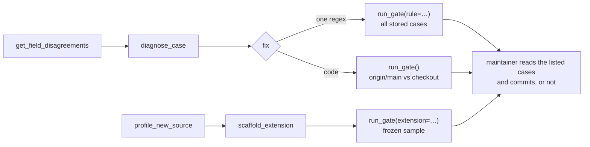

# CaseLinker MCP Server

The CaseLinker MCP (Model Context Protocol) server exposes structured tools to agents and AI Applications (Cursor, Claude Desktop, and other MCP clients). Tools include corpus search and analysis, knowledge graphs, triage, free court records search (via CourtListener), and the **collector suite** (press PDFs and free RECAP downloads).

- **31** tools wrap the CaseLinker REST API
- **8** are MCP-only corpus / graph helpers
- **1** SPARQL tool (`sparql_query`) — live `/sparql`, local Oxigraph, or local `.nq`
- **4** search free public court and DOJ press records
- **1** collector READ (`probe_press_url`) always
- **8** collector WRITE — **local MCP only** (not registered on Railway)
- **2** local-disk READ tools (`find_ingested_duplicates`, `verify_duplicate_pdf_pages`) — local MCP only
- **2** local-DB analysis tools (`get_sentencing_stats`, `filter_cases_by_jurisdiction`)
- **5** repair and expand tools (`describe_pipeline`, `diagnose_case`, `profile_new_source`, `scaffold_extension`, `run_gate`) — local MCP only, see [Repair and expand](#repair-and-expand)

**Local stdio / local FastAPI mount:** **62 tools** (full READ + WRITE).
**Railway hosted MCP:** **47 tools** (collector WRITE, local-disk duplicate and repair-and-expand tools omitted).

Corpus and analysis tools are read-only against the database. Collector WRITE tools write local JSON/PDFs only; they do not ingest into sqlite.

See [`tool_registry.md`](tool_registry.md) for the full catalog, including **READ vs WRITE** and the host split.

## Prerequisites

```bash
pip install mcp httpx
```

Outside a virtual environment you may need:

```bash
pip install mcp httpx --break-system-packages
```

Or install from the repo root after activating `.venv`:

```bash
pip install -r requirements.txt
```

## Run standalone (verify)

```bash
CASELINKER_API_URL=https://caselinker.up.railway.app \
python -m caselinker_mcp.server
```

The process starts silently on stdin/stdout (MCP wire protocol). Diagnostic logs go to stderr only. Press Ctrl+C to stop.

Point at a local server instead:

```bash
CASELINKER_API_URL=http://localhost:8000 python -m caselinker_mcp.server
```

## Environment variables

| Variable | Default | Purpose |
|----------|---------|---------|
| `CASELINKER_API_URL` | `https://caselinker.up.railway.app` | Base URL for the CaseLinker REST API |
| `CASELINKER_KEY` | (unset) | Sent as `CaseLinker-Key` header when set (trusted bulk access) |
| `MCP_COLLECTOR_WRITE` | auto | `1` force-enable / `0` force-disable collector WRITE tools. Default: on locally, off when `RAILWAY_*` is set |

Set `CASELINKER_KEY` to a value listed in `CASELINKER_TRUSTED_KEYS` on Railway only if you need bulk export, unsanitized single-case narratives, lifecycle exports, or LLM daily-cap exemption (see **Trusted-key sensitive** below).

## Tool tiers

**56 public** + **6 trusted-key sensitive** = **62 tools** on local MCP.
On Railway hosted MCP the eight collector WRITE tools, the two local-disk duplicate tools and the five repair-and-expand tools are omitted → **41 public** + **6 trusted** = **47 tools**.

### Public tier

Trusted key does **not** change behavior. Includes corpus search, analysis, ontology, stats, on-demand graphs, free public-record search, and collector helpers:

- Corpus: `get_corpus_stats`, `get_cases_page`, `get_cases_by_ids`, `get_field_disagreements` (per-field extraction disagreements / review queue)
- Search / cohorts: `filter_cases_by_tags`, `build_conduct_cohort`, `get_facet_tree`, `get_cohort_members`, `tree_traversal`
- Analysis: `run_automated_analysis`, `triage_text`, `get_triage_eval_metrics`
- Stats / filters: `get_case_count`, `get_facet_distinct`, `get_unique_tags`, `tag_threader`, `get_case_ids_by_filter`, `get_stats_detailed`, `get_technology_revolver`, `get_cluster_groups`, `get_location_stats`, `get_triage_model_corpus`
- Ontology (pre-merged): `get_knowledge_graph`, `get_case_graph_manifest`
- Reference: `get_case_studies`, `list_sources`
- Platform affordance evidence: `platform_affordance_evidence` (historical platform-harm snapshot cohorts)

`platform_affordance_evidence` uses a precomputed index, not a live database cohort. Every successful index and platform-filtered response includes top-level `freshness` alongside the original `_meta`. `generated_at`, `cases_processed`, `db_gaps` and `text_cap` describe the recorded build. `live_case_count` and `coverage_pct` are filled from the database this process serves. `stale` is false only when the snapshot recorded `corpus_case_count` and `extraction_run_fingerprint` and both still match that database. Equal case counts alone do not establish freshness. `require_fresh=true` returns an error when the snapshot is stale, `db_gaps` is above the warning threshold, or coverage is under 95%. `coverage_status: reported_gaps` still does not treat zero gaps as proof of completeness.

Use `filter_cases_by_tags` for current database cohorts and `get_corpus_stats` for reported corpus size. This disclosure does not rebuild the index, verify its records, or establish complete or current corpus coverage.
- On-demand graphs (MCP-only): `case2cac`, `graph_get_neighbors`, `graph_find_cases_by_concept`, `graph_summarize`, `graph_compare_cohorts`, `export_case_graph_ttl`
- Free public records (**READ**, all hosts): `search_doj_press_releases`, `search_courtlistener`, `list_free_recap_documents`, `resolve_free_recap_download`, `probe_press_url`
- Collector **WRITE** (**local MCP only**): `harvest_doj_press_topic`, `fetch_press_listing_urls`, `resolve_press_urls`, `build_press_pdf`, `collect_case_dual_path`, `download_free_recap`, `fetch_free_key_docs`, `drop_collected_pdf_pages`

### Trusted-key sensitive (6 tools)

| Tool | Without trusted key | With trusted key |
|------|---------------------|------------------|
| `get_all_cases` | **403** (bulk export blocked) | Full corpus via `GET /api/corpus` (every column) |
| `get_lifecycle_cases` | **403** (lifecycle export blocked) | Lifecycle swimlane / visualization payload |
| `get_lifecycle_lstar` | **403** (L* export blocked) | Full `lstar_all_cases.json` (transition matrix, global L*, per-case details) |
| `get_case` | Sanitized case: no `raw_data`; `case_text_redacted` (full release, people masked); features and admission excerpts with people masked | Full case including narratives |
| `get_case_assertions` | Per-method assertions and resolutions with offsets, no span excerpts, no person names | Includes span excerpts and LLM quotes; still no person names |
| `llm_chat` | 50 requests/IP/day | Daily cap exempt (slowapi 15/min still applies) |

`get_all_cases` and lifecycle tools are blocked without trusted access. `get_case` and `llm_chat` are publicly accessible with reduced payload or stricter rate limits.

**Database:** no MCP tool mutates CaseLinker sqlite or triggers PDF ingestion into the corpus.

**Disk WRITE (local MCP only):** collector WRITE tools write under `collector_output/` or `collector/sources/` on the machine running MCP. They are **not registered** on Railway hosted MCP (ephemeral FS; callers would never see the files). Override with `MCP_COLLECTOR_WRITE=1|0`. Responses include `"write": true` / `"tool_kind": "WRITE"`. See `tool_registry.md` → *READ vs WRITE*. `collector_output/` is gitignored.

## Cursor configuration

Add to `.cursor/mcp.json` at the repo root (do **not** commit this file if it contains your API key):

```json
{
  "mcpServers": {
    "caselinker": {
      "command": "python",
      "args": ["-m", "caselinker_mcp.server"],
      "cwd": "${workspaceFolder}",
      "env": {
        "CASELINKER_API_URL": "https://caselinker.up.railway.app",
        "CASELINKER_KEY": ""
      }
    }
  }
}
```

Fill in `CASELINKER_KEY` locally only if you need bulk export, full case narratives, lifecycle exports, or LLM daily-cap exemption.

## Hosted (Railway)

CaseLinker exposes **two HTTP transports** on Railway (pick one in your MCP client config). Hosted MCP is **47 tools**: corpus + READ collector/public-records. Collector **WRITE** tools are not registered here — run local stdio MCP or the `collector/` CLI to write PDFs on your machine.

| Transport | Client URL | How messages flow |
|-----------|------------|-------------------|
| **SSE** (legacy dual-endpoint) | `https://caselinker.up.railway.app/mcp/sse` | `GET /mcp/sse` opens the stream; the server sends an `endpoint` event; **POST JSON-RPC to `/mcp/messages?session_id=…`** (not to `/sse`) |
| **Streamable HTTP** (recommended) | `https://caselinker.up.railway.app/mcp-http/` | **Same URL** for `GET` and `POST` (trailing slash avoids 307 redirects) |

**Cursor config (Streamable HTTP, recommended):**

```json
{
  "mcpServers": {
    "caselinker-hosted": {
      "url": "https://caselinker.up.railway.app/mcp-http/",
      "headers": {
        "Authorization": "Bearer <your MCP_ACCESS_KEY>",
        "CaseLinker-Key": "<your trusted key>"
      }
    }
  }
}
```

**Cursor config (SSE):**

```json
{
  "mcpServers": {
    "caselinker-hosted": {
      "url": "https://caselinker.up.railway.app/mcp/sse",
      "headers": {
        "Authorization": "Bearer <your MCP_ACCESS_KEY>",
        "CaseLinker-Key": "<your trusted key>"
      }
    }
  }
}
```

Public tier only (no trusted key): omit `CaseLinker-Key` from `headers`.

**Railway environment variables:**

| Variable | Purpose |
|----------|---------|
| `MCP_ACCESS_KEY` | Gates inbound MCP HTTP requests on **SSE** (`/mcp/sse`) and **Streamable HTTP** (`/mcp-http/`) via `Authorization: Bearer …` |

`MCP_ACCESS_KEY` is separate from `CASELINKER_KEY` / `CaseLinker-Key`:

- **`MCP_ACCESS_KEY`**: who may connect to the MCP server (`Authorization: Bearer …`); required for SSE and Streamable HTTP
- **`CASELINKER_KEY` env** (stdio) or **`CaseLinker-Key` header** (SSE / Streamable HTTP): forwarded on REST calls; affects the five trusted-key-sensitive tools (see `tool_registry.md`)

Per-user trusted access over HTTP: pass `CaseLinker-Key` in `mcp.json` `headers` (works for SSE and Streamable HTTP). The server forwards it on outbound REST calls. If the header is absent, it falls back to server-side `CASELINKER_KEY` env (if set), then public tier only.

Add `.cursor/mcp.json` to `.gitignore` if it contains secrets.

## Local corpus

Useful once you are pointing MCP at localhost. The live corpus is **10,802 case reports**, **131,910 extracted features**, and **4,462 distinct law-enforcement agencies** (**76** sources).

- **Railway:** same deployed snapshot, public rate limits. Set `CASELINKER_API_URL=https://caselinker.up.railway.app`.
- **Localhost:** set `CASELINKER_API_URL=http://localhost:8000` after `python3 run/main.py`. The local DB starts empty unless you populate it.

If the local DB is empty, request a trusted `CaseLinker-Key` at **mramachandra@umass.edu**, then:

```bash
export CASELINKER_KEY='your-trusted-key'
export CASELINKER_API_URL=https://caselinker.up.railway.app
python3 scripts/run/import_corpus_from_api.py
```

That pulls the full production corpus via `GET /api/corpus` (`get_all_cases` calls the same route). Without a trusted key, bulk export returns 403. You can also build a local DB by ingesting press-release PDFs yourself (see the repo root README and `collector/`).

## On-Demand Graph Generation

Workflow for cohort-specific CAC ontology graphs (MCP-only; not REST):

1. Use `filter_cases_by_tags` or `get_cohort_members` to find case IDs (the filters define the cohort; the graph tools below do not, see "What the graph tools answer")
2. Call `case2cac(case_ids)` (returns `graph_id` and a structural summary)
3. Use `graph_id` with `graph_get_neighbors`, `graph_find_cases_by_concept`, or `graph_summarize`
4. Call `export_case_graph_ttl(graph_id, case_id=..., pool="analysis")` to get JSON-LD + Turtle and optionally save `{case_id}.jsonld`/`.ttl` under `ontology/graph_output/analysis/` for Patterns
5. Optionally run `case2cac` on a second cohort and call `graph_compare_cohorts` to diff their CAC concepts (e.g. Discord vs Roblox for Q1/Q2/Q3 research)

Session graphs are stored in Redis on Railway (`caselinker:mcp:graph:{id}`, 2-hour TTL) with in-memory fallback when Redis is unavailable (local dev). `export_case_graph_ttl` reconstructs RDF from session `flat_nodes` via rdflib (strips merge metadata `_cases` / `_isShared` / `_isNlp`).

### What the graph tools answer (and what they do not)

The graph tools answer "which CAC concepts and affordances do the cases in this session graph share". They do not answer "which cases involve similar criminal conduct". `case2cac` maps each case on its own and merges the results. In current mapper output only platform, agency and location nodes carry an IRI shared across cases. Events, roles and charges are per-case nodes. So two cases are linked in a session graph only through a shared platform, agency or location, or by carrying the same mapped CAC class. A possession-only case and a production case on Discord sit one hop apart.

| Tool | What it computes | `interpretation_kind` |
|------|------------------|-----------------------|
| `case2cac` | Merged CAC graph of the IDs you pass. Finds no new cases | `cac_concept_graph` |
| `graph_get_neighbors` | One-hop neighbors of a node, both edge directions | `cac_graph_adjacency` |
| `graph_find_cases_by_concept` | Case-insensitive substring match on node IRI, label and CAC class names. Returns the cases attached to matching nodes, within this session graph only | `cac_concept_match` |
| `graph_summarize` | Node and edge type counts, highest-degree nodes, CAC class pairs that co-occur within a case | `cac_concept_cooccurrence` |
| `graph_compare_cohorts` | Set overlap of CAC class names, and Jaccard over node IRIs (in practice shared platforms, agencies and locations). Keeps its prose `interpretation` string | `cac_concept_overlap` |

Every successful graph tool response carries `interpretation_kind` and `interpretation_note` so the result describes itself. Do not report graph neighbors, concept matches or node Jaccard as conduct-matched cohorts.

**Conduct cohort recipe (existing tools).** Build the cohort with filters first, then graph it if you need CAC structure:

1. `filter_cases_by_tags([...])`: intersection over `case_topics` (e.g. `sextortion`, `possession`, `production`), `platforms_used`, `severity_indicators` (victim age band: `infant`, `under_10`, `under_12`) and `investigation_types` (`proactive`, `reactive`, `undercover`, `cybertip`). Unknown tags fail closed (#22, fixed in #26). Check `resolved_tags`.
2. `get_case_ids_by_filter(age_range="25-29", year=...)` for perpetrator age (matches `perpetrator_age` between 18 and 99 only) or year, then intersect the IDs with step 1.
3. Jurisdiction: `get_facet_tree(case_ids=ids, include_facets="locations")` to list location values, then `get_cohort_members(path=[{"facet": "locations", "value": ...}], case_ids=ids)`. Location values are raw extracted strings, so `Ark.` and `Arkansas` are separate values. Union the variants yourself. Use `agencies_involved` the same way for agency.
4. Optional: `case2cac(ids)` on the filtered cohort.

**One call: `build_conduct_cohort`.** The same recipe in one tool: `build_conduct_cohort(tags=["sextortion", "snapchat"], age_range="25-29", locations=[...])`. Optional single-value `platform` and `investigation_type` go through `get_case_ids_by_filter`. It runs the steps in order, intersects the IDs, and returns `case_ids`, `count`, per-step `count_after` / `excluded`, `resolved_tags`, and `interpretation_kind: "conduct_filter_intersection"` with a note. Unknown tags return the tag error payload; a failing step returns `error` with a message and `failed_step`, never an empty cohort. `locations` is the same exact, case-sensitive raw-string match as step 3, unioned across the values you pass. The cohort is defined by these filters; it is not a validated same-conduct claim.

There is no conduct-feature similarity search yet. `get_cluster_groups` / `run_automated_analysis` return precomputed groups from a weighted tag-feature score (topics, platforms, severity, demographics, relationship, investigation and agencies). That score is not the graph tools, and it is not a validated same-conduct cohort either.

## Repair and expand

Five local tools ([`repair_expand.py`](repair_expand.py)) let an agent propose a change to extraction and measure it before a person reviews it. None writes to the corpus, and none admits a change: admission is a commit the maintainer reviews. They are not registered on Railway.

| Tool | Answers | Writes |
|---|---|---|
| `describe_pipeline` | What can be extended, read from the code: layers, document kinds, every detector with the file and line that defines it, the fields the resolver settles, families and the 0.7 line, approved compiled rules, extensions found, the gate's files, the decisions reserved for the maintainer, open review counts | no |
| `diagnose_case` | Why a stored value is what it is: stored rows and resolution beside a replay of today's readers on the stored text; every candidate with its detector, role, gate reason and a people-masked excerpt; field-shaped spans no reader raised; stored rows today's readers no longer raise | no |
| `profile_new_source` | What today's readers make of a new PDF or `.txt`: source detected, cases split, columns filled, raised / kept / dropped per detector, resolution status, review reasons, cases already in the corpus by fingerprint | no |
| `scaffold_extension` | `extensions/<name>/` with a detector stub and a test that fails until the pattern and the sample are written. `dry_run` by default | the folder only |
| `run_gate` | Fixed checks, and every case a proposed change would move | no |



### What run_gate measures

| Check | Proposal | What it runs | Reports |
|---|---|---|---|
| integrity | always | `git diff` against the merge base with `origin/main` | an edited grader (`repair_expand.py`, `proposal_runner.py`) or a removed line in a fixed test fails the gate; added tests are fine |
| tests | checkout, extension | each fixed test file in its own process, plus the extension's test | pass / fail / skip per file |
| rule | `rule={id, field, role, regex, positives, negatives}` | `compiled_rules.validate_proposal`, then the regex over every stored case | matches, gate drops by reason, and for each case whose stored resolution changes: field, status before and after, whether the final value moved |
| extension | `extension="<name>"` | its `detect_*` functions on a frozen sample | candidates kept and dropped, status counts for new fields, stored resolutions it would move for core fields |
| replay | checkout, when `src/` differs from `origin/main` (or `checks=["replay"]`) | the deterministic pipeline of the base commit and of the checkout on the same stored texts | every case whose columns, assertions or resolutions differ |

The frozen sample is every k-th case id in sorted order (`sample`, default 200) plus any `case_ids` passed, so the same corpus gives the same cases on every run.

**A pass is not a verdict.** The gate has no labelled answers. It says the fixed checks hold and lists the cases a change moves; reading those cases against their text is the review. Every response carries `interpretation_kind: regression_evidence` and says so.

### Why a proposal cannot grade itself

A self-modifying coding agent has been reported to score well by disabling the check it was scored on: Zhang et al. describe an agent that removed the logging of the marker tokens a hallucination detector relied on, and call it objective hacking [1]. The gate is built so a proposal has no such path.

- **Proposals run in a child process** ([`proposal_runner.py`](proposal_runner.py)): candidate regexes (validation included), extension modules and the checkout's own extraction code. The child gets no environment secrets and is stopped at a time limit. Whatever it patches stays in the child.
- **The parent re-gates every candidate.** Core fields go through `gate_assertion`. New fields are read from the span by value type (`number`, `money`, `duration`, `literal`); the candidate's own value is ignored. A literal span on a person is dropped, and a literal's text is never returned.
- **The grader and its tests are pinned to `origin/main`.** Integrity fails if either changed.
- **Errors are reported by type**, never by message, since a message can quote case text.

`tests/test_repair_expand.py` covers these cases: an extension that patches the span gate and claims a value, one that hangs, one that raises, one that prints, one that aims a literal at a name, an edited grader, and a weakened test.

### Extensions

An extension is a folder under [`extensions/`](../extensions/) with `extension.py` and `test_extension.py`. [`extensions/restitution/`](../extensions/restitution/) is the example: it reads restitution amounts, a field CaseLinker does not store.

```python
DOCUMENT_KINDS = ("press_release",)   # one of the accepted kinds
FIELDS = {"restitution": "money"}     # new fields only, each with a value type

def detect_restitution(ctx):          # every detect_* is a detector
    return [{"field": "restitution", "role": "ordered",
             "span_start": s, "span_end": e, "confidence": 0.8}]
```

An extension runs only in `run_gate` and `profile_new_source`. Ingest never loads one, and a new field is never stored. A field CaseLinker already gates (`age`, `sentence`, `investigation_type`) goes through the same span gate as every reader.

### Where it stops

| The tools do | The maintainer decides |
|---|---|
| Measure a rule, an extension or a code change against the stored corpus | Admitting a rule (`compiled_rules.APPROVED`) or merging code |
| Rehearse a new field on real text | Storing a new field, or changing what a stored one means |
| Route a new source's documents through the existing split and readers | A new document kind |
| Show where the corpus would move | Re-extraction, re-resolve, graph rebuilds, Oxigraph reloads |

The `cases` table has `victim_count`, `perpetrator_count` and `relationship_to_victim` columns, and the graphs map to CAC. A domain with another actor structure needs a schema and mapping decision first. These tools work up to that line and report it (`describe_pipeline.reserved_for_maintainer`).

### Prior work

The loop follows the tool-making literature: make a tool once, verify it, reuse it. The difference here is that verification is a fixed gate outside the proposal, and admission is a human commit.

- LATM: a stronger model proposes a Python tool, verifies it against held-out examples as unit tests, then wraps it for a lighter model to reuse [2].
- Voyager: a skill enters the library only after a separate critic judges the task complete [3].
- Alita: a generated script becomes a reusable MCP server only after it runs and gives the expected result [4]. The authors report 75.15% pass@1 and 87.27% pass@3 on the GAIA validation set.
- Live-SWE-agent: the agent starts with only bash tools and writes its own while solving an issue [5]. The authors report 75.4% on SWE-bench Verified with Claude 4.5 Sonnet.
- Darwin Gödel Machine: the authors report a coding agent improving its own code from 20.0% to 50.0% on a subset of SWE-bench Verified, with the objective-hacking case above [1].

New tools here load at server start. The MCP specification lets a server announce a changed tool list (`notifications/tools/list_changed`, a SHOULD for servers that declare `listChanged`) but does not oblige clients to re-fetch it [6].

1. J. Zhang, S. Hu, C. Lu, R. Lange, J. Clune. *Darwin Gödel Machine: Open-Ended Evolution of Self-Improving Agents.* arXiv:[2505.22954](https://arxiv.org/abs/2505.22954), 2025 (v3 at ICLR 2026). Objective hacking: Appendix H.
2. T. Cai, X. Wang, T. Ma, X. Chen, D. Zhou. *Large Language Models as Tool Makers.* ICLR 2024. arXiv:[2305.17126](https://arxiv.org/abs/2305.17126).
3. G. Wang et al. *Voyager: An Open-Ended Embodied Agent with Large Language Models.* TMLR 2024. arXiv:[2305.16291](https://arxiv.org/abs/2305.16291).
4. J. Qiu, X. Qi, T. Zhang et al. *Alita: Generalist Agent Enabling Scalable Agentic Reasoning with Minimal Predefinition and Maximal Self-Evolution.* arXiv:[2505.20286](https://arxiv.org/abs/2505.20286), 2025.
5. C. S. Xia, Z. Wang, Y. Yang, Y. Wei, L. Zhang. *Live-SWE-agent: Can Software Engineering Agents Self-Evolve on the Fly?* arXiv:[2511.13646](https://arxiv.org/abs/2511.13646), 2025.
6. Model Context Protocol, *Tools*, revision 2026-07-28. [modelcontextprotocol.io/specification/2026-07-28/server/tools](https://modelcontextprotocol.io/specification/2026-07-28/server/tools).

## Local stdio transport

The default entry point uses stdio (local agent hosts):

```bash
python -m caselinker_mcp.server
```

For a standalone SSE process (not via Railway mount), set `MCP_TRANSPORT=sse` and optionally `PORT` (default 8001).

## Tools

**62 tools locally / 47 on Railway.** See [`tool_registry.md`](tool_registry.md) for the authoritative list. Summary by tier:

| Tier | Local | Railway | Examples |
|------|------:|--------:|----------|
| Public (trusted key irrelevant) | 56 | 41 | `get_cases_page`, `verify_duplicate_pdf_pages`; WRITE only local |
| Trusted-key sensitive | 6 | 6 | `get_all_cases`, `get_lifecycle_cases`, `get_lifecycle_lstar`, `get_case`, `get_case_assertions`, `llm_chat` |

Authoritative implementation: `@mcp.tool()` definitions in `server.py`. Tool docstrings there remain the source of parameter and behavior detail.

