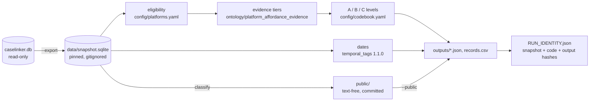

# AfH 2.0 Q1: platform-affordance manifest

Rebuilds the AfH Section 3–4 platform evidence from the current CaseLinker corpus: which platforms releases name, whether they document the platform's use, which of the six affordance classes that use touches, how that looks by publication year, and which harms co-occur. Outputs are generated from a pinned corpus snapshot and committed with the corpus release they describe.



## Reproduce

Needs Python 3.12 with PyYAML 6.0.3 (nothing else: verified in a fresh virtualenv). Tests need pytest.

| Command | Needs | Does |
|---|---|---|
| `numbers/run_all.sh` | the frozen `caselinker.db` ([`SNAPSHOT.md`](SNAPSHOT.md)) | AfH 2.0: every number in [`numbers/numbers.md`](numbers/numbers.md); `--other-inputs` runs the same analysis on another corpus, labelled as not AfH 2.0 |
| `run_all.py --public` | this repo | Rebuilds every output from the committed text-free `public/` snapshot |
| `run_all.py --verify --public` | this repo | The same into a temp directory; prints `identical` or the files that differ |
| `run_all.py --snapshot <era>` | a `CaseLinker-Key` | Downloads a registered era's frozen full-text snapshot, checks its sha256 against [`snapshots.json`](snapshots.json), and rebuilds everything. No era is registered for AfH 2.0: its inputs are on Zenodo (below) |
| `run_all.py --export` | a CaseLinker SQLite corpus | Snapshots the current corpus and builds a new release from it |
| `run_all.py --verify` | `data/snapshot.sqlite` | Reruns the classifier from the full snapshot and compares with `outputs/` |

`public/` holds each case's id, `fp-1` fingerprint, source, URL, publication year, platform labels, topics and date roles, every platform-case record's classification (tiers, conduct, affordance levels, harm flags, sentence offsets), and the exclusions. It holds no release text and no person spans. A `--public` build writes every output except `legacy_afh1_exemplars.json`, which resolves old case ids against release text. Each record's evidence sentence is served masked in [`platform_affordance_evidence.json`](../platform_affordance_evidence.json); the release itself is at its source URL.

`--export` copies the columns the analysis reads from `../CaseLinker/caselinker.db` (or `AFH_Q1_SOURCE_DB=/path/to/caselinker.db`), opened read-only, into `data/snapshot.sqlite`, and a full build rewrites `public/` from it. `--verify` refuses to run unless the snapshot's `dataset_identity` equals the one in `outputs/RUN_IDENTITY.json`.

| Pin | Where |
|---|---|
| Corpus | `RUN_IDENTITY.json` `dataset_identity`: sha256 over id, `fp-1` fingerprint, text hash, platforms, topics, source, URL and year of every case |
| Code | `RUN_IDENTITY.json` `git.commit`, `code_sha256` |
| Rules | `config/platforms.yaml`, `config/codebook.yaml`; evidence tiers `tiers-1` (baseline) and `tiers-1+linewrap-3` (primary); sha256 in `RUN_IDENTITY.json` |
| Outputs | `RUN_IDENTITY.json` `outputs_sha256`, checked by `--verify` |

### Frozen eras

The corpus keeps changing after a release, so `--export` from a later corpus is a new release, not a reproduction. Each era's full-text snapshot is frozen when its outputs are committed: the file is served to `CaseLinker-Key` holders at `GET /api/snapshots/<era>` (from `CASELINKER_SNAPSHOT_DIR` on the server, same access as `/api/corpus`), and [`snapshots.json`](snapshots.json) records its sha256, `dataset_identity`, case count and date. The file holds full release text and is never committed. `--snapshot <era>` refuses a download whose sha256 differs from the registry.

Tests (pytest and the repo requirements; corpus-dependent tests skip without `caselinker.db`):

```bash
DATABASE_URL='' python -m pytest -q tests/research tests/privacy tests/api tests/extraction/test_program_boilerplate_dates.py tests/extraction/test_field_assertions.py
```

Frozen inputs: [10.5281/zenodo.24520066](https://doi.org/10.5281/zenodo.24520066) (restricted; access on request). Verify against SNAPSHOT.md.

A different corpus gives a different `dataset_identity`; the outputs are then a new release, not a reproduction. Output tests read the shipped AfH 2.0 build in `numbers/build/`; snapshot tests need `data/snapshot.sqlite`, which `numbers/run_all.sh` exports.

The snapshot holds source text and stays out of git. Share it only under the same access rules as `caselinker.db`.

## Outputs for the manuscript

| File | Use |
|---|---|
| `outputs/latex/tab_inventory.tex` | Section 3 counts: presence, documented use under both tier rules |
| `outputs/latex/tab_affordance_coverage.tex` | Six-class A / B / I / C coverage |
| `outputs/latex/tab_recurrence.tex` | Recurrence across platform families and eras |
| `outputs/latex/tab_platform_manifest.tex` | Top 15 platforms with dated native capabilities |
| `outputs/latex/tab_exemplars.tex` | Manifest exemplars, each automatically coded |
| `outputs/manifest.json`, `exemplar_inventory.json`, `citations.json` | Full manifest; every exemplar with its coding label and fingerprint |
| `outputs/registry_checks.json` | Registry confidence, link reachability, manuscript claim verdicts |

Generated locally by `run_all.py` and not committed. `\input{}` each table inside a `table` environment; captions and labels belong to the manuscript. Requires `\usepackage{booktabs}`.

## What is where

| Path | Role |
|---|---|
| `config/platforms.yaml` | Every platform label: status, family, native capabilities with first year, `default_on`, confidence. Generated by `python -m afhq1.registry` from `config/capability_sources/*.yaml` (dated evidence per cell; `url_check.json` records link reachability). |
| `config/codebook.yaml` | Six-class definitions, conduct categories, instrumental cues, exclusions, harm cues |
| `config/review_exemplars.csv`, `review_round3_tier_variants.csv`, `review_round4_promoted_cases.csv`, `capability_sources/manuscript_claims_verified.csv` | Earlier blind review of manifest exemplars (codebooks 4 and 6; kept as history, not validation of codebook 9); stated, co-occurrence and line-wrap-promoted samples behind the headline rates; 25 manuscript platform claims checked on fetched dated pages |
| `config/validation_reviews.csv`, `review_round2_*.csv`, `validation_adjudication.csv` | First and second blind AI reviews (classification, harm, tiers, inferred facilitation) and the author agent's resolution of disagreements; no human adjudication. Ids, fingerprints, verdicts and short notes only. |
| `afhq1/snapshot.py` | Read-only export, `dataset_identity`, and the text-free `public/` snapshot |
| `afhq1/pipeline.py` | Eligibility, tiers (via the published Q1 builder), A/B/C levels, harm flags |
| `afhq1/temporal.py` | Date roles from `temporal_tags` 1.1.0 |
| `afhq1/identity.py`, `citations.py` | Content crosswalk for AfH 1.0 ids; fingerprint-bound citations |
| `afhq1/build.py`, `latex.py` | All outputs; booktabs tables in `outputs/latex/` (local only) |
| `afhq1/review.py` | Sample selection; writes a people-masked review sheet to `data/` (local only) |

## Measurement definitions

| Term | Definition |
|---|---|
| Broad eligible | Case has any label except `online`, `internet`, `unknown*` (the AfH 1.0 rule) |
| Strict eligible | Case has a `specific` named platform |
| Platform-case observation | One (case, label) record; a case can have several |
| Tier | Per record, from the published Q1 rules: `stated` (platform tied to offense conduct in one sentence), `inferred` (co-occurrence), `named_only`. Case tier = best record tier; tiers are exclusive per case. |
| Use-documented | Tier `stated` or `inferred` |
| A available | Platform had the capability natively in the case's publication year |
| B capability-relevant conduct | A, plus use-documented, plus conduct of the kind the class bears on, in a sentence naming the platform |
| I inferred facilitation | B on a platform where the capability is on for every use by design (`default_on`), or C |
| C explicit instrumental use | B, plus a capability-specific cue in a sentence naming the platform |
| Primary tier | `tiers-1+linewrap-3`: the published rules plus an additive repair of hard-wrapped lines that never demotes and refuses promotions earned only by agency social-media or reporting-duty boilerplate naming that platform. `tiers-1` is kept as the baseline. |
| Harm direct / case-level | Harm cue in a platform sentence of a use-documented record / case topic or cue anywhere in the release |
| Timeline | Publication year. An upper bound on conduct time, never relabelled as offense date. |

## Citations

Manifest exemplars are stored as `(case_id, fp-1 fingerprint)` in `outputs/citations.json`. `citations.verify` reports `id_reassigned` if an id later holds different text, and follows the fingerprint to the case's new id. Never cite a CaseLinker case by bare id across corpus versions: ids can move on a rebuild until the id map is frozen.
