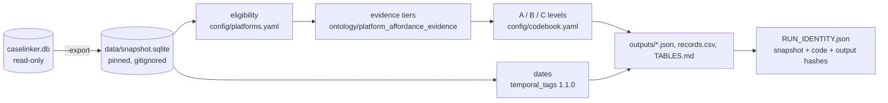

# AfH 2.0 Q1: platform-affordance manifest

Rebuilds the AfH Section 3–4 platform evidence from the current CaseLinker corpus: which platforms releases name, whether they document the platform's use, which of the six affordance classes that use touches, how that looks by publication year, and which harms co-occur. Findings and claim-by-claim recommendations: [FINDINGS.md](FINDINGS.md). Every table: [outputs/TABLES.md](outputs/TABLES.md).



## Reproduce

Needs Python 3.12 with PyYAML 6.0.3 (nothing else: verified in a fresh virtualenv) and a CaseLinker SQLite corpus. Tests need pytest; the LaTeX check needs pdflatex and skips without it.

```bash
python ontology/platform_affordance_evidence/afh_manifest/run_all.py --export
```

```bash
python ontology/platform_affordance_evidence/afh_manifest/run_all.py --verify
```

`--export` copies the columns the analysis reads from `../CaseLinker/caselinker.db` (or `AFH_Q1_SOURCE_DB=/path/to/caselinker.db`), opened read-only, into `ontology/platform_affordance_evidence/afh_manifest/data/snapshot.sqlite`. `--verify` refuses to run unless that snapshot's `dataset_identity` equals the one in [outputs/RUN_IDENTITY.json](outputs/RUN_IDENTITY.json), rebuilds every output in a temp directory and prints `identical` or the files that differ. A plain `run_all.py` rewrites `outputs/`.

| Pin | Where | Value for the committed outputs |
|---|---|---|
| Corpus | `RUN_IDENTITY.json` `dataset_identity` (sha256 over id, `fp-1` fingerprint, text hash, platforms, topics, source, URL, year of every case) | `60f7bfaa…d06b`, 10,802 cases |
| Code | `RUN_IDENTITY.json` `git.commit`, `code_sha256` | the commit that generated the outputs (`3f346c670` for the committed set) |
| Rules | `config/platforms.yaml` `platforms-2` (generated from `config/capability_sources/`), `config/codebook.yaml` `codebook-6`; evidence tiers `tiers-1` (baseline) and `tiers-1+linewrap-3` (primary) | sha256 in `RUN_IDENTITY.json` |
| Outputs | `RUN_IDENTITY.json` `outputs_sha256` | checked by `--verify` |

Tests (pytest and the repo requirements; corpus-dependent tests skip without `caselinker.db`):

```bash
DATABASE_URL='' python -m pytest -q tests/research tests/privacy tests/api tests/extraction/test_program_boilerplate_dates.py tests/extraction/test_field_assertions.py
```

A different corpus gives a different `dataset_identity`; the outputs are then a new release, not a reproduction. Someone without the corpus DB can still check the committed numbers reconcile (`pytest tests/api/test_afh_q1_pipeline.py`); the snapshot-dependent tests skip.

The snapshot holds source text and stays out of git. Share it only under the same access rules as `caselinker.db`.

## Outputs for the manuscript

| File | Use |
|---|---|
| `outputs/latex/tab_inventory.tex` | Section 3 counts: presence, documented use under both tier rules |
| `outputs/latex/tab_affordance_coverage.tex` | Six-class A / B / I / C coverage |
| `outputs/latex/tab_recurrence.tex` | Recurrence across platform families and eras |
| `outputs/latex/tab_platform_manifest.tex` | Top 15 platforms with dated native capabilities |
| `outputs/latex/tab_tier_variants.tex` | Decision 1 tier variants |
| `outputs/latex/tab_verified_exemplars.tex` | Exemplars a blind reviewer judged supported |
| `outputs/manifest.json`, `exemplar_inventory.json`, `citations.json` | Full manifest; every exemplar with verdict and fingerprint |
| `outputs/registry_checks.json` | Registry confidence, link reachability, manuscript claim verdicts |

Generated locally by `run_all.py` and not committed. `\input{}` each table inside a `table` environment; captions and labels belong to the manuscript. Requires `\usepackage{booktabs}`.

## What is where

| Path | Role |
|---|---|
| `config/platforms.yaml` | Every platform label: status, family, native capabilities with first year, `default_on`, confidence. Generated by `python -m afhq1.registry` from `config/capability_sources/*.yaml` (dated evidence per cell; `url_check.json` records link reachability). |
| `config/codebook.yaml` | Six-class definitions, conduct categories, instrumental cues, exclusions, harm cues |
| `config/review_exemplars.csv`, `review_round3_tier_variants.csv`, `capability_sources/manuscript_claims_verified.csv` | Blind exemplar review (every manifest exemplar), Decision 1 tier-variant review, and 25 manuscript platform claims checked on fetched dated pages |
| `config/validation_reviews.csv`, `review_round2_*.csv`, `validation_adjudication.csv` | Round-1 verdicts, four blind round-2 reviews (classification, harm, tiers, inferred facilitation) and adjudication. Ids, fingerprints, verdicts and short notes only. |
| `afhq1/snapshot.py` | Read-only export and `dataset_identity` |
| `afhq1/pipeline.py` | Eligibility, tiers (via the published Q1 builder), A/B/C levels, harm flags |
| `afhq1/temporal.py` | Date roles from `temporal_tags` 1.1.0 |
| `afhq1/identity.py`, `citations.py` | Content crosswalk for AfH 1.0 ids; fingerprint-bound citations |
| `afhq1/build.py`, `report.py`, `latex.py`, `tier_variants.py` | All outputs, `TABLES.md`, booktabs tables in `outputs/latex/`, Decision 1 tier comparison |
| `afhq1/review.py` | Sample selection; writes a people-masked review sheet to `data/` (local only) |
| `audit_2026-11-16/` | The read-only audit that preceded this work |

## Measurement definitions

| Term | Definition |
|---|---|
| Broad eligible | Case has any label except `online`, `internet`, `unknown*` (the AfH 1.0 rule) |
| Strict eligible | Case has a `specific` named platform |
| Platform-case observation | One (case, label) record; a case can have several |
| Tier | Per record, from the published Q1 rules: `stated` (platform tied to offense conduct in one sentence), `inferred` (co-occurrence), `named_only`. Case tier = best record tier; tiers are exclusive per case. |
| Use-documented | Tier `stated` or `inferred` |
| A available | Platform had the capability natively in the case's publication year |
| B capability-relevant conduct | A, plus use-documented, plus conduct of the kind the class bears on, in a sentence naming the platform |
| I inferred facilitation | B on a platform where the capability is on for every use by design (`default_on`), or C |
| C explicit instrumental use | B, plus a capability-specific cue in a sentence naming the platform |
| Sensitivity tier | Published tier rules rerun on line-unwrapped text with storage/receipt verbs; reported beside the published tier |
| Harm direct / case-level | Harm cue in a platform sentence of a use-documented record / case topic or cue anywhere in the release |
| Timeline | Publication year. An upper bound on conduct time, never relabelled as offense date. |

## Citations

Manifest exemplars are stored as `(case_id, fp-1 fingerprint)` in `outputs/citations.json`. `citations.verify` reports `id_reassigned` if an id later holds different text, and follows the fingerprint to the case's new id. Never cite a CaseLinker case by bare id across corpus versions: ids before #38 (2026-10-19) were positional and shifted when sources were re-split; between the 2026-10-20 local backup and the current DB another 919 ids moved to different text, most likely in the 2026-11-12 rebuild while the local fingerprint table was still empty.
