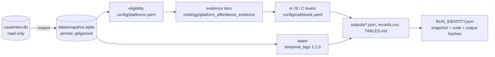

# AfH 2.0 Q1: platform-affordance manifest

Rebuilds the AfH Section 3–4 platform evidence from the current CaseLinker corpus: which platforms releases name, whether they document the platform's use, which of the six affordance classes that use touches, how that looks by publication year, and which harms co-occur. Findings and claim-by-claim recommendations: [FINDINGS.md](FINDINGS.md). Every table: [outputs/TABLES.md](outputs/TABLES.md).



## Reproduce

Needs the repo's Python environment (`requirements.txt`, PyYAML) and a CaseLinker SQLite corpus.

```bash
python research/afh_q1/run_all.py --export
```

```bash
python research/afh_q1/run_all.py --verify
```

`--export` copies the columns the analysis reads from `../CaseLinker/caselinker.db` (or `AFH_Q1_SOURCE_DB=/path/to/caselinker.db`), opened read-only, into `research/afh_q1/data/snapshot.sqlite`. `--verify` refuses to run unless that snapshot's `dataset_identity` equals the one in [outputs/RUN_IDENTITY.json](outputs/RUN_IDENTITY.json), rebuilds every output in a temp directory and prints `identical` or the files that differ. A plain `run_all.py` rewrites `outputs/`.

| Pin | Where | Value for the committed outputs |
|---|---|---|
| Corpus | `RUN_IDENTITY.json` `dataset_identity` (sha256 over id, `fp-1` fingerprint, text hash, platforms, topics, source, URL, year of every case) | `60f7bfaa…d06b`, 10,802 cases |
| Code | `RUN_IDENTITY.json` `git.commit`, `code_sha256` | `8d83621ec` |
| Rules | `config/platforms.yaml` `platforms-1`, `config/codebook.yaml` `codebook-2` | sha256 in `RUN_IDENTITY.json` |
| Outputs | `RUN_IDENTITY.json` `outputs_sha256` | checked by `--verify` |

A different corpus gives a different `dataset_identity`; the outputs are then a new release, not a reproduction. Someone without the corpus DB can still check the committed numbers reconcile (`pytest tests/research/test_afh_q1_pipeline.py`); the snapshot-dependent tests skip.

The snapshot holds source text and stays out of git. Share it only under the same access rules as `caselinker.db`.

## What is where

| Path | Role |
|---|---|
| `config/platforms.yaml` | Every platform label: `specific` / `technology` / `generic` / `ambiguous_alias` / `excluded`, family, native capabilities with first year. Years are `needs_author_check`. |
| `config/codebook.yaml` | Six-class definitions, conduct categories, instrumental cues, exclusions, harm cues |
| `config/validation_reviews.csv` | Reviewer verdicts for the 107-row deterministic sample (ids, fingerprints, verdict, note) |
| `afhq1/snapshot.py` | Read-only export and `dataset_identity` |
| `afhq1/pipeline.py` | Eligibility, tiers (via the published Q1 builder), A/B/C levels, harm flags |
| `afhq1/temporal.py` | Date roles from `temporal_tags` 1.1.0 |
| `afhq1/identity.py`, `citations.py` | Content crosswalk for AfH 1.0 ids; fingerprint-bound citations |
| `afhq1/build.py`, `report.py` | All outputs and `TABLES.md` |
| `afhq1/review.py` | Sample selection; writes a people-masked review sheet to `data/` (local only) |
| `audit_2026-11-16/` | The read-only audit that preceded this work |

## Measurement definitions

| Term | Definition |
|---|---|
| Broad eligible | Case has any label except `online`, `internet`, `unknown*` (the AfH 1.0 rule) |
| Strict eligible | Case has a `specific` named platform |
| Platform-case observation | One (case, label) record; a case can have several |
| Tier | Per record, from the published Q1 rules: `stated` (platform tied to offense conduct in one sentence), `inferred` (co-occurrence), `named_only`. Case tier = best record tier; tiers are exclusive per case. |
| Use-documented | Tier `stated` or `inferred` |
| A available | Platform had the capability natively in the case's publication year |
| B action-relevant | A, plus use-documented, plus conduct of the kind the class bears on, in a sentence naming the platform |
| C instrumental | B, plus a capability-specific cue in a sentence naming the platform |
| Harm direct / case-level | Harm cue in a platform sentence of a use-documented record / case topic or cue anywhere in the release |
| Timeline | Publication year. An upper bound on conduct time, never relabelled as offense date. |

## Citations

Manifest exemplars are stored as `(case_id, fp-1 fingerprint)` in `outputs/citations.json`. `citations.verify` reports `id_reassigned` if an id later holds different text, and follows the fingerprint to the case's new id. Never cite a CaseLinker case by bare id across corpus versions: ids before #38 (2026-10-19) were positional and shifted when sources were re-split; between the 2026-10-20 local backup and the current DB another 919 ids moved to different text, most likely in the 2026-11-12 rebuild while the local fingerprint table was still empty.
