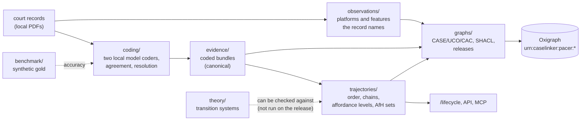

# State machines

Federal court records, coded as evidence and represented through documented trajectories. Each case is reconstructed from source-supported actions, participants, temporal relationships, platform interactions, and harms, with provenance and uncertainty preserved.

The underlying event graph serves as the canonical representation from which trajectories, CASE/UCO/CAC knowledge graphs, and the /lifecycle visualization are derived. Separately, the theory layer implements the affordance-aware state-space framework of [Affordances for Harm](https://doi.org/10.5281/zenodo.21347781) (AfH), allowing documented trajectories to be evaluated against formally specified models.

**Contents:**
- [Layers](#layers)
- [Three levels of evidence](#three-levels-of-evidence)
- [The documented event graph](#the-documented-event-graph)
- [How a court record is encoded](#how-a-court-record-is-encoded)
- [What the encoding establishes](#what-the-encoding-establishes)
- [Use it](#use-it)
- [Code map](#code-map)

## Layers



| Layer | What it holds | README |
|---|---|---|
| [`evidence/`](evidence/) | The canonical record: coded events, participants and their event roles, dated assertions, relations, provenance, validation rules | [evidence](evidence/README.md) |
| [`trajectories/`](trajectories/) | Views derived from it: the documented partial order, maximal chains, affordance levels, the AfH sets, the `/lifecycle` payload | [trajectories](trajectories/README.md) |
| [`graphs/`](graphs/) | CASE/UCO/CAC emission with the CASE-UCO SDK, SHACL against the full CAC shape set, datasets, Oxigraph loading | [graphs](graphs/README.md) |
| [`observations/`](observations/) | What the record names, read by rule from the pages: listed platforms, services named only by a placeholder or a generic description, and codebook feature phrases, each cited to its sentence; the relationships an act's own sentence supports; the research table and the affordance evidence matrix | [observations](observations/README.md) |
| [`coding/`](coding/) | The workflow that produces bundles: page text, two pinned local model coders, agreement, machine resolution, optional adjudication | [coding](coding/README.md) |
| [`benchmark/`](benchmark/) | Synthetic gold cases (dev, held-out and a blind confirmation split) and the scorer that measures the coders' accuracy on known truth | [benchmark](benchmark/README.md) |
| [`theory/`](theory/) | Finite transition systems for feasible pathways (AfH Appendix X) | [theory](theory/README.md) |

## Three levels of evidence

A record supports three different kinds of claim, and each has its own gate. They are kept in separate graphs and never promoted by proximity.

| Level | Claim | Gate | Graph |
|---|---|---|---|
| 1. Observation | The record names this platform, refers to a service without naming it, or states this feature phrase, in this sentence | The term is on a fixed list or has a fixed form, and is on the page | `urn:caselinker:pacer:<case>:observations` |
| 2. Act | The record states someone did this | Two model coders agree on the sentence, the action and the actor | `…:evidence` |
| 3. Supported relationship | The record states the act was done by means of the platform or feature | The observation lies in the act's cited sentence, and that sentence states the means | `…:observations`, pointing at the act |

- **A mention is not use.** A platform named in a filing says nothing about what it was used for.
- **A platform name is not an affordance.** Only a stated feature can count toward one, and only a stated means ties it to an act.
- **A withheld name is not an affordance either.** "Website A" documents that a service was involved and that the record does not say which. It is not evidence of anonymity.
- **A sparse graph is a correct graph.** A case may have observations and no relationship, or acts and no platform.
- **The record is not the model.** A stated feature documents that the capability appears in the case. Whether it enabled the offence is a question for the [theory](theory/README.md) layer, not a fact in the graph.
- **$O_{i}$ is documented feature use, and on `pacer-v1` the stated-means rule leaves it empty** (one known miss, `doj_ceos_2026_001` `e149`). The analysis of the 30 does not stop there. The [analysis frame](trajectories/README.md#the-analysis-frame) puts each step next to the platform the sentence names, the capabilities the registry says that platform offered, and the feature phrases the record states. A person records use in a separate note. The note is not written into $O_{i}$.

Dataset `pacer-v1` holds all three levels for 30 cases (98 documents): 284 agreed acts, 875 observations, 9 acts tied to a platform by a stated means, 45 sentences in 10 cases that state a means where the two coders dispute the act (kept apart, as disputed machine readings), a case-level [research table](observations/README.md#research-table) and an [affordance evidence matrix](observations/README.md#affordance-evidence-matrix) that keep the kinds of evidence apart. Act counts are lower bounds: on the blind benchmark split the release finds 104 of 247 gold acts. It is machine-coded: no person adjudicated an act or reviewed an observation, and it is complete, loadable and citable as that. A case id is the corpus id of the press release for the same prosecution, where the corpus holds one. The cases are a selected collection of prosecutions, not a sample of offending.

`pacer-v2` (2026-11-24) recodes the cases with the capability registry loaded and replaces `external_extortion` (no press record) with `ut_ag_2026_006`, so all 30 cases link to a press release: 290 agreed acts (`pacer-v1`: 284), 170 chains (163), `candidate_capabilities` on 10 of 210 derived steps (0 of 202; DIRECT derivation), 98 documents. `pacer-v1` is kept unchanged on record. Both use the same graph IRIs, so a SPARQL store loads one of them, not both.

## The documented event graph

$$
D=(\Pi,\ E,\ R,\ P,\ U)
$$

| | | |
|---|---|---|
| $\Pi$ | participants | role-neutral (P1, P2, …): persons, undercover personas, organizations, collectives; legal status recorded separately, with sources |
| $E$ | events | one per source observation: action, actor and targets with their roles in this event, outcome, dated assertions, affordances, harms, platform interactions |
| $R$ | relations | BEFORE, MEETS, interval relations, INTERRUPTS, RESPONDS_TO, …, and SAME_ACT for possible identity |
| $P$ | provenance | document hash, page, character offsets, quote hash, the passage's legal standing (allegation, admission, finding, …), verification |
| $U$ | uncertainty | an assertion status on every claim (DIRECT, INFERRED, UNSUPPORTED, CONTRADICTED); conflicting dates kept side by side |

The bundle is the canonical artifact. Everything else is a view of it at an evidence threshold $\theta$ (DIRECT, or DIRECT plus INFERRED):

- **Order.** $\prec_{\theta}$ is the transitive closure of admitted BEFORE and MEETS relations and of the order cited dates imply. Pairs it leaves incomparable are reported, not forced.
- **Trajectories.** $L=((a_{1},O_{1}),\ldots,(a_{n},O_{n}))$ is a maximal chain of offender events under $\prec_{\theta}$. $O_{i}$ holds the affordances the record ties to the act. One event can sit in several chains.
- **AfH sets.** $\mathrm{Aff}(L)$, $H(c)$ and $\psi_{\mathcal{C}}(o)$ are computed over the chains and the case's minor-directed harms.

## How a court record is encoded

1. **Collect.** [`collector/pacer/`](../collector/pacer/) fetches public dockets into `ontology/PACER/` (the PDFs are local and never committed; the cost log there is tracked). The research build needs `pip install -r requirements.txt -r requirements-sdk.txt` (`./setup.sh` does this).
2. **Code.** Two local models (pinned by digest) read the page text and each write a bundle; [`coding/`](coding/README.md) measures their agreement. Court text never leaves the machine.
3. **Resolve.** A fixed rule publishes what both coded (`machine`), or a manual human reviewer decides every disagreement (`adjudicated`).
4. **Publish.** [`graphs/release.py`](graphs/release.py) validates each bundle, derives its views, emits its graphs, runs SHACL, and writes a manifest with hashes and the dataset's `review_mode`. A bundle with any validation error is refused in every mode.
5. **Load.** `rebuild_oxigraph.py --pacer-release <id> --verify` loads the dataset with the rest of the corpus and checks the store against the manifest.

## What the encoding establishes

Three layers of checking, each answering a different question. Passing one says nothing about the next.

| Layer | Question | Checked by |
|---|---|---|
| **Structural** | Is the bundle well formed, and are its views and graphs derived from it deterministically? | JSON Schema, rules T01–T19, CASE-UCO SDK emission, SHACL, `tests/pacer` |
| **Evidence fidelity** | Does each coded claim say what its cited passage says, with the right standing? | Quote and page hashes (T04), standing per passage (T06), two model coders and their agreement (agreement is not correctness: mean action κ on the real cases is 0.30) |
| **Resolution** | How were disagreements, open roles and possible retellings settled? | `machine`: a fixed rule publishes only what both coders coded, links possible retellings, keeps open roles open. `adjudicated`: a manual human reviewer decided each item |

| `review_mode` | Published items | Served on `/lifecycle` and loaded into Oxigraph |
|---|---|---|
| `adjudicated` | decided by a manual human reviewer | yes |
| `machine` | agreed by two model coders, resolved by rule | yes; the review mode is stated in the manifest, the API (`review_mode`) and the store's dataset graph |
| `preview` | anything that validates | no (local stores only) |

A machine-coded dataset reports reliability (agreement between the coders) and, separately, accuracy on the [synthetic benchmark](benchmark/README.md); neither is accuracy on the real cases. Level-C affordances are documented instrumental support, not causal effects; $\psi$ is co-occurrence within a case.

## Use it

```bash
# validate a bundle against its page text
python -c "import json,sys; from state_machines.evidence.validate import validate; \
  [print(f) for f in validate(json.load(open(sys.argv[1])), require_verified=True)]" bundle.json

# build a release and its N-Quads
python -m state_machines.coding.pipeline release pacer-v1 <case> [...] --observations   # from the local resolved bundles (machine-coded)
python -m state_machines.graphs.release nquads pacer-v1

# convert a schema 1.x bundle, and list what needs a person
python -m state_machines.evidence.migrate old.json new.json

# tests
DATABASE_URL='' python -m pytest tests/pacer

# the analysis frame for a release: trajectories, stated platforms, registry capabilities.
# does not modify the release and does not emit graphs. <dir> receives digest.json, digest.md, index.html
python -m state_machines.trajectories.digest pacer-v1 --registry <capability_sources> --out <dir>
```

| Surface | Access | Returns |
|---|---|---|
| [`/lifecycle`](https://caselinker.up.railway.app/lifecycle) | public | documented and theory views of the current dataset (machine-coded) |
| `GET /api/lifecycle/cases` | trusted key or localhost | the page payload: events, roles, dates, standing, sources (no quotes, no names) |
| `GET /api/lifecycle/analysis` | trusted key or localhost | chains, unordered pairs, $\mathrm{Aff}(c)$, $H(c)$, $\psi$, coverage identity |
| `GET /api/ontology/pacer` | public | the dataset manifest: cases, graph IRIs, SHACL status |
| MCP `get_lifecycle_cases`, `get_trajectory_analysis` | trusted key | the two API routes above |

## Code map

| Path | Purpose |
|---|---|
| [`evidence/vocab.py`](evidence/vocab.py) | Every code list: actions, roles, statuses, time bases, relation types, affordance classes, harms |
| [`evidence/schema.py`](evidence/schema.py) | Bundle JSON Schema 2.0, generated from the vocabulary |
| [`evidence/validate.py`](evidence/validate.py) | Rules T01–T19 and the publication gate |
| [`evidence/evidence.py`](evidence/evidence.py) | Page text, passages, quote hashes, the local quote store |
| [`evidence/migrate.py`](evidence/migrate.py) | Schema 1.x to 2.0 |
| [`evidence/CODEBOOK.md`](evidence/CODEBOOK.md), [`evidence/CODER_GUIDE.md`](evidence/CODER_GUIDE.md) | What each code means; how to code a case |
| [`trajectories/derive.py`](trajectories/derive.py) | Partial order, chains, interruptions, derivation metadata |
| [`trajectories/affordances.py`](trajectories/affordances.py) | Affordance levels A and B from the shared capability registry |
| [`trajectories/claims.py`](trajectories/claims.py) | One step, split into coded platform interactions, registry candidates, and documented feature use |
| [`trajectories/digest.py`](trajectories/digest.py) | The analysis frame for a dataset, and the coding bench |
| [`trajectories/use_notes.py`](trajectories/use_notes.py) | Researcher judgments of use. They sit beside a step and never enter $O_{i}$ |
| [`trajectories/afh.py`](trajectories/afh.py) | $\mathrm{Aff}$, $H(c)$, $\psi$, coverage identity, dataset analysis |
| [`trajectories/payload.py`](trajectories/payload.py) | The `/lifecycle` payload |
| [`graphs/emit.py`](graphs/emit.py), [`graphs/shacl.py`](graphs/shacl.py), [`graphs/release.py`](graphs/release.py) | Emission, SHACL, datasets |
| [`coding/workflow.py`](coding/workflow.py), [`coding/adjudication.py`](coding/adjudication.py) | Coding and adjudication workflow |
| [`theory/transition_systems.py`](theory/transition_systems.py) | AfH Appendix X |
| [`../tests/pacer/`](../tests/pacer/) | Tests for all of the above |
