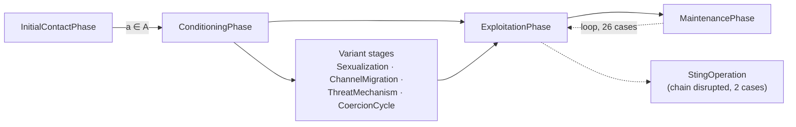
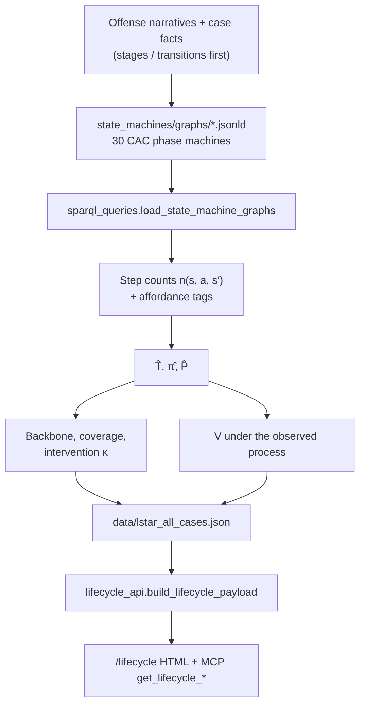

# Exploitation lifecycle state machines

Federal PACER cases modeled as **CAC-native state machines**: typed offense phases, affordance-tagged transitions, and the observed paths through them. Thirty court-record lifecycles become one transition model you can query, compare across offense types, and use to measure how many recorded paths a blocked phase would have cut. The construction started in Appendix X of [Affordances for Harm](https://doi.org/10.5281/zenodo.21347781) (AfH); the notation here is the corrected version and supersedes the preprint where they differ ([§ Relation to AfH](#relation-to-afh-appendix-x)).

The press-release corpus answers *what happened at scale*. These graphs answer *how an offense moved*: which phase followed which, which platform capability enabled the step, and where the path is shared across offense types.

| | |
|---|---|
| Public UI | [`/lifecycle`](https://caselinker.up.railway.app/lifecycle) |
| Lifecycle JSON (trusted / localhost) | `GET /api/lifecycle/cases` |
| Full L\* export (trusted / localhost) | `GET /api/lifecycle/lstar` |
| Public 5-case JSON | `GET /api/lifecycle/anchors` |
| Source PACER material | [`ontology/PACER/`](../ontology/PACER/) (narratives + facts → graphs) |
| Related research Q | [`ontology/q2/`](../ontology/q2/) (exploitation lifecycles) |

**Contents:** [Machine](#the-machine) · [Observed trajectories](#observed-trajectories) · [Transition function](#transition-function) · [Observed policy and phase chain](#observed-policy-and-phase-chain) · [Backbone](#backbone-and-variants) · [Intervention](#intervention-as-path-coverage) · [Value under the observed process](#value-under-the-observed-process) · [Relation to AfH](#relation-to-afh-appendix-x) · [Implementation status](#implementation-status) · [Corpus](#corpus-5-anchors--25-expansion) · [Pipeline](#pipeline) · [Code map](#code-map)

## The machine

$$
\mathcal{M} = (S,\ A,\ T,\ R_G,\ s_0,\ F)
$$

| Symbol | Definition | In this package |
|---|---|---|
| $S$ | Finite set of offense-phase types | CAC classes: `cac-grooming:InitialContactPhase`, `ConditioningPhase`, `SexualizationPhase`, `ExploitationPhase`, `MaintenancePhase`, `cac-platforms:ChannelMigrationEvent`, `cac-sextortion:ThreatMechanism`, `CoercionCycle`, `cac-undercover:StingOperation` |
| $A$ | Finite set of affordance classes | `Anonymity`, `Ephemerality`, `UnmonitoredCommunication`, `ContactDiscovery`, `DistributionInfrastructure`, `Coordination`, `CoercionLeverage` |
| $T$ | Transition function $T : S \times A \to \Delta(S)$ | Estimated from case counts ([below](#transition-function)) |
| $R_G$ | Goal-indexed reward family $R_g : S \to \mathbb{R}$, $g \in G$ | Peak-state rewards per offense type ([below](#value-under-the-observed-process)) |
| $s_0$ | Initial state | `InitialContactPhase` (30/30 cases start here) |
| $F$ | Terminal states | `ExploitationPhase` (28 cases end here) and `StingOperation` (2 cases, chain disrupted) |
| $C$ | The corpus: one case graph $c$ per federal case | 30 JSON-LD files in [`graphs/`](graphs/) |
| $G$ | Offense goals | `enticement`, `production`, `sextortion`, `enterprise`, `trafficking` |

$\Delta(S)$ is the set of probability distributions over $S$. $A$ lists the seven classes the graphs actually tag; AfH §4 groups them into four families (contact and approach, production, possession and trade, coordination).

## Observed trajectories

Each case graph $c$ is one ordered phase sequence, linked by `cac-core:precedes`, with an affordance tag on most steps:

$$
\sigma_c = (s_0, s_1, \dots, s_{T_c}), \qquad s_t \xrightarrow{a_t} s_{t+1}, \quad a_t \in A \cup \lbrace \varnothing \rbrace
$$

$a_t = \varnothing$ marks a step with no `cac-platforms:AffordanceMisuse` annotation. Across the 30 graphs there are 170 steps and 168 are tagged; no step carries more than one tag. Phase types repeat inside a case (the Exploitation ⇄ Maintenance loop), so the unit of count is the **step**, not the case. The step count is

$$
n(s_i, a, s_j) = \sum_{c \in C} \left|\lbrace t : s_t = s_i,\ a_t = a,\ s_{t+1} = s_j \text{ in } \sigma_c \rbrace\right|
$$

with marginals written by dots: $n(s_i, a, \cdot) = \sum_{s_j} n(s_i, a, s_j)$, $n(s_i, \cdot, \cdot) = \sum_{a, s_j} n(s_i, a, s_j)$.

## Transition function

$$
T : S \times A \to \Delta(S)
$$

$T(\cdot \mid s_i, a)$ is a distribution over next phases for a phase and the affordance **used** to leave it. Its estimate is the step frequency:

$$
\hat{T}(s_j \mid s_i, a) = \frac{n(s_i, a, s_j)}{n(s_i, a, \cdot)}
$$

$\sum_{s_j} \hat{T}(s_j \mid s_i, a) = 1$ by construction for every pair $\left(s_i, a\right)$ the corpus observes; unobserved pairs are undefined, not zero. Counting cases instead of steps breaks that: three (case, phase, affordance) triples leave one phase type to two next types (`ky_sp_2025_038`, `ncmec_2025_1116`, `usss_2023_004`, all from `ExploitationPhase`), so per-case shares over $s_j$ sum to more than 1.

The graphs record the affordance that enabled a step, never the affordances that were available and unused. So $\hat{T}$ conditions on use, and no statement of the form "when $a$ is available" follows from it.

**Support.** The set of observed successors is $\mathrm{supp} \hat{T}(\cdot \mid s_i, a) = \lbrace s_j \in S : \exists  c \in C,\ s_i \xrightarrow{a} s_j \text{ in } c  \rbrace$, a map $S \times A \to \mathcal{P}(S)$. Claims of the form "no case ever moved from $s_i$ to $s_j$ through $a$" are statements about the support and need no frequencies.

**Small counts.** With 30 cases many $\left(s_i, a\right)$ pairs rest on two or three steps. Report $\hat{T}$ with $n(s_i, a, \cdot)$.

## Observed policy and phase chain

How often each affordance is used to leave a phase is the observed policy:

$$
\hat{\pi}(a \mid s_i) = \frac{n(s_i, a, \cdot)}{n(s_i, \cdot, \cdot)}, \qquad a \in A \cup \lbrace \varnothing \rbrace
$$

$\hat{\pi}$ is descriptive. It records what the offenders in these cases did, not a choice rule they followed.

Marginalising the affordance gives the phase-to-phase chain, the row-normalised step-count matrix:

$$
\hat{P}(s_j \mid s_i) = \sum_{a} \hat{\pi}(a \mid s_i)\, \hat{T}(s_j \mid s_i, a) = \frac{n(s_i, \cdot, s_j)}{n(s_i, \cdot, \cdot)}
$$

The identity is exact for step counts. Case coverage, the `k/5` and `k/30` labels in the `/lifecycle` swimlanes, is a different quantity: the share of cases that contain a phase or a step at least once.

## Backbone and variants

The backbone is the set of phases every completed observed trajectory passes through. Completed means the chain was not disrupted by a sting:

$$
\mathcal{B} = \bigcap_{c \in C^{\circ}} \mathrm{set}(\sigma_c), \qquad C^{\circ} = \lbrace c \in C : \text{StingOperation} \notin \sigma_c \rbrace
$$

$|C^{\circ}| = 28$. The definition uses observed paths only. It needs no rewards and no optimal path.

| Phase type | Coverage, all 30 | Coverage, 28 completed | Status |
|---|---:|---:|---|
| InitialContactPhase | 30/30 | 28/28 | Backbone |
| ConditioningPhase | 30/30 | 28/28 | Backbone |
| ExploitationPhase | 30/30 | 28/28 | Backbone |
| MaintenancePhase | 28/30 | 28/28 | Backbone |
| SexualizationPhase | 16/30 | | Variant |
| ChannelMigrationEvent | 12/30 | | Variant |
| ThreatMechanism | 6/30 | | Variant |
| CoercionCycle | 3/30 | | Variant (sextortion only) |
| StingOperation | 2/30 | | Disruption (`ncis_2023_001`, `usss_2023_004`) |

The two cases without `MaintenancePhase` are the two sting cases: the chain was cut before it reached maintenance.



## Intervention as path coverage

Blocking a phase $b$ is measured on the recorded trajectories, per goal $g$, as the share of completed trajectories that avoid $b$:

$$
\kappa_g(b) = \frac{\left|\lbrace c \in C^{\circ}_g : b \notin \sigma_c \rbrace\right|}{\left|C^{\circ}_g\right|}, \qquad C^{\circ}_g = \lbrace c \in C^{\circ} : \text{modality}(c) = g \rbrace
$$

**Backbone corollary.** If $b \in \mathcal{B}$, every completed trajectory contains $b$, so $\kappa_g(b) = 0$ for every goal at once. If $b \notin \mathcal{B}$, only the trajectories through $b$ are affected; for `CoercionCycle` that is the sextortion cases (the claim depends on modality assignment, see [Implementation status](#implementation-status)).

This is a statement about recorded paths. It does not assume offenders choose paths optimally, and it does not predict how a displaced offender would reroute. Reachability under $\hat{P}$ is a different question: because `ExploitationPhase` is reached before `MaintenancePhase`, deleting `MaintenancePhase` from $\hat{P}$ leaves $F$ reachable, even though no completed trajectory avoids it.

## Value under the observed process

Goal rewards are kept for comparing offense types, not for modelling choice. Each goal places reward on the phase where that offense type's harm concentrates:

| Goal $g$ | Peak state, $R_g(s) = 10$ | All other states |
|---|---|---|
| enticement, production | `ExploitationPhase` | 0 |
| sextortion | `CoercionCycle` | 0 |
| enterprise, trafficking | `MaintenancePhase` | 0 |

The value of a phase is the expected discounted reward of the **observed** process from that phase, the Bellman expectation equation under $\hat{\pi}$:

$$
V^{\hat{\pi}}_{g}(s) = R_g(s) + \gamma \sum_{a} \hat{\pi}(a \mid s) \sum_{s' \in S} \hat{T}(s' \mid s, a)\, V^{\hat{\pi}}_{g}(s') = R_g(s) + \gamma \sum_{s'} \hat{P}(s' \mid s)\, V^{\hat{\pi}}_{g}(s')
$$

with $\gamma \in (0, 1)$ (default $0.9$) and $V^{\hat{\pi}}_g(\text{StingOperation}) = R_g(\text{StingOperation})$, the only phase with no outgoing steps. `ExploitationPhase` is both a mid-path phase and the last one, so at the level of phase types it cannot be absorbing; the Exploitation ⇄ Maintenance loop then makes the chain recurrent, and $\gamma < 1$ keeps $V$ finite. The equation is linear: $V = (I - \gamma \hat{P})^{-1} R_g$.

There is no $\max$. $V^{\hat{\pi}}_g$ describes the record; it makes no claim that offenders optimise trajectories, which the cases cannot show. The optimality form $V^{*}_g(s) = \max_a \lbrace \cdots \rbrace$ answers a different, hypothetical question (the best path an ideal planner could take) and is not used here.

Per-goal values pool the cases of that modality: $\hat{P}$ is re-estimated on $C_g = \lbrace c \in C : \text{modality}(c) = g \rbrace$ and $V^{\hat{\pi}}_g$ is reported at $s_0$.

## Relation to AfH Appendix X

| | AfH preprint | This README |
|---|---|---|
| Transition model | $T : S \times A \to \Delta(S)$ | Same |
| Estimator | Cases with $s_i \xrightarrow{a} s_j$ over cases containing $s_i$ | Steps $s_i \xrightarrow{a} s_j$ over steps leaving $s_i$ via $a$ |
| Reading of $a$ | "when $a$ is available" | When $a$ is used |
| Backbone | Intersection of optimal paths $L^{*}_{g,A}$ | Intersection of completed observed paths |
| Backbone coverage | 30/30 for all four phases | 28/28 completed; MaintenancePhase 28/30 overall |
| Bellman | Optimality equation, $\max_a$ | Expectation equation under $\hat{\pi}$ |
| Intervention | Drop in $V^{*}_g(s_0)$ | Share of completed trajectories avoiding $b$ |

The AfH estimator divides by every case that reaches $s_i$, so for a fixed $\left(s_i, a\right)$ its values do not sum to 1 and it is not an element of $\Delta(S)$. Normalising step counts over the steps that leave $s_i$ via $a$ fixes that without changing the model. The backbone, its four phases and the intervention corollary carry over; they are restated on observed paths so that none of them depends on an optimisation assumption.

## Implementation status

The code implements this specification. Where each quantity lives, and the key it is written under in [`data/lstar_all_cases.json`](data/lstar_all_cases.json):

| Quantity | Function | JSON key |
|---|---|---|
| Steps $\sigma_c$, tags $a_t$ | `compute_lstar.load_cases`, `estimators.steps_from_case` | `cases.*.phase_sequence`, `cases.*.phase_details` |
| $n(s_i, a, s_j)$ | `estimators.step_counts` | `transition_estimate[].steps` |
| $\hat{T}(s_j \mid s_i, a)$ | `estimators.transition_estimate` | `transition_estimate` (with `steps_leaving_via_a`) |
| $\hat{\pi}(a \mid s_i)$ | `estimators.observed_policy` | `observed_policy` |
| $\hat{P}(s_j \mid s_i)$ | `estimators.phase_chain` | `phase_chain`, `raw_transitions[].weight` |
| $\mathcal{B}$, coverage | `estimators.backbone`, `estimators.coverage` | `backbone` |
| $\kappa_g(b)$ | `estimators.path_coverage_intervention` | `intervention` |
| $V^{\hat{\pi}}_g(s_0)$ | `bellman.value_for_goal`, `bellman.observed_value` | `value_by_goal` |
| Most probable path under $\hat{P}$ | `trajectory.max_weight_empirical_path` | `most_likely_path` |
| Coverage over all 30 (no completion filter) | `trajectory.cross_case_comparison` | `cross_case_comparison` |

`raw_transitions` and `affordance_annotations` keep their earlier shape for `lifecycle_api` and the MCP tools; both are now derived from step records, so the superclass `cac-core:Phase` no longer double-counts steps. The SPARQL count queries in `sparql_queries.py` filter it out as well.

**Known issue: modality inference.** `iris.infer_modality` reads `ontology/PACER/BULK_FOLDER/{case}/{case}_facts.txt` and `{case}.jsonld`. The folder now holds per-document files (`pacer -- {case} -- {document}.jsonld`), so the conduct scan finds nothing and two cases fall back from sextortion to production: `ky_sp_2025_038` and `texas_ag_2019_013`. That changes the sextortion pool from 4 cases to 2 and puts a `CoercionCycle` trajectory in production. Until it is fixed, regenerate the JSON only after checking `value_by_goal.*.case_ids`.

## Corpus: 5 anchors + 25 expansion

| Tier | Count | IDs | Role |
|---|---:|---|---|
| **Anchor** | 5 | `enticement`, `production`, `sextortion`, `enterprise`, `trafficking` | Harm-signature anchors from AfH §5 (Rehman, Pathmanathan, Amin, Bermudez, Riley) |
| **Expansion** | 25 | see `EXPANSION_CASE_IDS` in [`iris.py`](iris.py) | Additional federal PACER instantiations across districts and modalities |

All 30 files are listed in `CASE_FILES` and loaded together. Metadata (citation, modality, sting flags, corpus id) lives in `CASE_META` in the same module: edit there when adding a case, then drop `{case_id}.jsonld` into `graphs/`.

Each JSON-LD under [`graphs/`](graphs/) is one named investigation: ordered phases via `cac-core:precedes`, optional `caselinker:disruptsChain` markers on sting nodes, and `cac-platforms:AffordanceMisuse` annotations naming the capability that enabled a transition.

## Pipeline



1. **Start from narratives and facts** under [`ontology/PACER/`](../ontology/PACER/) (offense story, stage and transition facts, not the finished graph).
2. **Author** phase graphs in [`graphs/`](graphs/) from those facts (JSON-LD, CAC types, `precedes` chain, AffordanceMisuse annotations).
3. **Load** into an rdflib `ConjunctiveGraph` ([`sparql_queries.py`](sparql_queries.py)).
4. **Query** phase order, step counts and affordance tags (SPARQL over named graphs `urn:caselinker:case:{id}`).
5. **Compute** with [`python3 -m state_machines.compute_lstar`](compute_lstar.py), which writes [`data/lstar_all_cases.json`](data/lstar_all_cases.json).
6. **Serve** via [`lifecycle_api.py`](lifecycle_api.py) into FastAPI (`run/main.py`) and MCP (`get_lifecycle_cases`, `get_lifecycle_lstar`).

Missing JSON is regenerated on demand the first time the lifecycle API needs it.

## Code map

| Path | Role |
|---|---|
| [`iris.py`](iris.py) | CAC IRIs, anchor and expansion id lists, `CASE_META`, modality helpers |
| [`sparql_queries.py`](sparql_queries.py) | Load graphs; SPARQL for phases, step counts, affordance tags; ordered `precedes` walks |
| [`trajectory.py`](trajectory.py) | Most probable path and sequence probability under $\hat{P}$; coverage over all cases |
| [`estimators.py`](estimators.py) | Step counts; $\hat{T}$, $\hat{\pi}$, $\hat{P}$; completion, coverage, backbone, $\kappa_g$ |
| [`bellman.py`](bellman.py) | $R_g$ profiles; value under the observed process (expectation, $\gamma < 1$) |
| [`compute_lstar.py`](compute_lstar.py) | CLI: rebuild `lstar_all_cases.json` |
| [`lifecycle_api.py`](lifecycle_api.py) | Payload for `/lifecycle` and the trusted lifecycle APIs |
| [`graphs/`](graphs/) | 30 case JSON-LD state machines |
| [`data/lstar_all_cases.json`](data/lstar_all_cases.json) | Estimates, per-case sequences, backbone, interventions, per-goal values |

## Recompute locally

```bash
# From repo root (reads graphs/, writes data/lstar_all_cases.json)
python3 -m state_machines.compute_lstar
```

Or import the API builders without regenerating if the JSON already exists:

```python
from state_machines.lifecycle_api import build_lifecycle_payload, load_lstar_raw

payload = build_lifecycle_payload()   # swimlane-ready
raw = load_lstar_raw()                # full compute output
```

Requires `rdflib` (already in root `requirements.txt`). The run prints case, step and tag counts, the coverage table and $V_g(s_0)$ per goal. No database access: graphs on disk are the source of truth.

## HTTP and MCP

| Surface | Auth | Returns |
|---|---|---|
| `GET /lifecycle` | Public | HTML; payload embedded server-side |
| `GET /api/lifecycle/anchors` | Public (rate limited) | Five anchor cases only |
| `GET /api/lifecycle/cases` | Trusted `CaseLinker-Key` or localhost | Anchor + expansion swimlane payload |
| `GET /api/lifecycle/lstar` | Trusted / localhost | Raw `lstar_all_cases.json` |
| MCP `get_lifecycle_cases` / `get_lifecycle_lstar` | Same trusted-key gate | See [`caselinker_mcp/README.md`](../caselinker_mcp/README.md) |

## Scope and limits

These machines are bound by the observable enforcement record: detected, charged, public federal matters. Trajectories that never reach PACER are absent by construction. Every estimate conditions on what was recorded: an affordance appears only on a step that happened, and a phase appears only if the court record names it.

The population is the people in these 30 cases, who were already moving through an ICAC pathway when the record was made. $\hat{T}$, $\hat{\pi}$ and $\hat{P}$ are estimated against those trajectories and describe them only. They say how recorded offending progressed, phase to phase and through which affordance; they say nothing about whether anyone will offend, and they are not estimates over users of a platform, over the public, or over offenders who were never charged. A number like $\hat{T}(s_j \mid s_i, a) = 0.8$ reads "of the recorded steps that left $s_i$ through $a$, four in five went to $s_j$", not "a person with access to $a$ has an 80% chance of reaching $s_j$". The machines study pathways already being traversed; they do not predict entry onto them.

The graphs abstract away victim experience and offender psychology. They map capability to phase progression and nothing else. Nothing here models why people offend or how they choose; the value function is a summary of recorded paths, not a model of decision-making (AfH Appendix Y).

The 10,711 press-release graphs under [`ontology/graph_output/`](../ontology/graph_output/) are a separate layer, queried at corpus scale over SPARQL. The 30 state machines here are built from court records and cover phase order and blocking only. They do not replace the press-release graphs.

## External references

- [Affordances for Harm (AfH)](https://doi.org/10.5281/zenodo.21347781): §4 affordance families, §5 harm signatures, §6.2 contact chain, Appendix X state machine
- [CAC Ontology](https://github.com/Project-VIC-International/CAC-Ontology): phase and platform modules
- [CASE](https://caseontology.org/) · [UCO](https://unifiedcyberontology.org/) · [Project VIC](https://projectvic.org/)
- Ontology working docs: [`ontology/README.md`](../ontology/README.md)
