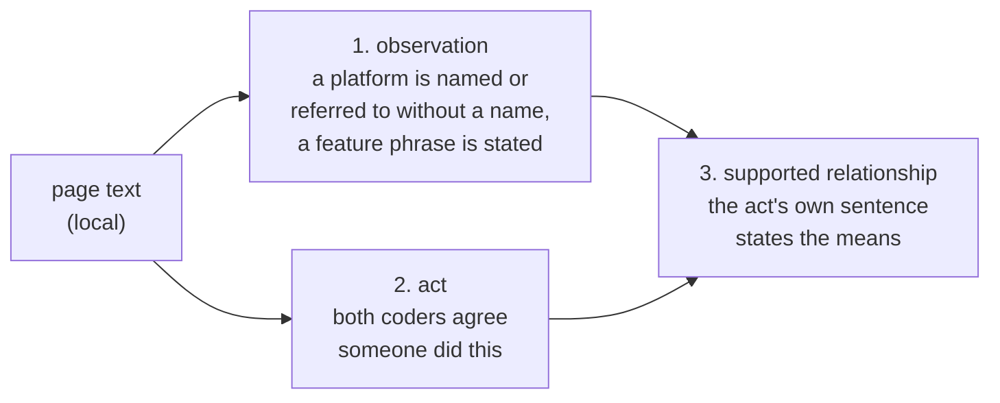

# Observations

What a court record names: the platforms, the services it refers to without a name, and the technological features stated in its text, each cited to its sentence. Read by rule from the pages, independent of the model coders and of which acts they agreed on.

**Contents:**
- [Three levels of evidence](#three-levels-of-evidence)
- [What is observed](#what-is-observed)
- [Supported relationships](#supported-relationships)
- [Dates](#dates)
- [Graph](#graph)
- [Queries](#queries)
- [Research table](#research-table)
- [Affordance evidence matrix](#affordance-evidence-matrix)
- [Review on the real text](#review-on-the-real-text)
- [Measured](#measured)
- [Limits](#limits)

## Three levels of evidence



| Level | Claim | Gate | Where |
|---|---|---|---|
| 1. Observation | The record mentions this platform, unnamed service or feature, here | The name or phrase is on a fixed list, or has a fixed form, and is on the page | [`observe.py`](observe.py), `:observations` graph |
| 2. Act | The record states someone did this | Two model coders agree on sentence, action and actor | [`coding/`](../coding/README.md), `:evidence` graph |
| 3. Supported relationship | The record states the act was done by means of it | The observation lies in the act's cited sentence, and that sentence states the means | [`observe.relate`](observe.py) |

A level is never promoted by proximity. A mention is not use. A platform name is not an affordance, and neither is a withheld name. Sharing a case, a page, a sentence or a date ties nothing together. A sparse graph is a correct graph: most observations stand alone.

## What is observed

```bash
python -m state_machines.observations.observe <case_id> --text-root local/pacer_text [--bundle <resolved bundle>]
python -m state_machines.coding.pipeline release <release_id> <case> [...] --observations
```

- **Platforms:** a service on the list of known services ([`enrich.PLATFORMS`](../coding/enrich.py)). A name that is also an ordinary word ("Signal", "Zoom", "Discord") counts only beside a service word ("on Signal", "a Discord server").
- **Features:** a phrase on the codebook's list per affordance class (`FEATURES` in [`enrich.py`](../coding/enrich.py), the same list the act layer's level C uses), matched as whole words. The phrase is recorded under the class the codebook lists it in; no affordance is asserted. The bare word "website" is not a feature in either layer: it names a place on the internet, not a capability, and "Website A" is a withheld name.
- **Services under a placeholder:** a record that writes "Website A" says a service exists and withholds which one. It is observed as a platform under the record's own label, marked `withheld`, and kept inside its case: "Website A" in two cases is two services. Nothing is inferred from the withholding: it is not evidence of anonymity, of any feature, or of use. Only "Website" followed by one capital letter or a number is taken, the one form the 30 cases hold; the letter I is left out ("the Website I described").
- **Generic service descriptions:** a phrase such as "social media application", "online chat room" or "file-sharing website", from a closed grammar (an optional "online" or "mobile", one kind of service, one head noun). It is kept as a cited phrase of kind `service_description`. It is not a platform, has no affordance class, and is never tied to an act. A description standing beside a named or placeholder service ("the Kik messaging application") is that service's own descriptor and is not taken. A bare "website", "application" or "social media" names nothing and is not taken; qualifiers that would themselves claim a capability ("encrypted", "anonymous", "dark web") are not in the grammar.
- **Aliases:** two listed spellings of one service are one platform ("Kik Messenger" is Kik); the spelling found is kept as `named_as`.
- **Every page except docket sheets.** Docket sheets record court business ("hearing held via Zoom").
- **Each observation holds:** document, page, the sentence's character span and hash, the page text hash, the document's legal standing, and the term's own span. No quote text, no free text.
- **Checked on every build** (`observe.check`): each span is re-read from the page and re-hashed, each name and phrase is on its list or has its fixed form, each relationship's act cites that sentence, and no description carries a relationship.

## Supported relationships

`relate` ties an observation to a published offender act only when all of these hold:

1. the observed term lies inside the sentence the act cites, no other published act cites that sentence, and the act's cited passage does not run past the observation's own sentence;
2. a cue and the term stand together in one clause of it;
3. that clause is not a third party's doing, and nothing before the cue in it negates or denies it.

| Kind | Construction | Relationship |
|---|---|---|
| Platform | "through / via / using / over / by means of the Kitebox application" | `Carried_Out_Through` |
| Platform | "on Kitebox" after a verb of the conduct ("contacted her on Kitebox") | `Carried_Out_Through` |
| Platform | "uploaded / posted / saved ... to Dropbox"; "in a Kitebox group" | `Carried_Out_Through` |
| Platform | "moved / continued / switched ... to, on or onto Kitebox" | `Moved_To` |
| Feature | "used / using / through / with the disappearing-message feature", or the feature is what the act made or sent ("created a new account under a false name") | `Supports_Action` |

What gives no relationship:

| Sentence | Why |
|---|---|
| "... and her mother reported the account to Kitebox" | a recipient, in a third party's clause |
| "... and agents served a warrant on Kitebox" | a third party's act; "served" is not the offender's conduct |
| "He denied that he had ever asked her for images through Kitebox" | a denial |
| "He told her to download Kitebox" | an infinitive, not a means |
| "... after she used a fake name" | a feature someone else used |
| "He had the Snapwire application installed" | present, not a means |
| "He wrote to her through Kitebox and later drove to her home" (two published acts cite it) | the sentence does not say which act the means belongs to |
| "Another user wrote to her through Website A. The defendant sent the files in March." (one act cites both sentences) | the cited passage runs across two sentences, so which one is the act's own is unknown |
| "He asked her for images through a social media application" | a generic description is never tied to an act |

A platform carries both sides of a conversation, so a clause about the victim ("when Minor Victim 1 wrote back via Kitebox") can still state the means of the offender's act. A feature cannot be borrowed that way.

## Dates

Dates stated in an observation's sentence are kept in the observations file as `dates_in_sentence`: calendar bounds, with no claim about what the date refers to (the act, an account, the investigation, the filing). They are not written to the graph and never enter a timeline. Chronology comes only from the dated acts of level 2.

## Graph

No new vocabulary. An observation is a W3C Web Annotation, the pattern the evidence graph already uses for citations.

| Record | Graph |
|---|---|
| platform observation | `oa:Annotation`, `oa:motivatedBy oa:identifying`, `oa:hasBody` the platform (`uco-observable:ObservableObject`, the IRI the evidence graph uses, under `https://w3id.org/caselinker/resource/platform/`) |
| service under a placeholder | the same, with a body node local to the case graph (not under `/resource/platform/`) named with the record's label and "(name withheld)" |
| generic service description | `oa:Annotation`, `oa:motivatedBy oa:describing`, `oa:hasBody` an `oa:TextualBody` of its own whose `rdf:value` is the phrase. No platform node, no class, no relationship |
| feature observation | `oa:Annotation`, `oa:motivatedBy oa:classifying`, `oa:hasBody` the CAC affordance class, `clt:featureTerm` the phrase. The passage is classified; no individual of the class is created |
| source | `oa:SpecificResource` on the document, page `oa:FragmentSelector` refined by `oa:TextPositionSelector`; `clt:quoteSha256`, `clt:pageTextSha256`, `clt:sourceStatus` |
| rule | `clt:derivationRule "observe-1.3.0"` on every observation |
| supported relationship | the canonical relationship (`Carried_Out_Through`, `Moved_To`, `Supports_Action`) under the IRI the evidence graph would use, plus an evidence `oa:Annotation` on the observation's own target |

Graph IRI: `urn:caselinker:pacer:<case>:observations`. A case with nothing observed has no observation graph.

## Queries

[`queries.py`](queries.py) holds the queries; each release's `REPORT.md` prints them with their results.

| Query | Answers |
|---|---|
| `documented` | Which listed platforms do the records name, in how many cases? |
| `withheld` | Which services does a record refer to by a placeholder, case by case? |
| `described` | Which generic service descriptions do the records use? |
| `features` | Which feature phrases do the records state, under which class? |
| `reconstructed` | Which acts did both coders agree on? |
| `supported` | Where does a record state that an act was done by means of a platform or feature? |

```bash
python -m state_machines.observations.queries pacer-v1
```

```sparql
PREFIX oa: <http://www.w3.org/ns/oa#>
PREFIX core: <https://ontology.unifiedcyberontology.org/uco/core/>
SELECT ?platform (COUNT(DISTINCT ?g) AS ?cases) (COUNT(?obs) AS ?mentions) WHERE {
  GRAPH ?g { ?obs oa:motivatedBy oa:identifying ; oa:hasBody ?p . ?p core:name ?platform }
  FILTER(STRSTARTS(STR(?p), "https://w3id.org/caselinker/resource/platform/"))   # listed platforms; placeholders are case-local nodes
} GROUP BY ?platform ORDER BY DESC(?cases)
```

## Research table

[`table.py`](table.py) writes `research_table.json` and `research_table.csv` into the release: one row per case, built from the committed release files alone (`python -m state_machines.observations.table <release> --check` rebuilds and compares).

| Column group | Meaning |
|---|---|
| `platform_named` | Listed services the record mentions, with mentions and the standing of the documents. A mention, not use |
| `platform_withheld` | Services the record refers to by a placeholder. The label means nothing outside the case, and a withheld name is not evidence of anonymity or of any feature |
| `service_described` | Generic descriptions of an online service. Cited phrases, not platforms, never tied to an act |
| `feature_stated` | Codebook feature phrases the record states, by affordance class. A mention, not use |
| `used_in_act` | The only rows where the observation rule ties technology to conduct: an agreed act whose own sentence states it was done by means of that platform or feature |
| `acts` | Agreed acts, offender acts, dated acts, offender action codes, harm codes |

These are different kinds of evidence and must not be added together. A case with five platforms named and nothing in `used_in_act` documents five mentions, not five platform-mediated acts. The 30 cases are a selected collection of prosecutions with available records, not a sample of offending.

The table's totals also sort the cases by the strongest thing each record gives about a service: a listed name, else a placeholder, else a generic description, else nothing.

The `/lifecycle` page shows the same things per case ("names 2 platforms, 1 feature" opens the list; a diamond marks an act whose sentence states its means), and the API and MCP payloads carry them under `observed` with the sentence "mentions, not use".

## Affordance evidence matrix

[`affordance_matrix.py`](affordance_matrix.py) writes `affordance_matrix.json`, `affordance_matrix.csv` (one row per affordance class) and `affordance_case_grid.csv` (one row per case) into the release, from the committed release files alone (`python -m state_machines.observations.affordance_matrix <release> --check`).

| Column group | Kind of evidence |
|---|---|
| `phrase_stated` | A listed feature phrase of the class is stated in a cited sentence, by the legal standing of the document. A mention |
| `means_stated_in_act_sentence` | The observation rule found an agreed act's own sentence stating the act was done by means of that phrase |
| `coder_agreed_on_act` | An act both model coders agreed on whose own cited sentence holds a listed phrase of the class (codebook rule B0, level C of the act layer). The sentence states the feature beside the act; it need not use a "by means of" construction |

Each case and class gets one mechanical reading:

| Reading | Meaning |
|---|---|
| `means_stated` | an act's own sentence states the feature as its means |
| `coder_agreed_only` | an agreed act's sentence holds the phrase; the stricter rule found no "by means of" construction in it |
| `stated_only` | the phrase is stated, tied to no act by either layer |
| `none` | no listed phrase and no coder-agreed act |

A class `needs_researcher_interpretation` when some case reads `coder_agreed_only` or `stated_only`: the record says something a person has to read. `no_evidence_in_these_records` means every case reads `none`.

How not to read it:
- **Not prevalence.** The classes have phrase lists of different sizes, and the cases are a selected collection. There is no total row and no percentage.
- **Not use.** Only `means_stated` and `coder_agreed_only` concern an act, and the second is two models agreeing, not a person.
- **Platforms never count.** A platform name, a withheld name or a generic description never feeds a row.
- **`none` has two causes.** A case whose narrative filings are sealed or were not collected reads `none` like a case where nothing of the kind happened.

## Review on the real text

Optional, and a researcher's step: the release is machine-read and is complete, loadable and citable without it.

```bash
python -m state_machines.observations.validation packet pacer-v1     # local/validation/pacer-v1.review.html (court text; never committed)
python -m state_machines.observations.validation score pacer-v1 <downloaded decisions.json>
```

[`validation.py`](validation.py) draws a fixed, stratified set of items from the release: every observation tied to an act, every feature observation, one placeholder label and one generic description per case, term and standing, and listed-platform observations sampled one per platform and standing, then at random up to 60. The reviewer answers two questions per item, kept apart: is the term in the sentence as cited (grounding), and does it mean what the observation says (meaning). `score` writes counts and 95% intervals per stratum to `validation.json`, with no text, and the release report prints them.

## Measured

On the [synthetic benchmark](../benchmark/README.md) (`pipeline bench-observations --split <split> --record`), rule `observe-1.3.0`:

| Measure | Dev | Held-out | Confirm |
|---|---:|---:|---:|
| Gold platform mentions found | 71/71 | 63/63 | 71/71 |
| Gold feature statements found | 27/27 | 30/30 | 32/32 |
| Relationships the gold also holds, same kind | 65/66 | 65/72 | 32/33 |
| Relationships to the right platform, wrong kind | 1 | 0 | 1 |
| Relationships to a platform the gold says is only named | 0 | 0 | 0 |
| Relationships on an act that is not a gold act | 0 | 3 | 0 |
| Gold relationships found, on published acts | 65/72 | 65/71 | 32/42 |

The benchmark's gold holds no placeholder label and no generic description, and its text holds none, so these rows check that 1.3.0 did not move the platform, feature and relationship results. The two new kinds are covered by unit tests on invented sentences and by the counts below, not by a scored benchmark.

History of the rule, so the numbers can be read correctly:
- **1.0.0** was developed on dev and scored once on held-out and confirm.
- **1.1.0** merged aliases and dropped "website", from the audit of the real cases.
- **1.2.0** followed an independent review that found relationships asserted without a stated means. The relationship rule was rewritten on the reviewer's examples, the dev cases and the structure of the real cases' relationships, and the scorer was made to require the relationship kind. Held-out and confirm are therefore a later look, not a first one.
- **1.3.0** added placeholder labels and generic descriptions, and ties a means only when the act's cited passage stays inside the observation's own sentence. A second review found that a passage running across two sentences could tie another party's platform use to the act. All three splits score as under 1.2.0.

On the 30 real cases (`pacer-v1`, 98 documents):

| Observed | Count |
|---|---:|
| Observations | 875 |
| of a listed platform's name | 539, in 25 cases (70 distinct case and platform pairs) |
| of a platform under a placeholder | 176, in 2 cases (5 labels) |
| of a generic service description | 73, in 18 cases |
| of a feature phrase | 87, in 13 cases |
| Acts tied to a platform by a stated means | 10, in 7 cases |
| Acts tied to a feature by a stated means | 0 |

By the strongest thing each record gives about a service: 25 cases name a listed platform, 2 give only a generic description, and 3 give nothing (`ncmec_2023_222`, `usss_2023_004`, `wy_dci_2023_005`). Both cases with placeholder labels also name a listed platform.

By the standing of the document: 282 observations are in sworn affidavits, 221 in charging documents, 197 in admitted facts, 147 in advocacy, 27 in court records and 1 in a plea transcript. 56 of the 87 feature statements are the word "Tor" in one sworn complaint.

## Limits

- **Listed terms and fixed forms only.** A service or a feature wording that is not on the lists is not observed, and a placeholder other than "Website" with a letter or number is not taken. All benchmark splits keep platform names and feature terms verbatim, so the rates above measure finding listed terms in new sentence constructions, not recognising new wording.
- **Machine-read.** No person reviewed these observations on the real text; the release does not depend on such a review. On the five reference cases the three listed platforms the reference coding names were all observed, and the reference names four platform surfaces that are not on the list.
- **Feature statements are concentrated.** 87 statements in 13 cases, 56 of them one word in one document. The affordance evidence matrix counts cases beside statements for that reason.
- **Relationships are few because acts are few, and the rule prefers silence.** A relationship needs a published act in that sentence (the release publishes 163 offender acts) and a construction the rule recognises. A true means stated another way is not tied: "on the Tor network" and "on an encrypted application" are not "by means of" constructions, so the six agreed acts whose sentence holds a feature phrase are in the matrix's `coder_agreed_on_act` column and not in `means_stated_in_act_sentence`.
- **Three records give nothing about a service.** One case's narrative filings are sealed, and for two CourtListener holds no docket sheet to collect from. A thin record is represented as thin.
- **Known rough edges with no hit in the 30 cases:** "Line 7" or a surname "Tor" would be observed; a hyphenated feature phrase broken across a line stops the build; a relationship can take a different IRI from the evidence graph's when the two rules disagree on "through" versus "moved to"; "Websites A and B" yields only "Website A".
