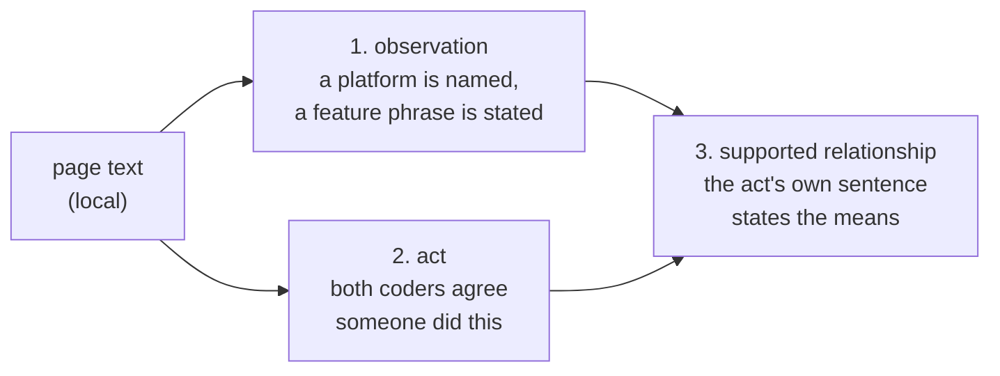

# Observations

What a court record names: the platforms and technological features stated in its text, each cited to its sentence. Read by rule from the pages, independent of the model coders and of which acts they agreed on.

**Contents:**
- [Three levels of evidence](#three-levels-of-evidence)
- [What is observed](#what-is-observed)
- [Supported relationships](#supported-relationships)
- [Dates](#dates)
- [Graph](#graph)
- [Queries](#queries)
- [Research table](#research-table)
- [Review on the real text](#review-on-the-real-text)
- [Measured](#measured)
- [Limits](#limits)

## Three levels of evidence



| Level | Claim | Gate | Where |
|---|---|---|---|
| 1. Observation | The record mentions this platform or feature, here | The name or phrase is on a fixed list and on the page | [`observe.py`](observe.py), `:observations` graph |
| 2. Act | The record states someone did this | Two model coders agree on sentence, action and actor | [`coding/`](../coding/README.md), `:evidence` graph |
| 3. Supported relationship | The record states the act was done by means of it | The observation lies in the act's cited sentence, and that sentence states the means | [`observe.relate`](observe.py) |

A level is never promoted by proximity. A mention is not use. A platform name is not an affordance. Sharing a case, a page, a sentence or a date ties nothing together. A sparse graph is a correct graph: most observations stand alone.

## What is observed

```bash
python -m state_machines.observations.observe <case_id> --text-root local/pacer_text [--bundle <resolved bundle>]
python -m state_machines.coding.pipeline release <release_id> <case> [...] --observations
```

- **Platforms:** a service on the list of known services ([`enrich.PLATFORMS`](../coding/enrich.py)). A name that is also an ordinary word ("Signal", "Zoom", "Discord") counts only beside a service word ("on Signal", "a Discord server").
- **Features:** a phrase on the codebook's list per affordance class (`FEATURES` in [`observe.py`](observe.py)), matched as whole words. The phrase is recorded under the class the codebook lists it in; no affordance is asserted. The bare word "website" is not a feature: it names a place on the internet, not a capability.
- **Aliases:** two listed spellings of one service are one platform ("Kik Messenger" is Kik); the spelling found is kept as `named_as`.
- **Every page except docket sheets.** Docket sheets record court business ("hearing held via Zoom").
- **Each observation holds:** document, page, the sentence's character span and hash, the page text hash, the document's legal standing, and the term's own span. No quote text, no free text.
- **Checked on every build** (`observe.check`): each span is re-read from the page and re-hashed, each name and phrase is on its list, and each relationship's act cites that sentence.

## Supported relationships

`relate` ties an observation to a published offender act only when both hold:

1. the observed term lies inside the sentence the act cites;
2. that sentence states the means.

| Kind | Construction | Relationship |
|---|---|---|
| Platform | "through / via / using / on / over the Kitebox application", "in a Kitebox group" | `Carried_Out_Through` |
| Platform | the same after "moved / continued / switched ... to" | `Moved_To` |
| Feature | "used / using / through / with the disappearing-message feature", or the feature is what the act made or sent ("created a new account under a false name", "posted ... in a group chat") | `Supports_Action` |

A negated sentence ("did not reply on Kitebox"), a platform that is only present ("had the Snapwire application installed") and a non-offender act give no relationship.

## Dates

Dates stated in an observation's sentence are kept in the observations file as `dates_in_sentence`: calendar bounds, with no claim about what the date refers to (the act, an account, the investigation, the filing). They are not written to the graph and never enter a timeline. Chronology comes only from the dated acts of level 2.

## Graph

No new vocabulary. An observation is a W3C Web Annotation, the pattern the evidence graph already uses for citations.

| Record | Graph |
|---|---|
| platform observation | `oa:Annotation`, `oa:motivatedBy oa:identifying`, `oa:hasBody` the platform (`uco-observable:ObservableObject`, the IRI the evidence graph uses) |
| feature observation | `oa:Annotation`, `oa:motivatedBy oa:classifying`, `oa:hasBody` the CAC affordance class, `clt:featureTerm` the phrase. The passage is classified; no individual of the class is created |
| source | `oa:SpecificResource` on the document, page `oa:FragmentSelector` refined by `oa:TextPositionSelector`; `clt:quoteSha256`, `clt:pageTextSha256`, `clt:sourceStatus` |
| rule | `clt:derivationRule "observe-1.1.0"` on every observation |
| supported relationship | the canonical relationship (`Carried_Out_Through`, `Moved_To`, `Supports_Action`) under the IRI the evidence graph would use, plus an evidence `oa:Annotation` on the observation's own target |

Graph IRI: `urn:caselinker:pacer:<case>:observations`. A case with nothing observed has no observation graph.

## Queries

[`queries.py`](queries.py) holds one query per level; each release's `REPORT.md` prints them with their results.

```bash
python -m state_machines.observations.queries pacer-v2
```

```sparql
PREFIX oa: <http://www.w3.org/ns/oa#>
PREFIX core: <https://ontology.unifiedcyberontology.org/uco/core/>
SELECT ?platform (COUNT(DISTINCT ?g) AS ?cases) (COUNT(?obs) AS ?mentions) WHERE {
  GRAPH ?g { ?obs oa:motivatedBy oa:identifying ; oa:hasBody ?p . ?p core:name ?platform }
} GROUP BY ?platform ORDER BY DESC(?cases)
```

## Research table

[`table.py`](table.py) writes `research_table.json` and `research_table.csv` into the release: one row per case, built from the committed release files alone (`python -m state_machines.observations.table <release> --check` rebuilds and compares).

| Column group | Meaning |
|---|---|
| `platform_named` | Listed services the record mentions, with mentions and the standing of the documents. A mention, not use |
| `feature_stated` | Codebook feature phrases the record states, by affordance class. A mention, not use |
| `used_in_act` | The only rows that tie technology to conduct: an agreed act whose own sentence states it was done by means of that platform or feature |
| `acts` | Agreed acts, offender acts, dated acts, offender action codes, harm codes |

The three are different kinds of evidence and must not be added together. A case with five platforms named and nothing in `used_in_act` documents five mentions, not five platform-mediated acts. The 30 cases are a selected collection of prosecutions with available records, not a sample of offending.

The `/lifecycle` page shows the same three things per case ("names 2 platforms, 1 feature" opens the list; a diamond marks an act whose sentence states its means), and the API and MCP payloads carry them under `observed` with the sentence "mentions, not use".

## Review on the real text

```bash
python -m state_machines.observations.validation packet pacer-v2     # local/validation/pacer-v2.review.html (court text; never committed)
python -m state_machines.observations.validation score pacer-v2 <downloaded decisions.json>
```

[`validation.py`](validation.py) draws a fixed, stratified set of items from the release: every observation tied to an act, every feature observation, and platform observations sampled one per platform and standing, then at random up to 60. The reviewer answers two questions per item, kept apart: is the term in the sentence as cited (grounding), and does it mean what the observation says (meaning). `score` writes counts and 95% intervals per stratum to `validation.json`, with no text, and the release report prints them.

## Measured

On the [synthetic benchmark](../benchmark/README.md) (`pipeline bench-observations --split <split> --record`). The rule was developed on dev; held-out and confirm were scored once after it was committed.

| Measure | Dev | Held-out | Confirm |
|---|---:|---:|---:|
| Gold platform mentions found | 71/71 | 63/63 | 71/71 |
| Gold feature statements found | 27/27 | 30/30 | 32/32 |
| Relationships the gold also holds | 67/68 | 67/74 | 33/33 |
| Relationships to a platform the gold says is only named | 0 | 0 | 0 |
| Gold relationships found, on published acts | 67/72 | 67/71 | 33/42 |

On the 30 real cases (`pacer-v2`, rule `observe-1.1.0`): 497 observations (478 platform, 19 feature); 22 cases name a listed platform and 10 state a feature phrase; 59 distinct case-platform pairs; 12 observations tied to a published act, in 9 cases. Rule 1.1.0 differs from 1.0.0 only in merging aliases and dropping "website"; its benchmark scores are identical.

## Limits

- **Listed terms only.** A service or a feature wording that is not on the lists is not observed. All benchmark splits keep platform names and feature terms verbatim, so the rates above measure finding listed terms in new sentence constructions, not recognising new wording.
- **Real-text review is the reviewer's to do.** Until `validation.json` exists, the release report says the observations are not yet reviewed. On the five reference cases the three listed platforms the reference coding names were all observed, and the reference names four platform surfaces that are not on the list.
- **Features are rare in court records.** 19 feature statements in 30 cases. The records name platforms far more often than they describe capabilities.
- **Relationships are few because acts are few.** A relationship needs a published act in that sentence, and the release publishes 152 offender acts.
