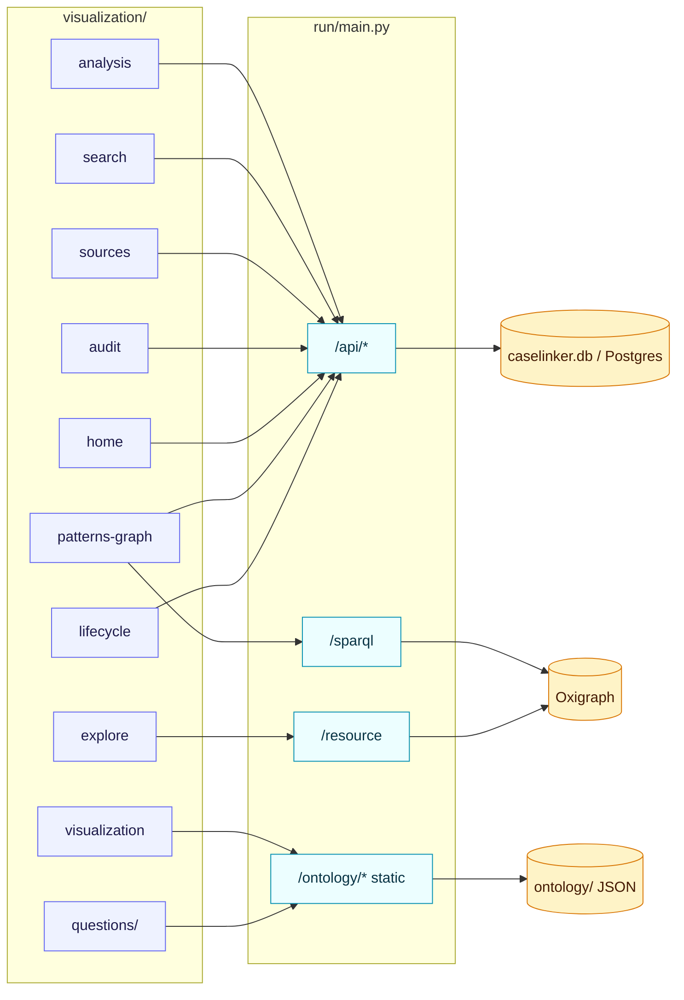

# Visualization

The CaseLinker web app: static HTML pages served by [`run/main.py`](../run/main.py), with no build step. Each page reads the REST API, `/sparql` or `/resource` and draws on the shared v4 shell.

**Live:** [caselinker.up.railway.app](https://caselinker.up.railway.app) · **Local:** `cd run && ../.venv/bin/uvicorn main:app --port 8000` → [localhost:8000](http://localhost:8000)

## Pages

| Route | File | Shows | Reads |
|---|---|---|---|
| `/` | [`home.html`](home.html) | Corpus at a glance, entry points | `/api/stats` |
| `/analysis` | [`analysis.html`](analysis.html) | A plain-language question → SPARQL → answers → source passages | `/api/sparql/from-nl` |
| `/patterns` | [`patterns-graph.html`](patterns-graph.html) | D3 graph explorer over the case pools (compare, universe, big bang, analysis, PACER) | `/api/ontology/*`, `/api/cohort-sparql`, `/sparql` |
| `/patterns/questions/q01`–`q03` | [`questions/`](questions/) | Research-question write-ups | `/ontology/question_data/` |
| `/explore` | [`explore.html`](explore.html) | Walk one case graph: id → steps, agencies, platforms, places → provenance → passage | `/resource` |
| `/search` | [`search.html`](search.html) | Facet tree, cohort members, a copyable cohort SPARQL query | `/api/facet-*`, `/api/cohort-sparql` |
| `/lifecycle` | [`lifecycle.html`](lifecycle.html) | PACER prosecution state machines, L* | `/api/lifecycle/*` |
| `/visualization` | [`visualization.html`](visualization.html) | Platform affordances and harm analysis | `/ontology/platform-affordance-evidence/` |
| `/sources` | [`sources.html`](sources.html) | Per-source counts and date spans | `/api/sources-stats` |
| `/audit` | [`audit.html`](audit.html) | Case review and tag removal | `/api/case-count`, case APIs |
| `/under-the-hood` | [`under-the-hood.html`](under-the-hood.html) | Architecture: corpus → graphs → SPARQL → clients | `/api/stats` |
| `/crash-course` | [`crash-course.html`](crash-course.html) | Slides and an atlas of the repo | `/api/stats`, `/sparql` |

## Assets

| File | Role |
|---|---|
| [`v4.css`](assets/v4.css) · [`v4.js`](assets/v4.js) | Design system and shared shell: nav (`NAV` in `v4.js`), theme, layout. Every page but `crash-course` and `questions/` loads both |
| [`caselinker-api.js`](assets/caselinker-api.js) | Adds the `CaseLinker-Key` header from `sessionStorage` to API calls. Never commit a key |
| [`patterns-graph.js`](assets/patterns-graph.js) | Graph explorer (D3 v7) |
| [`lifecycle.js`](assets/lifecycle.js) · [`lifecycle.css`](assets/lifecycle.css) | State-machine viewer |
| [`questions.js`](assets/questions.js) · [`questions.css`](assets/questions.css) | Research-question pages |
| [`search.css`](assets/search.css) · [`site-nav.css`](assets/site-nav.css) | Page-specific styles |
| [`cover.png`](assets/cover.png) | Cover image |

External scripts: D3 v7 (patterns), KaTeX 0.16.22 (lifecycle, crash course).

## Adding a page

1. `visualization/<name>.html`, loading `assets/v4.css` and `assets/v4.js`.
2. A route in [`run/main.py`](../run/main.py) next to the others (`@app.get("/<name>")`, `read_utf8_text_file`).
3. A nav entry in `v4.js`, a row in the table above, and one in the repo tree in the root [`README.md`](../README.md).

Public callers get release text with people masked (`case_text_redacted`); a new page reads only that ([`AGENTS.md`](../AGENTS.md)).
